# Buildings

Buildings are yours alone: 3 resource buildings and 23 facilities you build and upgrade with building supplies and scrap. Most work on their own, wherever their effect applies (more energy, longer expeditions, better store prices, stronger heists and battles). Some produce something every night or let you make something every day, which you pick up in the **Collect** menu.

**Where:** `/buildings` to build and upgrade. `/start` → **Activities** → **Collect** for 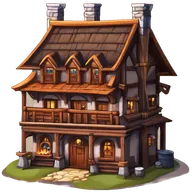{ .gi .gi-mention width="20" height="20" loading="lazy" }&nbsp;[The Inn](#what-each-building-does), 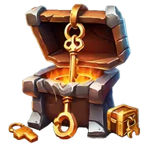{ .gi .gi-mention width="20" height="20" loading="lazy" }&nbsp;[Treasure Forge](#what-each-building-does), 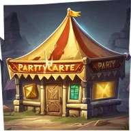{ .gi .gi-mention width="20" height="20" loading="lazy" }&nbsp;[Party Store](#what-each-building-does), 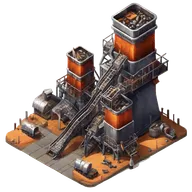{ .gi .gi-mention width="20" height="20" loading="lazy" }&nbsp;[Nail Factory](#what-each-building-does), 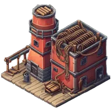{ .gi .gi-mention width="20" height="20" loading="lazy" }&nbsp;[Rope Factory](#what-each-building-does) and the { .gi .gi-mention width="20" height="20" loading="lazy" }&nbsp;[Iron Bank](#the-iron-bank).

## Building and upgrading

Pick the type and the building, then **Build** the next level.

- **Cost:** { .gi .gi-mention width="20" height="20" loading="lazy" }&nbsp;[Toolbox](../items/materials/building-supplies.md#toolbox), { .gi .gi-mention width="20" height="20" loading="lazy" }&nbsp;[Nail](../items/materials/building-supplies.md#nail) and { .gi .gi-mention width="20" height="20" loading="lazy" }&nbsp;[Rope](../items/materials/building-supplies.md#rope) (building supplies) and { .gi .gi-mention width="20" height="20" loading="lazy" }&nbsp;[Wood](../items/materials/scrap.md#wood-scrap), { .gi .gi-mention width="20" height="20" loading="lazy" }&nbsp;[Metal](../items/materials/scrap.md#metal-scrap) and { .gi .gi-mention width="20" height="20" loading="lazy" }&nbsp;[Leather Scrap](../items/materials/scrap.md#leather-scrap). No credits. The screen shows exactly what the Build button takes.
- **Rank:** each building has a "rank per level": level 3 of a building with 5 ranks per level needs rank 15.
- **Last level:** 100 divided by the ranks per level, rounded down. A building at its last level can't go higher.
- With one resource short, or your rank too low, the Build button is off and nothing is taken. A double click builds once and charges once.
- The **Preview** screen shows what a level gives (its perks, the numbers the building then works with) and its rank, starting at the level you have; the arrows step one level, **...** jumps to any level. It also shows the total cost from nothing to the last level.

Costs below are Toolbox / Nail / Rope / Wood / Metal / Leather. Level L costs the level 1 cost × (1 + the building's cost growth × (L − 1)), each rounded down.

| Building | Levels | Rank per level | Level 1 | Level 2 | Last level | All levels together |
|---|---|---|---|---|---|---|
| 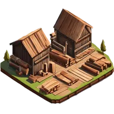{ .gi .gi-inline width="24" height="24" loading="lazy" } Lumber Yard | 10 | 10 | 4 / 1,000 / 200 / 40 / 40 / 0 | 6 / 1,700 / 340 / 68 / 68 / 0 | 29 / 7,300 / 1,460 / 292 / 292 / 0 | 162 / 41,497 / 8,298 / 1,657 / 1,657 / 0 |
| 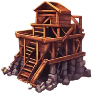{ .gi .gi-inline width="24" height="24" loading="lazy" } Iron Mine | 10 | 10 | 4 / 1,000 / 200 / 60 / 30 / 0 | 6 / 1,700 / 340 / 102 / 51 / 0 | 29 / 7,300 / 1,460 / 438 / 219 / 0 | 162 / 41,497 / 8,298 / 2,487 / 1,242 / 0 |
| 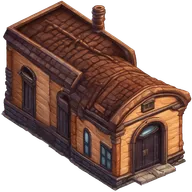{ .gi .gi-inline width="24" height="24" loading="lazy" } Tannery | 10 | 10 | 4 / 1,000 / 200 / 30 / 60 / 0 | 6 / 1,700 / 340 / 51 / 102 / 0 | 29 / 7,300 / 1,460 / 219 / 438 / 0 | 162 / 41,497 / 8,298 / 1,242 / 2,487 / 0 |
| 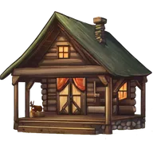{ .gi .gi-inline width="24" height="24" loading="lazy" } Hunting Cabin | 12 | 8 | 1 / 500 / 50 / 40 / 5 / 25 | 1 / 800 / 80 / 64 / 8 / 40 | 7 / 3,800 / 380 / 304 / 38 / 190 | 47 / 25,799 / 2,579 / 2,063 / 257 / 1,289 |
| 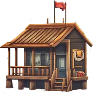{ .gi .gi-inline width="24" height="24" loading="lazy" } Fishing Club | 12 | 8 | 1 / 500 / 50 / 40 / 15 / 15 | 1 / 800 / 80 / 64 / 24 / 24 | 7 / 3,800 / 380 / 304 / 114 / 114 | 47 / 25,799 / 2,579 / 2,063 / 773 / 773 |
| { .gi .gi-inline width="24" height="24" loading="lazy" } The Inn | 100 | 1 | 0 / 75 / 15 / 3 / 3 / 3 | 0 / 150 / 30 / 6 / 6 / 6 | 0 / 7,500 / 1,500 / 300 / 300 / 300 | 0 / 378,750 / 75,750 / 15,150 / 15,150 / 15,150 |
| 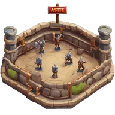{ .gi .gi-inline width="24" height="24" loading="lazy" } Training Grounds | 20 | 5 | 1 / 350 / 50 / 20 / 25 / 15 | 1 / 612 / 87 / 35 / 43 / 26 | 15 / 5,337 / 762 / 305 / 381 / 228 | 155 / 56,870 / 8,120 / 3,250 / 4,055 / 2,430 |
| 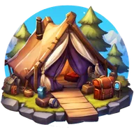{ .gi .gi-inline width="24" height="24" loading="lazy" } Traveler's Camp | 20 | 5 | 0 / 100 / 15 / 50 / 30 / 100 | 0 / 155 / 23 / 77 / 46 / 155 | 0 / 1,145 / 171 / 572 / 343 / 1,145 | 0 / 12,450 / 1,860 / 6,220 / 3,730 / 12,450 |
| { .gi .gi-inline width="24" height="24" loading="lazy" } Treasure Forge | 7 | 14 | 1 / 250 / 15 / 100 / 150 / 75 | 2 / 562 / 33 / 225 / 337 / 168 | 8 / 2,125 / 127 / 850 / 1,275 / 637 | 31 / 8,311 / 496 / 3,325 / 4,986 / 2,491 |
| 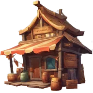{ .gi .gi-inline width="24" height="24" loading="lazy" } Trade Post | 100 | 1 | 0 / 210 / 20 / 25 / 10 / 30 | 0 / 348 / 33 / 41 / 16 / 49 | 0 / 13,931 / 1,326 / 1,658 / 663 / 1,990 | 0 / 707,030 / 67,300 / 84,150 / 33,630 / 100,970 |
| 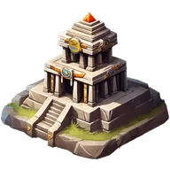{ .gi .gi-inline width="24" height="24" loading="lazy" } Expedition Command Center | 20 | 5 | 1 / 350 / 30 / 30 / 50 / 20 | 1 / 647 / 55 / 55 / 92 / 37 | 17 / 6,002 / 514 / 514 / 857 / 343 | 172 / 63,518 / 5,439 / 5,439 / 9,069 / 3,627 |
| 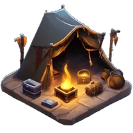{ .gi .gi-inline width="24" height="24" loading="lazy" } Thieves Den | 100 | 1 | 0 / 400 / 180 / 19 / 13 / 26 | 0 / 540 / 243 / 25 / 17 / 35 | 0 / 14,260 / 6,417 / 677 / 463 / 926 | 0 / 732,967 / 329,812 / 34,770 / 23,775 / 47,600 |
| { .gi .gi-inline width="24" height="24" loading="lazy" } Party Store | 12 | 8 | 1 / 450 / 75 / 75 / 50 / 100 | 1 / 787 / 131 / 131 / 87 / 175 | 9 / 4,162 / 693 / 693 / 462 / 925 | 57 / 27,672 / 4,608 / 4,608 / 3,072 / 6,150 |
| { .gi .gi-inline width="24" height="24" loading="lazy" } Arcane Library | 20 | 5 | 1 / 350 / 50 / 35 / 25 / 20 | 1 / 612 / 87 / 61 / 43 / 35 | 15 / 5,337 / 762 / 533 / 381 / 305 | 155 / 56,870 / 8,120 / 5,680 / 4,055 / 3,250 |
| 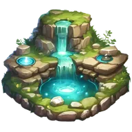{ .gi .gi-inline width="24" height="24" loading="lazy" } Healing Spring | 100 | 1 | 0 / 100 / 15 / 10 / 10 / 10 | 0 / 150 / 22 / 15 / 15 / 15 | 0 / 5,050 / 757 / 505 / 505 / 505 | 0 / 257,500 / 38,600 / 25,750 / 25,750 / 25,750 |
| 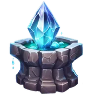{ .gi .gi-inline width="24" height="24" loading="lazy" } Mana Well | 100 | 1 | 0 / 100 / 15 / 10 / 10 / 10 | 0 / 150 / 22 / 15 / 15 / 15 | 0 / 5,050 / 757 / 505 / 505 / 505 | 0 / 257,500 / 38,600 / 25,750 / 25,750 / 25,750 |
| 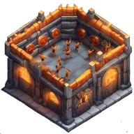{ .gi .gi-inline width="24" height="24" loading="lazy" } Fitness Foundry | 33 | 3 | 1 / 180 / 25 / 14 / 18 / 13 | 1 / 306 / 42 / 23 / 30 / 22 | 23 / 4,212 / 585 / 327 / 421 / 304 | 388 / 72,456 / 10,053 / 5,623 / 7,234 / 5,220 |
| { .gi .gi-inline width="24" height="24" loading="lazy" } Nail Factory | 11 | 9 | 0 / 400 / 50 / 100 / 120 / 80 | 0 / 720 / 90 / 180 / 216 / 144 | 0 / 3,600 / 450 / 900 / 1,080 / 720 | 0 / 21,999 / 2,749 / 5,499 / 6,599 / 4,400 |
| { .gi .gi-inline width="24" height="24" loading="lazy" } Rope Factory | 11 | 9 | 0 / 200 / 100 / 100 / 80 / 120 | 0 / 360 / 180 / 180 / 144 / 216 | 0 / 1,800 / 900 / 900 / 720 / 1,080 | 0 / 10,999 / 5,499 / 5,499 / 4,400 / 6,599 |
| 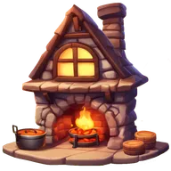{ .gi .gi-inline width="24" height="24" loading="lazy" } Cuisine Cottage | 10 | 10 | 1 / 300 / 75 / 150 / 110 / 85 | 1 / 555 / 138 / 277 / 203 / 157 | 8 / 2,594 / 648 / 1,297 / 951 / 735 | 43 / 14,474 / 3,615 / 7,235 / 5,305 / 4,098 |
| { .gi .gi-inline width="24" height="24" loading="lazy" } Iron Bank | 50 | 2 | 0 / 120 / 15 / 45 / 85 / 20 | 0 / 204 / 25 / 76 / 144 / 34 | 0 / 4,236 / 529 / 1,588 / 3,000 / 706 | 0 / 108,880 / 13,589 / 40,815 / 77,114 / 18,137 |
| 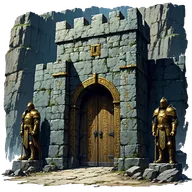{ .gi .gi-inline width="24" height="24" loading="lazy" } Bastion of the Chosen | 20 | 5 | 0 / 200 / 45 / 60 / 45 / 20 | 0 / 330 / 74 / 99 / 74 / 33 | 0 / 2,670 / 600 / 801 / 600 / 267 | 0 / 28,699 / 6,450 / 8,610 / 6,450 / 2,870 |
| 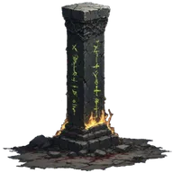{ .gi .gi-inline width="24" height="24" loading="lazy" } Pillar of the Undying | 20 | 5 | 0 / 200 / 45 / 50 / 70 / 30 | 0 / 330 / 74 / 82 / 115 / 49 | 0 / 2,670 / 600 / 667 / 934 / 400 | 0 / 28,699 / 6,450 / 7,169 / 10,040 / 4,300 |
| 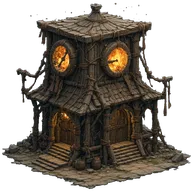{ .gi .gi-inline width="24" height="24" loading="lazy" } Temporal Nexus | 50 | 2 | 0 / 75 / 15 / 20 / 10 / 15 | 0 / 123 / 24 / 33 / 16 / 24 | 0 / 2,463 / 492 / 657 / 328 / 492 | 0 / 63,450 / 12,675 / 16,925 / 8,450 / 12,675 |
| 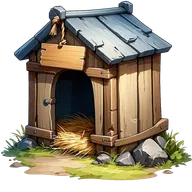{ .gi .gi-inline width="24" height="24" loading="lazy" } Pet Kennel | 6 | 15 | 0 / 300 / 100 / 90 / 30 / 60 | 0 / 519 / 173 / 155 / 51 / 103 | 0 / 1,395 / 465 / 418 / 139 / 279 | 0 / 5,085 / 1,695 / 1,523 / 505 / 1,015 |
| 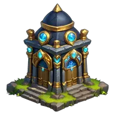{ .gi .gi-inline width="24" height="24" loading="lazy" } Arcane Reliquary | 33 | 3 | 0 / 100 / 15 / 20 / 20 / 20 | 0 / 150 / 22 / 30 / 30 / 30 | 0 / 1,700 / 255 / 340 / 340 / 340 | 0 / 29,700 / 4,447 / 5,940 / 5,940 / 5,940 |

## What each building does

<figure markdown="span">
{ .gi .gi-gallery width="96" height="96" loading="lazy" }
<figcaption>Lumber Yard</figcaption>
</figure>

<figure markdown="span">
{ .gi .gi-gallery width="96" height="96" loading="lazy" }
<figcaption>Iron Mine</figcaption>
</figure>

<figure markdown="span">
{ .gi .gi-gallery width="96" height="96" loading="lazy" }
<figcaption>Tannery</figcaption>
</figure>

<figure markdown="span">
{ .gi .gi-gallery width="96" height="96" loading="lazy" }
<figcaption>Hunting Cabin</figcaption>
</figure>

<figure markdown="span">
{ .gi .gi-gallery width="96" height="96" loading="lazy" }
<figcaption>Fishing Club</figcaption>
</figure>

<figure markdown="span">
{ .gi .gi-gallery width="96" height="96" loading="lazy" }
<figcaption>The Inn</figcaption>
</figure>

<figure markdown="span">
{ .gi .gi-gallery width="96" height="96" loading="lazy" }
<figcaption>Training Grounds</figcaption>
</figure>

<figure markdown="span">
{ .gi .gi-gallery width="96" height="96" loading="lazy" }
<figcaption>Traveler's Camp</figcaption>
</figure>

<figure markdown="span">
{ .gi .gi-gallery width="96" height="96" loading="lazy" }
<figcaption>Treasure Forge</figcaption>
</figure>

<figure markdown="span">
{ .gi .gi-gallery width="96" height="96" loading="lazy" }
<figcaption>Trade Post</figcaption>
</figure>

<figure markdown="span">
{ .gi .gi-gallery width="96" height="96" loading="lazy" }
<figcaption>Expedition Command Center</figcaption>
</figure>

<figure markdown="span">
{ .gi .gi-gallery width="96" height="96" loading="lazy" }
<figcaption>Thieves Den</figcaption>
</figure>

<figure markdown="span">
{ .gi .gi-gallery width="96" height="96" loading="lazy" }
<figcaption>Party Store</figcaption>
</figure>

<figure markdown="span">
{ .gi .gi-gallery width="96" height="96" loading="lazy" }
<figcaption>Arcane Library</figcaption>
</figure>

<figure markdown="span">
{ .gi .gi-gallery width="96" height="96" loading="lazy" }
<figcaption>Healing Spring</figcaption>
</figure>

<figure markdown="span">
{ .gi .gi-gallery width="96" height="96" loading="lazy" }
<figcaption>Mana Well</figcaption>
</figure>

<figure markdown="span">
{ .gi .gi-gallery width="96" height="96" loading="lazy" }
<figcaption>Fitness Foundry</figcaption>
</figure>

<figure markdown="span">
{ .gi .gi-gallery width="96" height="96" loading="lazy" }
<figcaption>Nail Factory</figcaption>
</figure>

<figure markdown="span">
{ .gi .gi-gallery width="96" height="96" loading="lazy" }
<figcaption>Rope Factory</figcaption>
</figure>

<figure markdown="span">
{ .gi .gi-gallery width="96" height="96" loading="lazy" }
<figcaption>Cuisine Cottage</figcaption>
</figure>

<figure markdown="span">
{ .gi .gi-gallery width="96" height="96" loading="lazy" }
<figcaption>Iron Bank</figcaption>
</figure>

<figure markdown="span">
{ .gi .gi-gallery width="96" height="96" loading="lazy" }
<figcaption>Bastion of the Chosen</figcaption>
</figure>

<figure markdown="span">
{ .gi .gi-gallery width="96" height="96" loading="lazy" }
<figcaption>Pillar of the Undying</figcaption>
</figure>

<figure markdown="span">
{ .gi .gi-gallery width="96" height="96" loading="lazy" }
<figcaption>Temporal Nexus</figcaption>
</figure>

<figure markdown="span">
{ .gi .gi-gallery width="96" height="96" loading="lazy" }
<figcaption>Pet Kennel</figcaption>
</figure>

<figure markdown="span">
{ .gi .gi-gallery width="96" height="96" loading="lazy" }
<figcaption>Arcane Reliquary</figcaption>
</figure>

L is the building's level.

| Building | What it gives | Where it counts |
|---|---|---|
| { .gi .gi-mention width="20" height="20" loading="lazy" }&nbsp;[Lumber Yard](#what-each-building-does), { .gi .gi-mention width="20" height="20" loading="lazy" }&nbsp;[Iron Mine](#what-each-building-does), { .gi .gi-mention width="20" height="20" loading="lazy" }&nbsp;[Tannery](#what-each-building-does) | { .gi .gi-mention width="20" height="20" loading="lazy" }&nbsp;[Wood](../items/materials/scrap.md#wood-scrap), { .gi .gi-mention width="20" height="20" loading="lazy" }&nbsp;[Metal](../items/materials/scrap.md#metal-scrap) or { .gi .gi-mention width="20" height="20" loading="lazy" }&nbsp;[Leather Scrap](../items/materials/scrap.md#leather-scrap) every night (table below), and each energy of its expedition lasts 10 + L seconds | your pouch; [Woodland Logging, Deep Excavation, Nature Expedition](../games/expeditions.md#the-three-expeditions) |
| { .gi .gi-mention width="20" height="20" loading="lazy" }&nbsp;[Fishing Club](#what-each-building-does), { .gi .gi-mention width="20" height="20" loading="lazy" }&nbsp;[Hunting Cabin](#what-each-building-does) | 10 + L fishing / hunting energy a day | [fishing](../games/fishing.md#energy), [hunting](../games/hunting.md#energy) |
| { .gi .gi-mention width="20" height="20" loading="lazy" }&nbsp;[Expedition Command Center](#what-each-building-does) | 5 + L expedition energy a day | [expeditions](../games/expeditions.md#energy) |
| { .gi .gi-mention width="20" height="20" loading="lazy" }&nbsp;[The Inn](#what-each-building-does) | 4 × L experience a night into a pool of 7 nights (28 × L). When the pool is full, it stops until you collect | Collect |
| { .gi .gi-mention width="20" height="20" loading="lazy" }&nbsp;[Iron Bank](#the-iron-bank) | stores credits and pays interest (below) | Collect |
| { .gi .gi-mention width="20" height="20" loading="lazy" }&nbsp;[Treasure Forge](#what-each-building-does) | 2 × L keys a day: a { .gi .gi-mention width="20" height="20" loading="lazy" }&nbsp;[Bronze](../items/keys-and-cards/treasure-keys.md#bronze-key), { .gi .gi-mention width="20" height="20" loading="lazy" }&nbsp;[Silver](../items/keys-and-cards/treasure-keys.md#silver-key) or { .gi .gi-mention width="20" height="20" loading="lazy" }&nbsp;[Gold Key](../items/keys-and-cards/treasure-keys.md#gold-key) for 1, 2 or 3 { .gi .gi-mention width="20" height="20" loading="lazy" }&nbsp;[Metal Scrap](../items/materials/scrap.md#metal-scrap) | Collect |
| { .gi .gi-mention width="20" height="20" loading="lazy" }&nbsp;[Party Store](#what-each-building-does) | L collects a day: 1 { .gi .gi-mention width="20" height="20" loading="lazy" }&nbsp;[Leather Scrap](../items/materials/scrap.md#leather-scrap) for a { .gi .gi-mention width="20" height="20" loading="lazy" }&nbsp;[Mystery Card](../items/keys-and-cards/cards-and-relics.md#mystery-card), a { .gi .gi-mention width="20" height="20" loading="lazy" }&nbsp;[Fishing Beer](../items/consumables/store-consumables.md#fishing-beer) and a { .gi .gi-mention width="20" height="20" loading="lazy" }&nbsp;[Hunting Weed](../items/consumables/store-consumables.md#hunting-weed) | Collect |
| { .gi .gi-mention width="20" height="20" loading="lazy" }&nbsp;[Nail Factory](#what-each-building-does) | L collects a day: 1 { .gi .gi-mention width="20" height="20" loading="lazy" }&nbsp;[Metal Scrap](../items/materials/scrap.md#metal-scrap) for 28 { .gi .gi-mention width="20" height="20" loading="lazy" }&nbsp;[Nails](../items/materials/building-supplies.md#nail) (at any level); counts toward the Collector - Nail quest | Collect |
| { .gi .gi-mention width="20" height="20" loading="lazy" }&nbsp;[Rope Factory](#what-each-building-does) | L collects a day: 1 { .gi .gi-mention width="20" height="20" loading="lazy" }&nbsp;[Leather Scrap](../items/materials/scrap.md#leather-scrap) for 7 { .gi .gi-mention width="20" height="20" loading="lazy" }&nbsp;[Ropes](../items/materials/building-supplies.md#rope) (at any level); counts toward the Collector - Rope quest | Collect |
| { .gi .gi-mention width="20" height="20" loading="lazy" }&nbsp;[Trade Post](#what-each-building-does) | selling to the store pays 75% + 0.15% × L of the price | [the store](store.md) |
| { .gi .gi-mention width="20" height="20" loading="lazy" }&nbsp;[Thieves Den](#what-each-building-does) | +0.035% × L chance that a heist attack keeps its energy | [heists](../games/heists-and-clans/attacks-and-defence/index.md#pets-buildings-clans) |
| { .gi .gi-mention width="20" height="20" loading="lazy" }&nbsp;[Cuisine Cottage](#what-each-building-does) | every dish you cook has an L% chance of one more | [cooking](../games/cooking.md#the-fire-and-cooking) |
| { .gi .gi-mention width="20" height="20" loading="lazy" }&nbsp;[Arcane Reliquary](#what-each-building-does) | the expeditions' crafting materials, and Magic and Rare Hack & Slash drops, are 0.25% × L likelier (of their own chance) | [expeditions](../games/expeditions.md#the-three-expeditions), [quick battles](../games/hack-and-slash/quick-battles.md) |
| { .gi .gi-mention width="20" height="20" loading="lazy" }&nbsp;[Pet Kennel](#what-each-building-does) | holds L pets | [pets](pets.md#the-kennel) |
| { .gi .gi-mention width="20" height="20" loading="lazy" }&nbsp;[Training Grounds](#what-each-building-does) | +5% × L physical and throw damage | [Hack & Slash](../games/hack-and-slash/gear-and-crafting.md#condition-repairs-and-gear) |
| { .gi .gi-mention width="20" height="20" loading="lazy" }&nbsp;[Arcane Library](#what-each-building-does) | +2% × L spell damage and +1% × L mana | [Hack & Slash](../games/hack-and-slash/gear-and-crafting.md#condition-repairs-and-gear) |
| { .gi .gi-mention width="20" height="20" loading="lazy" }&nbsp;[Healing Spring](#what-each-building-does), { .gi .gi-mention width="20" height="20" loading="lazy" }&nbsp;[Mana Well](#what-each-building-does) | 0.05% × L of your maximum health / mana back after every battle round | [Hack & Slash](../games/hack-and-slash/gear-and-crafting.md#condition-repairs-and-gear) |
| { .gi .gi-mention width="20" height="20" loading="lazy" }&nbsp;[Fitness Foundry](#what-each-building-does) | +1.5% × L stamina | [Hack & Slash](../games/hack-and-slash/gear-and-crafting.md#condition-repairs-and-gear) |
| { .gi .gi-mention width="20" height="20" loading="lazy" }&nbsp;[Traveler's Camp](#what-each-building-does) | +L inventory slots | [Hack & Slash](../games/hack-and-slash/gear-and-crafting.md#condition-repairs-and-gear) |
| { .gi .gi-mention width="20" height="20" loading="lazy" }&nbsp;[Bastion of the Chosen](#what-each-building-does) | +15 × L maximum health while you hold the Crown | [Crown of Chaos](../games/crown-of-chaos/holding-the-crown.md#buildings) |
| { .gi .gi-mention width="20" height="20" loading="lazy" }&nbsp;[Pillar of the Undying](#what-each-building-does) | while you hold the Crown, every 5th point heals 1 + 3 × L | [Crown of Chaos](../games/crown-of-chaos/holding-the-crown.md#buildings) |
| { .gi .gi-mention width="20" height="20" loading="lazy" }&nbsp;[Temporal Nexus](#what-each-building-does) | while you hold the Crown, each attacker waits 15 + L seconds before attacking again | [Crown of Chaos](../games/crown-of-chaos/holding-the-crown.md#buildings) |

### Resource buildings

| Level | Rank needed | Scrap a day | Expedition seconds per energy |
|---|---|---|---|
| 1 | 10 | 3 | 11 |
| 2 | 20 | 3.6 | 12 |
| 3 | 30 | 4.2 | 13 |
| 4 | 40 | 4.8 | 14 |
| 5 | 50 | 5.4 | 15 |
| 6 | 60 | 6 | 16 |
| 7 | 70 | 6.6 | 17 |
| 8 | 80 | 7.2 | 18 |
| 9 | 90 | 7.8 | 19 |
| 10 | 100 | 8.4 | 20 |

## Every night: production

At **00:00 UTC** the [resource buildings](#resource-buildings) put their scrap in your pouch (up to its room), { .gi .gi-mention width="20" height="20" loading="lazy" }&nbsp;[The Inn](#what-each-building-does) adds experience to its pool, and the { .gi .gi-mention width="20" height="20" loading="lazy" }&nbsp;[Iron Bank](#the-iron-bank) adds interest to its pool. Each building produces once a day: if the bot restarts in the middle of the night's production, it finishes the day for exactly the buildings it hadn't reached, and pays nobody twice. If the bot is down at midnight, the day is produced once when it's back; a day the bot was down for entirely isn't made up. Resource buildings keep the fraction of a scrap they couldn't give (3.6 a day pays 3 and keeps 0.6 for the next night).

## Collecting

In **Collect**, each building shows what's waiting and what a collect costs. When the pool is empty, the day's collects are used up, or you're short of the scrap a collect costs, the button is off and nothing happens. A double click, or two devices, collect once: a click that comes too late collects nothing and tells only you why ("there's nothing to collect", today's collects used, the scrap it costs).

- **The day's collects start again at 00:00 UTC:** a collect at 23:59:59 UTC uses that day's, and at 00:00 UTC the next day's are there.
- A { .gi .gi-mention width="20" height="20" loading="lazy" }&nbsp;[Nail Factory](#what-each-building-does) or { .gi .gi-mention width="20" height="20" loading="lazy" }&nbsp;[Rope Factory](#what-each-building-does) collect that completes a Collector quest shows the quest's rewards on the collect screen.

| Key | Metal Scrap each |
|---|---|
| Bronze Key | 1 |
| Silver Key | 2 |
| Gold Key | 3 |

Keys, { .gi .gi-mention width="20" height="20" loading="lazy" }&nbsp;[Mystery Cards](../items/keys-and-cards/cards-and-relics.md#mystery-card) and scrap go into your pouch, which has room for this much per pouch level:

| In the pouch | Room per pouch level |
|---|---|
| Wood Scrap | 100 |
| Metal Scrap | 100 |
| Leather Scrap | 100 |
| Mystery Cards (scratch cards) | 50 |
| Bronze Keys | 40 |
| Silver Keys | 20 |
| Gold Keys | 10 |

## The Iron Bank

The Iron Bank keeps credits for you and pays interest on them.

1. **Deposit** credits, up to what your level can store.
2. Every night it adds **0.25%** of what's stored to its pool, up to the pool's size. **Collect** the pool for a few { .gi .gi-mention width="20" height="20" loading="lazy" }&nbsp;[Metal Scrap](../items/materials/scrap.md#metal-scrap).
3. To take your credits out, **Unbound** them first. After the unbounding period you **Withdraw** them. Nothing is earned while they unbound.

Every credit the Iron Bank moves is in your wallet's history. A double click on Collect or Withdraw pays once, and a double click on Start Unbounding starts it once.

**When the bank says no, only you see why**, and nothing moves: a deposit that isn't a positive amount (the smallest is 0.00000001 credits; [typed as a plain number](credits-and-runes.md#typing-an-amount), rounded down to 8 decimals: `1.000000009` deposits 1, and `0x10` or `1e3` is refused), more than your wallet holds or more than the bank can still store; and anything an older screen still offers that no longer fits: a deposit while your credits unbound, unbounding when nothing is stored, a withdrawal before the unbounding period ends or when nothing unbounds. A second **Withdraw** (a double click, another device) is told there's nothing left to withdraw.

**If something goes wrong** while you deposit, start unbounding or withdraw, only you are told ("Something went wrong, nothing was withdrawn."), nothing of it happened, and you can try again.

| Level | Rank needed | Credits it stores | Interest a day when full | Pool (collect at least this often) | Unbounding | Metal Scrap to collect |
|---|---|---|---|---|---|---|
| 1 | 2 | 20,000 | 50 credits | 350 credits (7 days) | 3 days | 1 |
| 2 | 4 | 40,000 | 100 credits | 800 credits (8 days) | 4 days | 1 |
| 5 | 10 | 100,000 | 250 credits | 2,750 credits (11 days) | 5 days | 2 |
| 10 | 20 | 200,000 | 500 credits | 8,000 credits (16 days) | 8 days | 3 |
| 25 | 50 | 500,000 | 1,250 credits | 38,750 credits (31 days) | 15 days | 6 |
| 50 | 100 | 1,000,000 | 2,500 credits | 140,000 credits (56 days) | 28 days | 11 |

## Tips

- Upgrading needs both the resources and the rank: check the Preview for what each level gives and the whole road to the last level.
- Collect { .gi .gi-mention width="20" height="20" loading="lazy" }&nbsp;[The Inn](#what-each-building-does) and the { .gi .gi-mention width="20" height="20" loading="lazy" }&nbsp;[Iron Bank](#the-iron-bank) before their pools fill up: a full pool earns nothing more.
- Most buildings work without you doing anything; the energy buildings add their energy at the daily refill (00:00 UTC).
