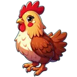
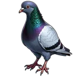
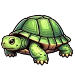
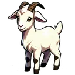
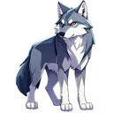
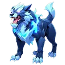
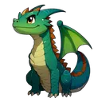

# 🐾 Pets

Pets come from pet tokens. Your active pet helps you in fishing, hunting, expeditions, heists and Crown of Chaos while it's awake and well cared for, and it earns pet points for the pet leaderboards. It needs food, washing, play and sometimes a cure, and its stats change every minute, also while you're away.

**Where:** `/start` → **Activities** → **Pet**.

## Getting a pet

Consume a pet token from the pet menu. Each **Consume** spends exactly one token and gives at most one pet: the token has a chance to find a pet of its rarity, picked from that rarity's pets. If it finds a pet you already have, the token is used up and you get nothing. Your first pet becomes your active pet. Without a token, nothing happens.

| Token | In the store | Chance to find a pet | Pets of this rarity |
|---|---|---|---|
| { .gi .gi-inline width="24" height="24" loading="lazy" } [Common Pet Token](../items/pet-items/pet-tokens.md#common-pet-token) | 5 credits | 65% | Chicken, Cat, Dog, Rabbit, Duck, Pigeon |
| { .gi .gi-inline width="24" height="24" loading="lazy" } [Uncommon Pet Token](../items/pet-items/pet-tokens.md#uncommon-pet-token) | not sold | 50% | Turtle, Hamster, Goldfish, Goat, Frog |
| { .gi .gi-inline width="24" height="24" loading="lazy" } [Rare Pet Token](../items/pet-items/pet-tokens.md#rare-pet-token) | not sold | 40% | Fox, Parrot, Squirrel, Raccoon, Hedgehog, Otter, Owl, Ferret |
| { .gi .gi-inline width="24" height="24" loading="lazy" } [Epic Pet Token](../items/pet-items/pet-tokens.md#epic-pet-token) | not sold | 30% | Lizard, Wolf, Eagle |
| { .gi .gi-inline width="24" height="24" loading="lazy" } [Legendary Pet Token](../items/pet-items/pet-tokens.md#legendary-pet-token) | not sold | 20% | Panther, Snow Leopard, Koi, Komodo Dragon |
| { .gi .gi-inline width="24" height="24" loading="lazy" } [Mythical Pet Token](../items/pet-items/pet-tokens.md#mythical-pet-token) | not sold | 10% | Phoenix Chick, Ghost Cat, Thunderbird, Dragon, Cerberus, Griffin, Basilisk, Fenrir, Unicorn, Kraken Hatchling, Shadow Hound, Dire Bear, Lunar Moth, Void Serpent, Astral Hare, Celestial Jellyfish |

Tokens also drop from many activities (fishing, hunting, expeditions, heists, chat, bumps, votes, dice, Loot Reels…): see each game's prize table.

## Caring for your pet

| Action | Costs | Notes |
|---|---|---|
| Feed | one Pet Food of the pet's rarity | |
| Wash | one Pet Wash Kit of the pet's rarity | |
| Cure | one Pet Cure of the pet's rarity | |
| Play | nothing | |

Each action moves the pet's stats (hunger, energy, happiness, hygiene, sickness) by that pet's own table, and gives **the pet 1 experience**, unless the action hits a bad condition (playing with a dirty pet, for example): then no experience. Pet items are sold in the pet menu and the store:

| Rarity | Pet Food | Pet Cure | Pet Wash Kit |
|---|---|---|---|
| Common | 1 credit | 10 credits | 5 credits |
| Uncommon | 1.5 credits | 15 credits | 6 credits |
| Rare | 2 credits | 20 credits | 7 credits |
| Epic | 2.5 credits | 25 credits | 8 credits |
| Legendary | 3 credits | 30 credits | 9 credits |
| Mythical | 3.5 credits | 35 credits | 10 credits |

## Awake and asleep

Each pet is a **day** pet or a **night** pet. A day pet is awake with the lights on, a night pet with the lights off; the light switch in the pet menu changes it. An asleep pet can't be played with or fed (nothing is spent), and its perks don't work.

## Every minute

While you're away, your active pet's stats move every minute by its awake or asleep table. Stats always stay between 0 and 100.

A pet left alone for 30 days stops changing (no stat changes, no points, no perks). Play with it or use the light switch, and it carries on from the stats it had.

## Pet points

Your active pet earns **pet points every minute**, awake or asleep, from its stats after the minute's change: the better fed (low hunger), happier, cleaner and healthier it is, the more (energy counts a little). A rarer pet earns more for the same stats: ×1.05 Uncommon, ×1.1 Rare, ×1.15 Epic, ×1.2 Legendary, ×1.25 Mythical. A pet in a bad state earns nothing. The pet menu shows it as **Score per Minute**.

- Only the minute earns points: feeding, washing, curing and playing give your pet experience, not points; a pet resting in the { .gi .gi-mention width="20" height="20" loading="lazy" }&nbsp;[Pet Kennel](buildings.md#what-each-building-does) earns nothing; activities, heists and the Crown give no pet points.
- The points wait, and go onto the **All-Time Pet Points** and **Monthly Pet Points** 🏅&nbsp;[leaderboards](leaderboards.md) every 15 minutes, also when your pet has fallen into a bad state since (before the update, points earned before a pet fell ill could stay waiting and be lost). Changing pets or putting your pet in the kennel puts its waiting points on the boards first, for that pet. Two clicks at once never count them twice, and a restart of the bot keeps them waiting.
- The monthly board counts the last 30 days: each batch of points leaves it (and your pet's monthly score) about 30 days later; the all-time board keeps them. The top 10 of each board hold its [role](roles.md#top-roles).

## Perks

Every pet has perks for the activities. **A perk works only while the pet is awake and its stats meet the perk's conditions.** Only your active pet counts: a pet in the kennel or among your favorites adds nothing. Every perk below is checked in play at exactly its number, on its game's screen and in the game itself, awake and asleep. A fishing, hunting or expedition trip uses the pet that is active and awake **when the trip ends**: change pets during a trip and the new pet's perks count; put it to sleep and none do. A fishing or hunting perk adds its points to the chance of one fish or animal, and only helps if your rod or rifle catches it. An expedition perk adds its points to one expedition's scrap. A Crown of Chaos perk helps either your attacks on the Crown ("attacking the Crown") or you while you hold the Crown ("holding the Crown"): a Dog's extra 1-2 damage counts on every attack while it's awake, and stops when you turn its lights off.

| Perk | Works while the pet has | Pets |
|---|---|---|
| 🏹&nbsp;[Hunting](../games/hunting.md#pets) | happiness above 20, energy above 10, sickness below 75 | every pet |
| { .gi .gi-mention width="20" height="20" loading="lazy" }&nbsp;[Fishing](../games/fishing.md#pets) | happiness above 20, energy above 10, sickness below 75 | every pet not named below |
| { .gi .gi-mention width="20" height="20" loading="lazy" }&nbsp;[Fishing](../games/fishing.md#pets) | happiness above 15, energy above 10, sickness below 75 | Eagle, Snow Leopard, Thunderbird, Dragon, Unicorn, Void Serpent, Celestial Jellyfish |
| 🧭&nbsp;[Expeditions](../games/expeditions.md#pets) | happiness above 15, energy above 10, sickness below 80 | every pet |
| [Heist](../games/heists-and-clans/attacks-and-defence/index.md#pets-buildings-clans) | happiness above 20, hunger below 80, sickness at most 65, hygiene above 10, energy at least 5 | every pet |
| { .gi .gi-mention width="20" height="20" loading="lazy" }&nbsp;[Crown of Chaos](../games/crown-of-chaos/attacking.md#runes-and-damage) | happiness above 20, hunger below 80, sickness at most 65, hygiene above 10, energy at least 5 | every pet |

| Pet | Rarity | Awake | { .gi .gi-mention width="20" height="20" loading="lazy" }&nbsp;[Fishing](../games/fishing.md#pets) | 🏹&nbsp;[Hunting](../games/hunting.md#pets) | 🧭&nbsp;[Expeditions](../games/expeditions.md#pets) | [Heist](../games/heists-and-clans/attacks-and-defence/index.md#pets-buildings-clans) | { .gi .gi-mention width="20" height="20" loading="lazy" }&nbsp;[Crown of Chaos](../games/crown-of-chaos/attacking.md#runes-and-damage) |
|---|---|---|---|---|---|---|---|
| { .gi .gi-inline width="24" height="24" loading="lazy" } Chicken | Common | by day (lights on) | Anchovy +1% | Squirrel +1% | Metal Scrap +0.55% (Deep Excavation) | Deflection Chance +0.6% (defending) | Reduce Attack Cooldown -1s (attacking the Crown) |
| { .gi .gi-inline width="24" height="24" loading="lazy" } Cat | Common | at night (lights off) | Mackerel +1.1% | Rabbit +0.8% | Leather Scrap +0.6% (Nature Expedition) | Counter-Attack Chance +0.6% (defending) | Increased Dodge Chance +2% (holding the Crown) |
| { .gi .gi-inline width="24" height="24" loading="lazy" } Dog | Common | by day (lights on) | Sardines +1% | Coyote +1% | Wood Scrap +0.65% (Woodland Logging) | Recovery Chance +0.6% (attacking) | Extra damage range +1-2 (attacking the Crown) |
| { .gi .gi-inline width="24" height="24" loading="lazy" } Rabbit | Common | by day (lights on) | Cod +0.75% | Wild Turkey +0.75% | Wood Scrap +0.6% (Woodland Logging) | Gain Assault Fortification Chance +0.6% (attacking) | Increase Health Regen +2 (holding the Crown) |
| { .gi .gi-inline width="24" height="24" loading="lazy" } Duck | Common | by day (lights on) | Tuna +0.75% | Pheasant +0.75% | Leather Scrap +0.6% (Nature Expedition) | Block Chance +0.6% (defending) | Increase Max Health +30 (holding the Crown) |
| { .gi .gi-inline width="24" height="24" loading="lazy" } Pigeon | Common | by day (lights on) | Tilapia +0.77% | White-tailed Deer +0.77% | Metal Scrap +0.5% (Deep Excavation) | Gain Retribution Fury Chance +0.6% (attacking) | Increase Health Bonus % +7.5% (holding the Crown) |
| { .gi .gi-inline width="24" height="24" loading="lazy" } Turtle | Uncommon | by day (lights on) | Eel +0.7% | Wild Turkey +0.85% | Wood Scrap +0.7% (Woodland Logging) | Block Chance +0.75% (defending) | Increase Max Health +50 (holding the Crown) |
| { .gi .gi-inline width="24" height="24" loading="lazy" } Hamster | Uncommon | by day (lights on) | Sardines +1.05% | Rabbit +0.95% | Leather Scrap +0.65% (Nature Expedition) | Recovery Chance +0.75% (attacking) | Extra damage range +2-3 (attacking the Crown) |
| { .gi .gi-inline width="24" height="24" loading="lazy" } Goldfish | Uncommon | by day (lights on) | Cod +0.85%; Mackerel +1.1% | – | Metal Scrap +0.75% (Deep Excavation) | Gain Assault Fortification Chance +0.75% (attacking) | Increase Health Regen +3 (holding the Crown) |
| { .gi .gi-inline width="24" height="24" loading="lazy" } Goat | Uncommon | by day (lights on) | Anchovy +1.1% | Wild Boar +0.85% | Leather Scrap +0.7% (Nature Expedition) | Deflection Chance +0.75% (defending) | Reduce Damage Taken -6 (holding the Crown) |
| { .gi .gi-inline width="24" height="24" loading="lazy" } Frog | Uncommon | at night (lights off) | Sardines +1% | Squirrel +1% | Wood Scrap +0.65% (Woodland Logging) | Counter-Attack Chance +0.75% (defending) | Increase Inflict Cooldown +3s (holding the Crown) |
| { .gi .gi-inline width="24" height="24" loading="lazy" } Fox | Rare | at night (lights off) | Mackerel +1.2% | Rabbit +1.2% | Metal Scrap +0.9% (Deep Excavation) | Deflection Chance +0.9% (defending) | Extra damage range +3-4 (attacking the Crown); Increase Health Regen +2 (holding the Crown) |
| { .gi .gi-inline width="24" height="24" loading="lazy" } Parrot | Rare | by day (lights on) | Cod +1% | Coyote +1.2% | Wood Scrap +0.8% (Woodland Logging) | Gain Retribution Fury Chance +0.9% (attacking) | Reduce Attack Cooldown -2s (attacking the Crown) |
| { .gi .gi-inline width="24" height="24" loading="lazy" } Squirrel | Rare | by day (lights on) | Eel +0.8% | Elk +1% | Leather Scrap +0.95% (Nature Expedition) | Counter-Attack Chance +0.9% (defending) | Increased Dodge Chance +3% (holding the Crown) |
| { .gi .gi-inline width="24" height="24" loading="lazy" } Raccoon | Rare | at night (lights off) | Sardines +1.1% | Wild Boar +1% | Wood Scrap +0.85% (Woodland Logging) | Recovery Chance +0.9% (attacking) | Increase Health Regen +4 (holding the Crown); Reduce Damage Taken -4 (holding the Crown) |
| { .gi .gi-inline width="24" height="24" loading="lazy" } Hedgehog | Rare | at night (lights off) | Trout +0.8% | Wild Turkey +1% | Metal Scrap +0.85% (Deep Excavation) | Block Chance +0.9% (defending) | Increase Max Health +30 (holding the Crown); Reduce Damage Taken -5 (holding the Crown) |
| { .gi .gi-inline width="24" height="24" loading="lazy" } Otter | Rare | by day (lights on) | Tilapia +1% | Pheasant +1% | Leather Scrap +0.75% (Nature Expedition) | Gain Assault Fortification Chance +0.9% (attacking) | Extra damage range +3-4 (attacking the Crown) |
| { .gi .gi-inline width="24" height="24" loading="lazy" } Owl | Rare | at night (lights off) | Tuna +1% | White-tailed Deer +1% | Metal Scrap +0.85% (Deep Excavation) | Deflection Chance +0.45% (defending); Recovery Chance +0.45% (attacking) | Reduce Attack Cooldown -2s (attacking the Crown); Increase Inflict Cooldown +2s (holding the Crown) |
| { .gi .gi-inline width="24" height="24" loading="lazy" } Ferret | Rare | by day (lights on) | Cod +1% | Rabbit +1.2% | Wood Scrap +0.9% (Woodland Logging) | Counter-Attack Chance +0.45% (defending); Gain Retribution Fury Chance +0.45% (attacking) | Increase Health Bonus % +18% (holding the Crown) |
| { .gi .gi-inline width="24" height="24" loading="lazy" } Lizard | Epic | by day (lights on) | Cod +1.2% | Squirrel +1.35% | Leather Scrap +1% (Nature Expedition) | Counter-Attack Chance +1% (defending) | Reduce Attack Cooldown -3s (attacking the Crown) |
| { .gi .gi-inline width="24" height="24" loading="lazy" } Wolf | Epic | at night (lights off) | Trout +1% | Coyote +1.35% | Wood Scrap +1% (Woodland Logging) | Recovery Chance +1% (attacking) | Extra damage range +3-5 (attacking the Crown) |
| { .gi .gi-inline width="24" height="24" loading="lazy" } Eagle | Epic | by day (lights on) | Swordfish +1% | Wild Turkey +1.2% | Metal Scrap +1.05% (Deep Excavation) | Deflection Chance +1% (defending) | Increased Dodge Chance +4% (holding the Crown) |
| { .gi .gi-inline width="24" height="24" loading="lazy" } Panther | Legendary | at night (lights off) | Eel +1.11% | Wild Boar +1.11% | Leather Scrap +1.02% (Nature Expedition) | Block Chance +1.1% (defending) | Extra damage range +4-6 (attacking the Crown) |
| { .gi .gi-inline width="24" height="24" loading="lazy" } Snow Leopard | Legendary | at night (lights off) | Swordfish +1.12% | Moose +1.12% | Metal Scrap +1% (Deep Excavation) | Deflection Chance +1.1% (defending) | Increased Dodge Chance +5% (holding the Crown) |
| { .gi .gi-inline width="24" height="24" loading="lazy" } Koi | Legendary | by day (lights on) | Tuna +1.3% | Wild Turkey +1.3% | Wood Scrap +1.03% (Woodland Logging) | Recovery Chance +1.1% (attacking) | Increase Health Regen +5 (holding the Crown) |
| { .gi .gi-inline width="24" height="24" loading="lazy" } Komodo Dragon | Legendary | by day (lights on) | Trout +1.15% | Coyote +1.38% | Leather Scrap +1.04% (Nature Expedition) | Gain Retribution Fury Chance +1.1% (attacking) | Increase Max Health +85 (holding the Crown) |
| { .gi .gi-inline width="24" height="24" loading="lazy" } Phoenix Chick | Mythical | by day (lights on) | Eel +1.15% | Elk +1.15% | Metal Scrap +1.05% (Deep Excavation) | Increased Experience Gain +1 (attacking) | Increase Health Regen +8 (holding the Crown); Increase Resurgence Regen +1.25% (holding the Crown) |
| { .gi .gi-inline width="24" height="24" loading="lazy" } Ghost Cat | Mythical | at night (lights off) | Trout +1.15% | Rabbit +1.5% | Wood Scrap +1.1% (Woodland Logging) | Lessen Exp Loss -1 (defending) | Reduce Attack Cooldown -3s (attacking the Crown); Extra damage range +3-5 (attacking the Crown) |
| { .gi .gi-inline width="24" height="24" loading="lazy" } Thunderbird | Mythical | by day (lights on) | Swordfish +1.15% | Wild Boar +1.15% | Metal Scrap +1.1% (Deep Excavation) | Increased Opponent Experience Loss +1 (attacking) | Increase Max Health +100 (holding the Crown); Increased Dodge Chance +1.35% (holding the Crown) |
| { .gi .gi-inline width="24" height="24" loading="lazy" } Dragon | Mythical | by day (lights on) | Swordfish +1.15% | Wild Boar +1.15% | Leather Scrap +1.1% (Nature Expedition) | Deflection Chance +0.5% (defending); Counter-Attack Chance +0.75% (defending) | Increase Health Bonus % +35% (holding the Crown); Reduce Damage Taken -7 (holding the Crown) |
| { .gi .gi-inline width="24" height="24" loading="lazy" } Cerberus | Mythical | at night (lights off) | Tuna +1.35% | Wild Boar +1.15% | Wood Scrap +1.12% (Woodland Logging) | Recovery Chance +0.5% (attacking); Gain Assault Fortification Chance +0.73% (attacking) | Extra damage range +5-7 (attacking the Crown); Increase Max Health +30 (holding the Crown) |
| { .gi .gi-inline width="24" height="24" loading="lazy" } Griffin | Mythical | by day (lights on) | Tilapia +1.35% | Moose +1.15% | Metal Scrap +1.14% (Deep Excavation) | Block Chance +1.15% (defending) | Increased Dodge Chance +6% (holding the Crown) |
| { .gi .gi-inline width="24" height="24" loading="lazy" } Basilisk | Mythical | at night (lights off) | Cod +1.35% | Squirrel +1.5% | Leather Scrap +1.1% (Nature Expedition) | Counter-Attack Chance +1.15% (defending) | Reduce Attack Cooldown -6s (attacking the Crown) |
| { .gi .gi-inline width="24" height="24" loading="lazy" } Fenrir | Mythical | at night (lights off) | Eel +1.15% | White-tailed Deer +1.35% | Wood Scrap +1.12% (Woodland Logging) | Gain Retribution Fury Chance +1.15% (attacking) | Increase Max Health +65 (holding the Crown); Increase Health Regen +4 (holding the Crown) |
| { .gi .gi-inline width="24" height="24" loading="lazy" } Unicorn | Mythical | by day (lights on) | Swordfish +1.15% | Wild Turkey +1.35% | Leather Scrap +1.15% (Nature Expedition) | Deflection Chance +1.15% (defending) | Increase Health Bonus % +30% (holding the Crown) |
| { .gi .gi-inline width="24" height="24" loading="lazy" } Kraken Hatchling | Mythical | at night (lights off) | Cod +1.35% | Wild Boar +1.15% | Metal Scrap +1.1% (Deep Excavation) | Recovery Chance +1.15% (attacking) | Increase Health Regen +3 (holding the Crown); Extra damage range +3-4 (attacking the Crown) |
| { .gi .gi-inline width="24" height="24" loading="lazy" } Shadow Hound | Mythical | at night (lights off) | Mackerel +1.5% | Wild Turkey +1.35% | Leather Scrap +1.05% (Nature Expedition) | Deflection Chance +0.6% (defending); Recovery Chance +0.6% (attacking) | Reduce Health Regen Interval -1 (holding the Crown); Extra damage range +2-3 (attacking the Crown) |
| { .gi .gi-inline width="24" height="24" loading="lazy" } Dire Bear | Mythical | at night (lights off) | Tilapia +1.35% | Moose +1.15% | Wood Scrap +1.1% (Woodland Logging) | Block Chance +1.15% (defending) | Increase Max Health +200 (holding the Crown) |
| { .gi .gi-inline width="24" height="24" loading="lazy" } Lunar Moth | Mythical | at night (lights off) | Sardines +1.5% | Squirrel +1.5% | Leather Scrap +1.14% (Nature Expedition) | Deflection Chance +0.6% (defending); Recovery Chance +0.6% (attacking) | Increased Dodge Chance +4% (holding the Crown); Reduce Attack Cooldown -2s (attacking the Crown) |
| { .gi .gi-inline width="24" height="24" loading="lazy" } Void Serpent | Mythical | at night (lights off) | Swordfish +1.15% | Coyote +1.5% | Metal Scrap +1.1% (Deep Excavation) | Gain Assault Fortification Chance +1.15% (attacking) | Extra damage range +6-9 (attacking the Crown) |
| { .gi .gi-inline width="24" height="24" loading="lazy" } Astral Hare | Mythical | at night (lights off) | Cod +1.35% | Rabbit +1.5% | Leather Scrap +1.1% (Nature Expedition) | Gain Retribution Fury Chance +1.15% (attacking) | Increase Inflict Cooldown +5s (holding the Crown) |
| { .gi .gi-inline width="24" height="24" loading="lazy" } Celestial Jellyfish | Mythical | by day (lights on) | Swordfish +1.15% | Squirrel +1.5% | Wood Scrap +1.15% (Woodland Logging) | Recovery Chance +1.1% (attacking) | Increase Health Regen +4 (holding the Crown); Increase Inflict Cooldown +2s (holding the Crown) |

## Changing pets, favorites, nicknames

- **Change Pet** makes another of your pets the active one. The old pet keeps its stats and the points it earned. The Pet Perks screen there shows each perk as it works: an extra damage range as "+1-2".
- **Favorites:** 5 slots for quick switching from a menu. A sixth is refused.
- **Nickname:** 2 to 50 characters; spaces at the ends are trimmed, and mentions and formatting are removed.

## The kennel

The **{ .gi .gi-mention width="20" height="20" loading="lazy" }&nbsp;[Pet Kennel](buildings.md#what-each-building-does)** building holds as many pets as its level (🏗️&nbsp;[Buildings](buildings.md)). Only a pet in good condition can go in (the menu tells you what to improve first). In the kennel a pet rests and regains energy every minute; at full energy it leaves the kennel, and you can ask for a DM when that happens.

## Tips

- Check whether your pet is a day or a night pet: its perks only work while it's awake.
- Match your pet to your gear: a fishing perk for a fish your rod doesn't catch does nothing.
- Keep the stats up (happiness, energy, low sickness): below a perk's conditions it stops working.
