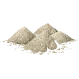
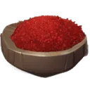
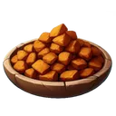
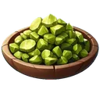
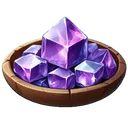

# 🏪 The store

The store sells you items for credits and buys them back. How credits get in and out of the game is in { .gi .gi-mention width="20" height="20" loading="lazy" }&nbsp;[Credits and RUNES](credits-and-runes.md).

**Where:** `/store`. Pick a category and an item, then **Buy** or **Sell** and type how many. Some other menus open the store on an item (the 🗡️&nbsp;[Crown of Chaos](../games/crown-of-chaos/attacking.md) menu's **Buy { .gi .gi-mention width="20" height="20" loading="lazy" }&nbsp;[Chaos Relic](../items/keys-and-cards/cards-and-relics.md#chaos-relic)**), and the store's delivery announcements have **Buy …** buttons for what just arrived.

**What the screen shows:** your credits, how many of the item you have, the price to **Buy** one and what **Sell** pays for one (with its percent), the store's own balance and the Crown of Chaos pool.

- **The price on the screen is what you pay**, to the last fraction of a credit: one costs exactly the price shown, several of a fixed-price item exactly the price × the amount (crafting materials: below), and you get exactly the amount. On top of that the game adds **5% of what you pay to the Crown of Chaos pool**; you don't pay it.
- **Selling pays exactly the amount the screen shows** × how many you sell, and takes exactly that many. Most items sell back for 75% of their price (the { .gi .gi-mention width="20" height="20" loading="lazy" }&nbsp;[Forgotten Throne Elixir](../items/consumables/store-consumables.md#forgotten-throne-elixir) for 2.5%). The **{ .gi .gi-mention width="20" height="20" loading="lazy" }&nbsp;[Trade Post](buildings.md#what-each-building-does)** building adds 0.15% of the price per level (75% becomes 90% at level 100; the elixir's 2.5% becomes 17.5%), and the screen shows it.
- **The store pays from its own balance**, which grows with every purchase in your server. When it doesn't have enough for your sale, the sale is refused and you keep your items. The { .gi .gi-mention width="20" height="20" loading="lazy" }&nbsp;[Party Store](buildings.md#what-each-building-does) building gives no store discount.
- **Every purchase and sale is one line** in your credits history, and one in the store's **Purchase History** button: newest first, 25 a page, with how many, the total and the price of one.
- **When the store says no, only you see why**, and nothing changes: an amount that isn't a whole number above 0 written plainly (`5`; `1e3`, `0x10`, `+5` and `1,000` aren't amounts), more than your wallet holds, selling more than you have, more than the store has in stock, a full pouch.
- **At the same moment:** a double click, two devices, or two players after the last one never pay twice, sell twice or get more than the store has: one goes through, the other is told why. A buy or sell box you closed never takes over your next purchase.
- **Scrap:** every day (from 00:00 UTC) your first 5 scrap cost a quarter of the price (25 credits instead of 100), wood, leather and metal together; after that, full price. The screen shows the price of your next one. The store never sells more scrap than it has, and your pouch must have room (100 of each kind per pouch level). The store gets 5 scrap every hour. Scrap can't be sold back.
- **Crafting materials** (for Hack & Slash) have no fixed price: the fewer the store has, the dearer they are (the table below). Each one you buy costs the price at the stock left, so buying several costs more than the shown price × the amount, and the next price goes up; selling raises the stock and lowers the price. The screen always shows the next one's price. Selling back what you just bought pays exactly 75% of what you paid (never more). At most 10,000 in one purchase or sale, and the store doesn't buy a material it already has more than 1,000,000 of. The store gets 3 random materials every 3 hours, and from players' sales.
- **The price can move while you look:** if another player buys a crafting material first, yours costs the price at the stock left after theirs. The message after your purchase always says what you paid.

| Rule | Value |
|---|---|
| Discounted scrap a day | 5 |
| A discounted scrap costs | 25% of the price (75% off) |
| Added to the Crown of Chaos pool on every purchase | 5% of what you pay |
| Scrap delivered to the store | 5 every hour |
| Crafting materials delivered to the store | 3 every 3 hours |
| Most crafting materials in one purchase or sale | 10,000 |
| The store stops buying a crafting material it has more than | 1,000,000 |

**Crafting materials:** the price of one, in credits, by how many the store has (a sale pays 75% of the price at one more):

| Material | Base cost | Stock 1 | Stock 2 | Stock 5 | Stock 20 | Stock 100 | Stock 1,000 |
|---|---|---|---|---|---|---|---|
| { .gi .gi-inline width="24" height="24" loading="lazy" } [Standard Essence](../items/materials/hack-and-slash-crafting-materials.md#standard-essence) | 1.5 credits | 30.74 | 15.74 | 6.72 | 2.16 | 0.84 | 0.38 |
| { .gi .gi-inline width="24" height="24" loading="lazy" } [Elemental Core](../items/materials/hack-and-slash-crafting-materials.md#elemental-core) | 4.5 credits | 92.23 | 47.21 | 20.17 | 6.49 | 2.51 | 1.14 |
| { .gi .gi-inline width="24" height="24" loading="lazy" } [Primal Source](../items/materials/hack-and-slash-crafting-materials.md#primal-source) | 13.5 credits | 276.7 | 141.64 | 60.5 | 19.48 | 7.53 | 3.43 |
| { .gi .gi-inline width="24" height="24" loading="lazy" } [Basic Residue](../items/materials/hack-and-slash-crafting-materials.md#basic-residue) | 4.5 credits | 92.23 | 47.21 | 20.17 | 6.49 | 2.51 | 1.14 |
| { .gi .gi-inline width="24" height="24" loading="lazy" } [Enigmatic Nexus](../items/materials/hack-and-slash-crafting-materials.md#enigmatic-nexus) | 13.5 credits | 276.7 | 141.64 | 60.5 | 19.48 | 7.53 | 3.43 |
| { .gi .gi-inline width="24" height="24" loading="lazy" } [Mystical Node](../items/materials/hack-and-slash-crafting-materials.md#mystical-node) | 40.5 credits | 830.09 | 424.93 | 181.5 | 58.43 | 22.6 | 10.3 |
| { .gi .gi-inline width="24" height="24" loading="lazy" } [Elite Essence](../items/materials/hack-and-slash-crafting-materials.md#elite-essence) | 13.5 credits | 276.7 | 141.64 | 60.5 | 19.48 | 7.53 | 3.43 |
| { .gi .gi-inline width="24" height="24" loading="lazy" } [Radiant Shard](../items/materials/hack-and-slash-crafting-materials.md#radiant-shard) | 40.5 credits | 830.09 | 424.93 | 181.5 | 58.43 | 22.6 | 10.3 |
| { .gi .gi-inline width="24" height="24" loading="lazy" } [Shattered Prism](../items/materials/hack-and-slash-crafting-materials.md#shattered-prism) | 121.5 credits | 2,490.26 | 1,274.79 | 544.49 | 175.29 | 67.81 | 30.9 |
| { .gi .gi-inline width="24" height="24" loading="lazy" } [Engraving Tool](../items/materials/hack-and-slash-crafting-materials.md#engraving-tool) | 1.5 credits | 30.74 | 15.74 | 6.72 | 2.16 | 0.84 | 0.38 |

| Category | Item | Price | Sells back for (without a Trade Post) |
|---|---|---|---|
| Spices | { .gi .gi-inline width="24" height="24" loading="lazy" } [Anchovy Powder](../items/ingredients/spices.md#anchovy-powder) | 1 credit | 0.75 credits (75%) |
| Spices | { .gi .gi-inline width="24" height="24" loading="lazy" } [Smoked Paprika](../items/ingredients/spices.md#smoked-paprika) | 2 credits | 1.5 credits (75%) |
| Spices | { .gi .gi-inline width="24" height="24" loading="lazy" } [Sumac](../items/ingredients/spices.md#sumac) | 3 credits | 2.25 credits (75%) |
| Spices | { .gi .gi-inline width="24" height="24" loading="lazy" } [Old Bay Seasoning](../items/ingredients/spices.md#old-bay-seasoning) | 4 credits | 3 credits (75%) |
| Spices | { .gi .gi-inline width="24" height="24" loading="lazy" } [Wasabi](../items/ingredients/spices.md#wasabi) | 8 credits | 6 credits (75%) |
| Spices | { .gi .gi-inline width="24" height="24" loading="lazy" } [Cumin](../items/ingredients/spices.md#cumin) | 5 credits | 3.75 credits (75%) |
| Spices | { .gi .gi-inline width="24" height="24" loading="lazy" } [Sichuan Peppercorns](../items/ingredients/spices.md#sichuan-peppercorns) | 5 credits | 3.75 credits (75%) |
| Spices | { .gi .gi-inline width="24" height="24" loading="lazy" } [Dill](../items/ingredients/spices.md#dill) | 8 credits | 6 credits (75%) |
| Spices | { .gi .gi-inline width="24" height="24" loading="lazy" } [Rosemary](../items/ingredients/spices.md#rosemary) | 10 credits | 7.5 credits (75%) |
| Spices | 🍋 [Lemon](../items/ingredients/spices.md#lemon) | 25 credits | 18.75 credits (75%) |
| Sauces | { .gi .gi-inline width="24" height="24" loading="lazy" } [Sawmill Gravy](../items/ingredients/sauces.md#sawmill-gravy) | 1 credit | 0.75 credits (75%) |
| Sauces | { .gi .gi-inline width="24" height="24" loading="lazy" } [Mustard Cream Sauce](../items/ingredients/sauces.md#mustard-cream-sauce) | 2 credits | 1.5 credits (75%) |
| Sauces | { .gi .gi-inline width="24" height="24" loading="lazy" } [Lingonberry Sauce](../items/ingredients/sauces.md#lingonberry-sauce) | 3 credits | 2.25 credits (75%) |
| Sauces | { .gi .gi-inline width="24" height="24" loading="lazy" } [Cranberry Glaze](../items/ingredients/sauces.md#cranberry-glaze) | 4 credits | 3 credits (75%) |
| Sauces | { .gi .gi-inline width="24" height="24" loading="lazy" } [Blackberry Balsamic Glaze](../items/ingredients/sauces.md#blackberry-balsamic-glaze) | 8 credits | 6 credits (75%) |
| Sauces | { .gi .gi-inline width="24" height="24" loading="lazy" } [Juniper Berry Demi-Glace](../items/ingredients/sauces.md#juniper-berry-demi-glace) | 5 credits | 3.75 credits (75%) |
| Sauces | { .gi .gi-inline width="24" height="24" loading="lazy" } [Huckleberry Sauce](../items/ingredients/sauces.md#huckleberry-sauce) | 5 credits | 3.75 credits (75%) |
| Sauces | { .gi .gi-inline width="24" height="24" loading="lazy" } [Blueberry Sauce](../items/ingredients/sauces.md#blueberry-sauce) | 8 credits | 6 credits (75%) |
| Sauces | { .gi .gi-inline width="24" height="24" loading="lazy" } [Cherry Sauce](../items/ingredients/sauces.md#cherry-sauce) | 10 credits | 7.5 credits (75%) |
| Consumables | { .gi .gi-inline width="24" height="24" loading="lazy" } [Fishing Beer](../items/consumables/store-consumables.md#fishing-beer) | 3 credits | 2.25 credits (75%) |
| Consumables | { .gi .gi-inline width="24" height="24" loading="lazy" } [Hunting Weed](../items/consumables/store-consumables.md#hunting-weed) | 3 credits | 2.25 credits (75%) |
| Consumables | { .gi .gi-inline width="24" height="24" loading="lazy" } [Einherjar's Barrier Draught](../items/consumables/store-consumables.md#einherjars-barrier-draught) | 850 credits | 637.5 credits (75%) |
| Consumables | { .gi .gi-inline width="24" height="24" loading="lazy" } [Skadi's Retribution Brew](../items/consumables/store-consumables.md#skadis-retribution-brew) | 850 credits | 637.5 credits (75%) |
| Consumables | { .gi .gi-inline width="24" height="24" loading="lazy" } [Frigg's Resurgence Elixir](../items/consumables/store-consumables.md#friggs-resurgence-elixir) | 850 credits | 637.5 credits (75%) |
| Consumables | { .gi .gi-inline width="24" height="24" loading="lazy" } [Forgotten Throne Elixir](../items/consumables/store-consumables.md#forgotten-throne-elixir) | 8,000 credits | 200 credits (2.5%) |
| Building Supplies | { .gi .gi-inline width="24" height="24" loading="lazy" } [Toolbox](../items/materials/building-supplies.md#toolbox) | 1,250 credits | 937.5 credits (75%) |
| Building Supplies | { .gi .gi-inline width="24" height="24" loading="lazy" } [Nail](../items/materials/building-supplies.md#nail) | 2.5 credits | 1.875 credits (75%) |
| Building Supplies | { .gi .gi-inline width="24" height="24" loading="lazy" } [Rope](../items/materials/building-supplies.md#rope) | 10 credits | 7.5 credits (75%) |
| Playtime Provisions | { .gi .gi-inline width="24" height="24" loading="lazy" } [Runes Pattern Card](../items/keys-and-cards/cards-and-relics.md#runes-pattern-card) | 50 credits | 37.5 credits (75%) |
| Playtime Provisions | { .gi .gi-inline width="24" height="24" loading="lazy" } [Chaos Relic](../items/keys-and-cards/cards-and-relics.md#chaos-relic) | 2 credits | 1.5 credits (75%) |
| Pet Items | { .gi .gi-inline width="24" height="24" loading="lazy" } [Common Pet Token](../items/pet-items/pet-tokens.md#common-pet-token) | 5 credits | 3.75 credits (75%) |
| Pet Items | { .gi .gi-inline width="24" height="24" loading="lazy" } [Uncommon Pet Token](../items/pet-items/pet-tokens.md#uncommon-pet-token) | not sold | 7.5 credits (75%) |
| Pet Items | { .gi .gi-inline width="24" height="24" loading="lazy" } [Rare Pet Token](../items/pet-items/pet-tokens.md#rare-pet-token) | not sold | 11.25 credits (75%) |
| Pet Items | { .gi .gi-inline width="24" height="24" loading="lazy" } [Epic Pet Token](../items/pet-items/pet-tokens.md#epic-pet-token) | not sold | 15 credits (75%) |
| Pet Items | { .gi .gi-inline width="24" height="24" loading="lazy" } [Legendary Pet Token](../items/pet-items/pet-tokens.md#legendary-pet-token) | not sold | 18.75 credits (75%) |
| Pet Items | { .gi .gi-inline width="24" height="24" loading="lazy" } [Mythical Pet Token](../items/pet-items/pet-tokens.md#mythical-pet-token) | not sold | 22.5 credits (75%) |
| Pet Items | { .gi .gi-inline width="24" height="24" loading="lazy" } [Common Pet Food](../items/pet-items/pet-food.md#common-pet-food) | 1 credit | 0.75 credits (75%) |
| Pet Items | { .gi .gi-inline width="24" height="24" loading="lazy" } [Uncommon Pet Food](../items/pet-items/pet-food.md#uncommon-pet-food) | 1.5 credits | 1.125 credits (75%) |
| Pet Items | { .gi .gi-inline width="24" height="24" loading="lazy" } [Rare Pet Food](../items/pet-items/pet-food.md#rare-pet-food) | 2 credits | 1.5 credits (75%) |
| Pet Items | { .gi .gi-inline width="24" height="24" loading="lazy" } [Epic Pet Food](../items/pet-items/pet-food.md#epic-pet-food) | 2.5 credits | 1.875 credits (75%) |
| Pet Items | { .gi .gi-inline width="24" height="24" loading="lazy" } [Legendary Pet Food](../items/pet-items/pet-food.md#legendary-pet-food) | 3 credits | 2.25 credits (75%) |
| Pet Items | { .gi .gi-inline width="24" height="24" loading="lazy" } [Mythical Pet Food](../items/pet-items/pet-food.md#mythical-pet-food) | 3.5 credits | 2.625 credits (75%) |
| Pet Items | { .gi .gi-inline width="24" height="24" loading="lazy" } [Common Pet Cure](../items/pet-items/pet-cures.md#common-pet-cure) | 10 credits | 7.5 credits (75%) |
| Pet Items | { .gi .gi-inline width="24" height="24" loading="lazy" } [Uncommon Pet Cure](../items/pet-items/pet-cures.md#uncommon-pet-cure) | 15 credits | 11.25 credits (75%) |
| Pet Items | { .gi .gi-inline width="24" height="24" loading="lazy" } [Rare Pet Cure](../items/pet-items/pet-cures.md#rare-pet-cure) | 20 credits | 15 credits (75%) |
| Pet Items | { .gi .gi-inline width="24" height="24" loading="lazy" } [Epic Pet Cure](../items/pet-items/pet-cures.md#epic-pet-cure) | 25 credits | 18.75 credits (75%) |
| Pet Items | { .gi .gi-inline width="24" height="24" loading="lazy" } [Legendary Pet Cure](../items/pet-items/pet-cures.md#legendary-pet-cure) | 30 credits | 22.5 credits (75%) |
| Pet Items | { .gi .gi-inline width="24" height="24" loading="lazy" } [Mythical Pet Cure](../items/pet-items/pet-cures.md#mythical-pet-cure) | 35 credits | 26.25 credits (75%) |
| Pet Items | { .gi .gi-inline width="24" height="24" loading="lazy" } [Common Pet Wash Kit](../items/pet-items/pet-wash-kits.md#common-pet-wash-kit) | 5 credits | 3.75 credits (75%) |
| Pet Items | { .gi .gi-inline width="24" height="24" loading="lazy" } [Uncommon Pet Wash Kit](../items/pet-items/pet-wash-kits.md#uncommon-pet-wash-kit) | 6 credits | 4.5 credits (75%) |
| Pet Items | { .gi .gi-inline width="24" height="24" loading="lazy" } [Rare Pet Wash Kit](../items/pet-items/pet-wash-kits.md#rare-pet-wash-kit) | 7 credits | 5.25 credits (75%) |
| Pet Items | { .gi .gi-inline width="24" height="24" loading="lazy" } [Epic Pet Wash Kit](../items/pet-items/pet-wash-kits.md#epic-pet-wash-kit) | 8 credits | 6 credits (75%) |
| Pet Items | { .gi .gi-inline width="24" height="24" loading="lazy" } [Legendary Pet Wash Kit](../items/pet-items/pet-wash-kits.md#legendary-pet-wash-kit) | 9 credits | 6.75 credits (75%) |
| Pet Items | { .gi .gi-inline width="24" height="24" loading="lazy" } [Mythical Pet Wash Kit](../items/pet-items/pet-wash-kits.md#mythical-pet-wash-kit) | 10 credits | 7.5 credits (75%) |
| Scrap Resources | { .gi .gi-inline width="24" height="24" loading="lazy" } [Wood Scrap](../items/materials/scrap.md#wood-scrap) | 100 credits | can't be sold |
| Scrap Resources | { .gi .gi-inline width="24" height="24" loading="lazy" } [Leather Scrap](../items/materials/scrap.md#leather-scrap) | 100 credits | can't be sold |
| Scrap Resources | { .gi .gi-inline width="24" height="24" loading="lazy" } [Metal Scrap](../items/materials/scrap.md#metal-scrap) | 100 credits | can't be sold |

## Tips

- Sell what you don't need: most items sell for 75% of their price, more with a { .gi .gi-mention width="20" height="20" loading="lazy" }&nbsp;[Trade Post](buildings.md#what-each-building-does).
- Buy up to 5 scrap a day: those cost a quarter of the price.
- Crafting materials are cheapest when the store has many: after a delivery, or after other players sold theirs. Buying the last few is expensive.
