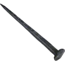
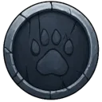
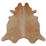
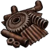

# 🗳️ Votes

A vote for the bot on discordbotlist.com pays **20 experience**, a roll on the vote prize table and the **voter role for 12 hours**. Another vote within those 12 hours pays nothing, also one delivered at the same moment as the first: one vote is recorded and paid. A voter who isn't in the server gets nothing; a member who never used the bot gets an account and the reward. A vote for a server on Discadia pays the same there, with that server's Discadia voter role for 24 hours. On both sites the bot records your vote before it tells the site it got it: a vote it fails to record is recorded when the site sends it again, and you're paid then, once; a vote the site sends again never pays twice. The same when your vote arrives while the bot is starting up, or while Discord can't tell the bot whether you're in the server: the bot asks the site to send it again rather than counting you out. In a server that hasn't set an experience channel a vote pays all the same, only unannounced, and the role still goes when its time is over; a server that hasn't set the voter role (or whose role was deleted) pays the vote all the same, without the role.

Your voter role follows your window: if the bot was down when you voted, or giving you the role failed, its role check (at the bot's start and twice a day) gives it to you for what's left of your window and says how long; once your window is over, the check takes it back.

The prize table is without utilities (a 🪓&nbsp;[Wood Axe](../games/expeditions.md#utilities-wood-axe-skinning-knife-mining-pick), 🔪&nbsp;[Skinning Knife](../games/expeditions.md#utilities-wood-axe-skinning-knife-mining-pick) or ⛏️&nbsp;[Mining Pick](../games/expeditions.md#utilities-wood-axe-skinning-knife-mining-pick) raises the scrap rows; they come last, so a utility never takes anything from the other prizes). Every row of this table is played in the tests and pays exactly what it shows.

| Prize | Chance per vote |
|---|---|
| { .gi .gi-inline width="24" height="24" loading="lazy" } 5 to 15 credits | 8% |
| { .gi .gi-inline width="24" height="24" loading="lazy" } 1 [Nail](../items/materials/building-supplies.md#nail) | 2% |
| { .gi .gi-inline width="24" height="24" loading="lazy" } 1 [Rope](../items/materials/building-supplies.md#rope) | 0.4% |
| { .gi .gi-inline width="24" height="24" loading="lazy" } 1 [Engraving Tool](../items/materials/hack-and-slash-crafting-materials.md#engraving-tool) | 5% |
| { .gi .gi-inline width="24" height="24" loading="lazy" } 1 [Chaos Relic](../items/keys-and-cards/cards-and-relics.md#chaos-relic) | 5% |
| { .gi .gi-inline width="24" height="24" loading="lazy" } 1 [Common Pet Token](../items/pet-items/pet-tokens.md#common-pet-token) | 1% |
| 1 📦&nbsp;[Pet Token](../items/pet-items/pet-tokens.md) (Uncommon, Rare, Epic, Legendary, Mythical) | 0.5% each |
| { .gi .gi-inline width="24" height="24" loading="lazy" } 1 [Leather Scrap](../items/materials/scrap.md#leather-scrap) | 25% |
| { .gi .gi-inline width="24" height="24" loading="lazy" } 1 [Metal Scrap](../items/materials/scrap.md#metal-scrap) | 25% |
| { .gi .gi-inline width="24" height="24" loading="lazy" } 1 [Wood Scrap](../items/materials/scrap.md#wood-scrap) | 25% |
| nothing | 1.1% |

## Tips

- Vote every 12 hours: each vote pays 20 experience and a roll on the vote prize table.
