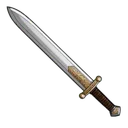
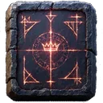

# { .gi .gi-title width="64" height="64" loading="lazy" } Robin Hood

**Where to play:** Discord
{ .where-to-play }

- **Tree:** { .gi .gi-mention width="20" height="20" loading="lazy" }&nbsp;[Offensive skills](index.md) (for attackers: they work when you attack the Crown)
- **Kind:** an attack skill: you pick it for an attack ([mana and attack skills](../../attacking.md#mana-and-attack-skills))
- **Learn it from:** your rank 12
- **Needs first:** no other skill
- **Opens:** { .gi .gi-mention width="20" height="20" loading="lazy" }&nbsp;[Black Hood](black-hood.md)

> In the game: Steal from accumulated taxes and distribute them among attackers.

## What it does

On a damaging hit it steals its share of the pool and splits it evenly among the reign's attackers still in the server, one who attacked and missed too; it steals exactly their shares, the rounding remainder stays in the pool.

Every attack costs one { .gi .gi-mention width="20" height="20" loading="lazy" }&nbsp;[Chaos Relic](../../../../items/keys-and-cards.md#chaos-relic) and faces the Crown's rune ([runes and damage](../../attacking.md#runes-and-damage)).

## Checked in play

- On a damaging hit rank 1 takes 0.025% of the pool and rank 20 0.5%, for 5 and 24 mana, split evenly among the reign's attackers still in the server, you included (one who only missed too; not one who left the server); the rounding remainder stays in the pool. With an empty pool, or one too small for a share each, nobody gets anything and the mana is spent. On a final blow the shares leave the pool first and the old Crown is paid the rest.
- A dodged attack steals nothing.

## Rank by rank

What its skill screen shows at each rank; the game plays with exactly these numbers. A skill holds at most 20 points; a { .gi .gi-mention width="20" height="20" loading="lazy" }&nbsp;[Forgotten Throne Elixir](../../../../items/store-consumables.md#forgotten-throne-elixir) resets every skill ([skill points](../index.md#skill-points)).

| Rank | of the pool, shared among the attackers | mana |
|---|---|---|
| 1 | 0.025% | 5 |
| 2 | 0.05% | 6 |
| 3 | 0.075% | 7 |
| 4 | 0.1% | 8 |
| 5 | 0.125% | 9 |
| 6 | 0.15% | 10 |
| 7 | 0.175% | 11 |
| 8 | 0.2% | 12 |
| 9 | 0.225% | 13 |
| 10 | 0.25% | 14 |
| 11 | 0.275% | 15 |
| 12 | 0.3% | 16 |
| 13 | 0.325% | 17 |
| 14 | 0.35% | 18 |
| 15 | 0.375% | 19 |
| 16 | 0.4% | 20 |
| 17 | 0.425% | 21 |
| 18 | 0.45% | 22 |
| 19 | 0.475% | 23 |
| 20 | 0.5% | 24 |
