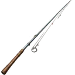
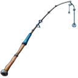
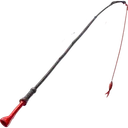

# Fishing

**Where to play:** Discord
{ .where-to-play }

An idle activity: you spend energy, wait while your trip runs, and come back to a catch. Fishing fills your basket with fish for [cooking](cooking.md). [Hunting](hunting.md) and [expeditions](expeditions.md) work the same way.

**Where:** `/fish` goes on a one-energy trip straight away. `/start` → **Activities** → **Fish** lets you pick how much energy to spend, and holds the crafting, equipment and buff menus.

## How a trip works

1. You choose how much energy to spend. Each energy is **10 seconds** of trip.
2. While the trip runs you're busy: you can't start another fishing trip, hunt or expedition until it's over (the bot tells you, privately, that you're already busy and until when).
3. Every second of the trip is one roll for a catch, and one roll on the trip's extra prizes (scrap, pet items, tokens and more; the table is at the end of this page).
   - Each scrap found is its own prize: when your pouch is full, the scrap that still fits is paid and the rest isn't. The result lists what was paid and, apart, what your pouch had no room for (**Unable to loot Pouch full**); **Today's loot** on the fishing menu counts only what was paid (with the trips' experience and quest rewards).
4. At the end you get your catch, your experience and your quest progress, and the trip counts on the leaderboards.

A trip pays exactly once. Clicking twice, or using two devices, starts one trip and spends the energy once. If the bot restarts during your trip, the trip is finished when the bot is back, and paid once.

## Energy

| Activity | Energy each day | Most energy | Seconds per energy |
|---|---|---|---|
| Fishing | 10 + Fishing Club level | 22 (level 12, rank 96) | 10 (+2 per Fishing Beer) |

- Energy refills at **00:00 UTC** every day. The refill sets your energy to the day's full amount; it doesn't add to what you had left.
- A trip that runs over midnight still pays once.
- **Out of fishing energy?** A **{ .gi .gi-mention width="20" height="20" loading="lazy" }&nbsp;[Pan-Fried Trout with Lemon and Dill](../items/dishes.md#pan-fried-trout-with-lemon-and-dill)** pays for one more energy of fishing. It's only used for the energy your daily energy doesn't cover, never while you still have energy. Without one, the trip doesn't start and nothing is spent: `/fish` tells you so privately, with your fishing menu (your energy, when it refills), and a **Go Fishing** button on a menu from earlier tells you privately and leaves the menu as it was.

## Experience, quests and leaderboards

A fishing trip pays **1 experience per energy**.

Trips also move your [quests](../account/quests.md#every-quest): the Fishing quest counts the energy you spend, and the quest for each fish counts what you catch of it (Fishing - Cod counts your { .gi .gi-mention width="20" height="20" loading="lazy" }&nbsp;[cod](../items/ingredients.md#cod)). A quest that reaches its goal completes on its own and pays its reward once.

The fishing leaderboards count the seconds of your trips (beer seconds included).

## Rods

You craft them in the **Fish** menu (**Craft Fishing Pole**) for scrap from your pouch. You can own one of each. Without one, you only catch { .gi .gi-mention width="20" height="20" loading="lazy" }&nbsp;[Anchovy](../items/ingredients.md#anchovy).

| Item | Crafting cost (wood / metal / leather scrap) | Catches, chance each second |
|---|---|---|
| { .gi .gi-inline width="24" height="24" loading="lazy" } no rod | – | { .gi .gi-mention width="20" height="20" loading="lazy" }&nbsp;[Anchovy](../items/ingredients.md#anchovy) 5% |
| { .gi .gi-inline width="24" height="24" loading="lazy" } Skathi's Rod | 6 / 1 / 2 | { .gi .gi-mention width="20" height="20" loading="lazy" }&nbsp;[Anchovy](../items/ingredients.md#anchovy) 5%, { .gi .gi-mention width="20" height="20" loading="lazy" }&nbsp;[Mackerel](../items/ingredients.md#mackerel) 5%, { .gi .gi-mention width="20" height="20" loading="lazy" }&nbsp;[Sardines](../items/ingredients.md#sardines) 5% |
| { .gi .gi-inline width="24" height="24" loading="lazy" } Gaul's Glimmer | 41 / 16 / 20 | { .gi .gi-mention width="20" height="20" loading="lazy" }&nbsp;[Cod](../items/ingredients.md#cod) 5%, { .gi .gi-mention width="20" height="20" loading="lazy" }&nbsp;[Tuna](../items/ingredients.md#tuna) 5%, { .gi .gi-mention width="20" height="20" loading="lazy" }&nbsp;[Tilapia](../items/ingredients.md#tilapia) 5% |
| { .gi .gi-inline width="24" height="24" loading="lazy" } Freyja's Spar | 200 / 50 / 60 | { .gi .gi-mention width="20" height="20" loading="lazy" }&nbsp;[Eel](../items/ingredients.md#eel) 5%, { .gi .gi-mention width="20" height="20" loading="lazy" }&nbsp;[Trout](../items/ingredients.md#trout) 5%, { .gi .gi-mention width="20" height="20" loading="lazy" }&nbsp;[Swordfish](../items/ingredients.md#swordfish) 5% |

- Equip a rod in the Fish menu. **The one equipped when the trip ends decides the catch**, so a swap during a trip counts.
- With more than one rod you can turn on **rotative** fishing: each second of the trip rolls on the next one in turn. With only one, the switch isn't offered and a trip never rotates.
- Crafting costs exactly the scrap shown. With a scrap short, or a rod you already own, the Craft button is off. A double click crafts one rod, and an older screen whose Craft button is still on crafts nothing once the scrap is gone; only you are told why. The same for an enhancement upgrade, and for a utility's credits. If something goes wrong while crafting, the crafting screen comes back, only you are told, and nothing is spent or made.

### Enhancements

Each rod has its own enhancement, upgraded from the crafting screen for scrap. Every level adds **0.1 percentage points** to each of that rod's three catches (not to your other rods). The crafting screen's "Chance: 5.3% per Second" ({ .gi .gi-mention width="20" height="20" loading="lazy" }&nbsp;[Skathi's Rod](#rods) at enhancement level 3) is exactly what a trip rolls. Each level needs a rank of twice the level (the crafting screen shows it as "User Level"): below it the upgrade button is off, and a click on an older one upgrades nothing and tells you, privately, the rank you need. The costs below are wood / metal / leather scrap.

| Item | Enhancement | Each level | Level 1 (rank 2) | Level 2 (rank 4) | Level 10 (rank 20) | Level 25 (rank 50) | Level 50 (rank 100) |
|---|---|---|---|---|---|---|---|
| { .gi .gi-inline width="24" height="24" loading="lazy" } Skathi's Rod | Glacier Glider | +0.1 points on each of its catches | 5 / 1 / 3 | 7 / 2 / 5 | 27 / 9 / 18 | 63 / 21 / 42 | 123 / 41 / 82 |
| { .gi .gi-inline width="24" height="24" loading="lazy" } Gaul's Glimmer | Moonlit Mirage | +0.1 points on each of its catches | 16 / 6 / 8 | 22 / 8 / 11 | 70 / 28 / 35 | 160 / 64 / 80 | 310 / 124 / 155 |
| { .gi .gi-inline width="24" height="24" loading="lazy" } Freyja's Spar | Runebound Rouser | +0.1 points on each of its catches | 52 / 22 / 15 | 70 / 30 / 20 | 210 / 90 / 60 | 472 / 202 / 135 | 910 / 390 / 260 |

## Utilities: Wood Axe and Mining Pick

Crafted for credits in `/start` → **Inventory** → **Utilities**. Every level adds **0.05 percentage points** to the chance of finding its scrap: in fishing's extra prizes (⛏️&nbsp;[Mining Pick](expeditions.md#utilities-wood-axe-skinning-knife-mining-pick) for { .gi .gi-mention width="20" height="20" loading="lazy" }&nbsp;[Metal Scrap](../items/materials.md#metal-scrap), 🪓&nbsp;[Wood Axe](expeditions.md#utilities-wood-axe-skinning-knife-mining-pick) for { .gi .gi-mention width="20" height="20" loading="lazy" }&nbsp;[Wood Scrap](../items/materials.md#wood-scrap)), on its expedition ([expeditions](expeditions.md)), and in the other prize tables that have that scrap (votes, bumps, chat, dice, heists, treasure chests and more). With exactly the price in your wallet you can craft it. **Level n needs rank n** (the screen shows it as "User Level"): below it the craft button is off, and a click on an older one crafts nothing and tells you, privately, the rank you need. The third utility, the 🔪&nbsp;[Skinning Knife](hunting.md#utilities-skinning-knife), raises { .gi .gi-mention width="20" height="20" loading="lazy" }&nbsp;[Leather Scrap](../items/materials.md#leather-scrap) ([hunting](hunting.md)).

| Utility | Raises | Each level | Level 1 | Level 2 | Level 3 | Level 5 | Level 10 | Level 25 | Level 50 |
|---|---|---|---|---|---|---|---|---|---|
| { .gi .gi-inline width="24" height="24" loading="lazy" } Wood Axe | Wood Scrap | +0.05 points | 350 credits | 612 credits | 875 credits | 1,400 credits | 2,712 credits | 6,650 credits | 13,212 credits |
| { .gi .gi-inline width="24" height="24" loading="lazy" } Mining Pick | Metal Scrap | +0.05 points | 350 credits | 612 credits | 875 credits | 1,400 credits | 2,712 credits | 6,650 credits | 13,212 credits |

## Buffs

| Buff | Where it comes from | Used by |
|---|---|---|
| { .gi .gi-inline width="24" height="24" loading="lazy" } [Fishing Beer](../items/store-consumables.md#fishing-beer) | 3 credits in the store; the Party Store | fishing |
| { .gi .gi-inline width="24" height="24" loading="lazy" } [Pan-Fried Trout with Lemon and Dill](../items/dishes.md#pan-fried-trout-with-lemon-and-dill) | cooked: 2 { .gi .gi-mention width="20" height="20" loading="lazy" }&nbsp;[Trout](../items/ingredients.md#trout) + 4 { .gi .gi-mention width="20" height="20" loading="lazy" }&nbsp;[Dill](../items/ingredients.md#dill) + 1 🍋&nbsp;[Lemon](../items/ingredients.md#lemon) | fishing, when the energy is gone |

- **{ .gi .gi-mention width="20" height="20" loading="lazy" }&nbsp;[Fishing Beer](../items/store-consumables.md#fishing-beer)** (bought from the store, also from the fishing menu, or collected at the { .gi .gi-mention width="20" height="20" loading="lazy" }&nbsp;[Party Store](../account/buildings.md#what-each-building-does)): each one adds **2 seconds** to one energy of a trip, so a trip uses **one per energy**, at most. A 3-energy trip with 2 beers lasts 34 seconds. The extra seconds roll for catches and extra prizes like any other second, and count on the leaderboard. Experience and the Fishing quest count energy, so the extra seconds add none; a fish caught in them counts for its fish quest like any other.
- The fishing menu shows the buffs you have and the trip time they give.

## Pets

Your active pet helps while it's **awake** and cared for (see [Pets](../account/pets.md) for every pet, its perks and when they work). Its fishing perk adds its points to one fish. A perk for a fish your rod doesn't catch does nothing: a { .gi .gi-mention width="20" height="20" loading="lazy" }&nbsp;[Mackerel](../items/ingredients.md#mackerel) perk needs { .gi .gi-mention width="20" height="20" loading="lazy" }&nbsp;[Skathi's Rod](#rods). Asleep, or below the perk's conditions, the pet adds nothing.

## Buildings that help

In [Buildings](../account/buildings.md): the **{ .gi .gi-mention width="20" height="20" loading="lazy" }&nbsp;[Fishing Club](../account/buildings.md#what-each-building-does)** gives +1 fishing energy a day per level.

Everything adds up once: a rod enhancement, a pet perk, beer and the { .gi .gi-mention width="20" height="20" loading="lazy" }&nbsp;[Fishing Club](../account/buildings.md#what-each-building-does) on one trip each count exactly once.

## Extra prizes, every second

Without utilities, pets or buildings. Each second rolls once on this table (at most one prize a second).

| Prize | Chance each second |
|---|---|
| { .gi .gi-inline width="24" height="24" loading="lazy" } 6 [Chaos Relic](../items/keys-and-cards.md#chaos-relic) | 0.15% |
| { .gi .gi-inline width="24" height="24" loading="lazy" } 1 [Common Pet Token](../items/pet-items.md#common-pet-token) | 0.5% |
| 1 [Pet Token](../items/pet-items.md#pet-tokens) (Uncommon, Rare, Epic, Legendary, Mythical) | 0.25% each |
| 1 [Pet Food](../items/pet-items.md#pet-food) (Common, Uncommon, Rare, Epic, Legendary, Mythical) | 0.5% each |
| 1 [Pet Cure](../items/pet-items.md#pet-cures) (Common, Uncommon, Rare, Epic, Legendary, Mythical) | 0.5% each |
| 1 [Pet Wash Kit](../items/pet-items.md#pet-wash-kits) (Common, Uncommon, Rare, Epic, Legendary, Mythical) | 0.5% each |
| { .gi .gi-inline width="24" height="24" loading="lazy" } 1 [Metal Scrap](../items/materials.md#metal-scrap) | 0.15% |
| { .gi .gi-inline width="24" height="24" loading="lazy" } 1 [Wood Scrap](../items/materials.md#wood-scrap) | 0.15% |
| nothing | 88.8% |

## Tips

- Spend the day's energy before 00:00 UTC: the refill doesn't carry leftovers over.
- A rod's enhancement only helps its own three fish, and a pet perk only helps a fish your rod catches: match your pet to your rod.
- Beer is used one per energy: a 10-energy trip uses 10.
