# The Arena

**Where to play:** Discord
{ .where-to-play }

`/hackslash` → **Arena** → **Challenge Opponent**: pick a player and challenge them; they join from the public **Join Duel** message (or from their own Arena menu, **Join Duel#…**), or turn it down with **Decline**. You take turns until one of you falls; the survivor wins.

## Challenging

- You can pick another player as often as you like before pressing **Challenge**. You can't challenge yourself, a bot, someone who isn't in the server, or a player without a Hack & Slash class: the picker tells you why, and only you see it. Every refusal (a full duel list too) is shown to you alone.
- **A challenge waits 5 minutes** for the opponent (your screen says when it cancels; opening the challenge again doesn't move that time). Then it's cancelled, and **Join Duel** says the duel is gone.
- **Decline:** the challenged player can turn a challenge down from its message: the message says so, and the challenger's screen too. Only the challenged player can decline (anyone else is told so, privately); once they've joined, the button is gone.
- **Cancel Duel** calls off your challenge while nobody has joined. Once your opponent has joined, the duel is on: a Cancel that comes after the join changes nothing, and you're told so.
- You can have at most 5 open duels, and a player who has 5 can't be challenged, even by several players at the same moment.
- **One duel at a time with the same player:** while a challenge or a duel between you two is open, a new challenge either way is refused and you're shown the open one (a double click on **Challenge** sends one challenge). If they've challenged you, you're told to join or decline theirs.
- Someone else pressing **Join Duel** on your challenge only watches, privately: your duel and the message stay as they are.

## A duel

- The first move is a coin toss. On your turn your screen shows your two attacks (your main and secondary skill, which you can change from the menus below them, at the mana their buttons show), **Heal** and a **Select Target** menu; on your opponent's turn it shows whose turn it is.
- **One click, one move:** each move button belongs to the turn it was drawn for. A second click of a double click, or a button from an earlier turn, plays nothing and you're told so, privately.
- **Heal** (3 a duel): your whole move, back to full health and mana; it costs nothing else. The rest of the move goes on as usual: your minions still attack, and effects on both of you count down. You can't heal while stunned or frozen (the button is off). A double click heals once.
- **Targets:** your opponent's minions (a { .gi .gi-mention width="20" height="20" loading="lazy" }&nbsp;[Necromancer](classes/necromancer.md)'s 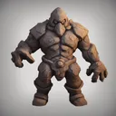{ .gi .gi-mention width="20" height="20" loading="lazy" }&nbsp;[Clay Golem](skills/necromancer/summoning-spells/clay-golem.md), for one) appear in your target menu; pick one and your attacks go there. A minion that falls leaves the duel: it attacks no more and your target goes back to the player.
- **Each turn has 2 minutes**; the screen counts them down. **If you don't move in time, you lose the duel** and your opponent wins: both duel screens and the duel's message in the channel say so. A move made before the time runs out counts; a click after it doesn't. Leaving the server doesn't end a duel: if it's your move, the 2 minutes do.
- **The end:** the player still standing wins; if both fall in the same move (a { .gi .gi-mention width="20" height="20" loading="lazy" }&nbsp;[Paladin](classes/paladin.md)'s 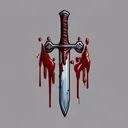{ .gi .gi-mention width="20" height="20" loading="lazy" }&nbsp;[Sacrifice](skills/paladin/battle-skills/sacrifice.md), for one), it's a tie. Both screens and the duel's message show the result, and the duel leaves both Arena menus.
- **If the bot restarts during a duel,** the time it was down never counts against you: the player whose turn it is gets a DM and **15 minutes** before their 2 minutes start (your duel screen from before still works, or open the duel again with `/hackslash` → **Arena** → **Join Duel#…**). A duel the bot lost track of during a very long outage (more than a day) is called off: nobody wins or loses. A challenge still cancels at its time, or as soon as the bot is back if that time passed while it was down.
- A duel pays nothing: no experience, no credits, no rating. There are no wagers.

## Skills and gear in a duel

- A buff you cast on your minions too (the { .gi .gi-mention width="20" height="20" loading="lazy" }&nbsp;[Warrior](classes/warrior.md)'s { .gi .gi-mention width="20" height="20" loading="lazy" }&nbsp;[Battle Orders](skills/warrior/warcries/battle-orders.md)) lasts its rounds on them, as on you.
- Auras, buffs and debuffs count once a move: a { .gi .gi-mention width="20" height="20" loading="lazy" }&nbsp;[Paladin](classes/paladin.md)'s 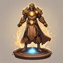{ .gi .gi-mention width="20" height="20" loading="lazy" }&nbsp;[Might](skills/paladin/auras/might.md) hits as hard on the fifth move as on the first. An aura that lowers enemy resistances (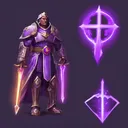{ .gi .gi-mention width="20" height="20" loading="lazy" }&nbsp;[Conviction](skills/paladin/auras/conviction.md)) lowers only your opponent's, on your move and theirs, and only their magical resistances (fire, cold, lightning, poison and magic), like the { .gi .gi-mention width="20" height="20" loading="lazy" }&nbsp;[Lower Resist](skills/necromancer/curses/lower-resist.md) curse. A curse such as { .gi .gi-mention width="20" height="20" loading="lazy" }&nbsp;[Amplify Damage](skills/necromancer/curses/amplify-damage.md) counts on every move while it lasts.
- **Resistances stop at 70 %** in a duel too, after your gear, auras and curses: a fire or magic hit on a player at 70 % does 30 % of its damage. A curse or { .gi .gi-mention width="20" height="20" loading="lazy" }&nbsp;[Conviction](skills/paladin/auras/conviction.md) lowers the whole total first, so resistance above 70 on your gear still helps against them.
- Your gear does in a duel what it does against monsters ([item bonuses](gear-and-crafting.md#item-bonuses)). 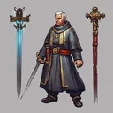{ .gi .gi-mention width="20" height="20" loading="lazy" }&nbsp;[Conversion](skills/paladin/battle-skills/conversion.md), the skill's or your gear's, never converts your opponent, as in Diablo II: the hit deals its damage and they fight on; it can convert one of their minions (a golem, a summon, a revived monster), which then fights for you with all its skills (it attacks its old master; a monster's Battle Cry or Frozen Armor now for your side, its Bone Armor on itself). The same buff twice never stacks: the stronger stays and either cast refreshes its rounds, as in [quick battles](quick-battles.md). Gear's chance to make a hit bleed works on your opponent and their minions too: a physical hit that lands may make them bleed like the { .gi .gi-mention width="20" height="20" loading="lazy" }&nbsp;[Warrior](classes/warrior.md)'s 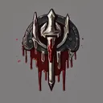{ .gi .gi-mention width="20" height="20" loading="lazy" }&nbsp;[Wound](skills/warrior/combat-skills/wound.md) at rank 1.
- An exploding attack (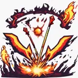{ .gi .gi-mention width="20" height="20" loading="lazy" }&nbsp;[Exploding Arrow](skills/hunter/bow-and-crossbow-skills/exploding-arrow.md), for one) hits the player you aim at and its explosion the minion beside them. 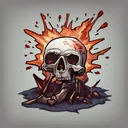{ .gi .gi-mention width="20" height="20" loading="lazy" }&nbsp;[Corpse Explosion](skills/necromancer/poison-and-bone-spells/corpse-explosion.md) blows up the duel's corpse (a duel with a { .gi .gi-mention width="20" height="20" loading="lazy" }&nbsp;[Necromancer](classes/necromancer.md) has one from the start) as fire on your opponent and their minions, through their fire resistance.
- What hits back (Thorns, gear's reflects, Iron Maiden, Retaliate's kick, Radiant Counter's smite) works as against monsters ([quick battles](quick-battles.md)): its physical part rolls to hit and can miss or be blocked, its fire or magic part never misses. 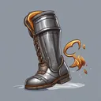{ .gi .gi-mention width="20" height="20" loading="lazy" }&nbsp;[Retaliate](skills/warrior/combat-masteries/retaliate.md)'s kick answers only a melee hit. A { .gi .gi-mention width="20" height="20" loading="lazy" }&nbsp;[Paladin](classes/paladin.md)'s 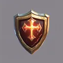{ .gi .gi-mention width="20" height="20" loading="lazy" }&nbsp;[Radiant Counter](skills/paladin/sanctified-protector/radiant-counter.md) with 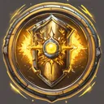{ .gi .gi-mention width="20" height="20" loading="lazy" }&nbsp;[Radiant Explosion](skills/paladin/sanctified-protector/radiant-explosion.md) smites back in a duel, explosion and all.
