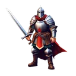

# 📈 Attributes and combat

**Where to play:** Discord
{ .where-to-play }

## Attributes

You get **5 attribute points per level** to spend on the stats screen (never more than you've earned), [typed as a plain whole number](../../account/credits-and-runes.md#typing-an-amount): `0x10`, `1e3`, words or decimals are refused on the stats screen and nothing is spent.

- **Strength:** its whole value as % extra physical (and throw) damage.
- **Dexterity:** +5 attack rating a point, multiplied by your level's multiplier ([below](#hitting-and-missing)); dexterity from your gear and its inscriptions counts the same as the points you spend.
- **Vitality:** health (× your class's health per vitality) and stamina (+1 a point, { .gi .gi-mention width="20" height="20" loading="lazy" }&nbsp;[Assassin](classes/assassin.md) 1.25).
- **Energy:** mana (× your class's mana per energy).
- Each level lowers your fire, cold, lightning, poison and magic resistance by 1.

**Reset:** a stats reset gives every point back, for 0.5 { .gi .gi-mention width="20" height="20" loading="lazy" }&nbsp;[Grilled Coyote Steak With Lingonberry Sauce](../../items/consumables/meat-dishes.md#grilled-coyote-steak-with-lingonberry-sauce) per point spent, rounded up. Points spent and resets paid just as the bot restarts happen once or not at all.

## Your main and secondary skill

The **Stats** screen has two menus: your **main** and your **secondary** skill, the two attack buttons of a battle (each named after its skill, with its mana cost). Each menu lists your class's usable skills (passive skills work without being picked, so they aren't listed); picking one saves it at once, and each menu leaves out the skill the other one holds. The battle screen, an Arena duel and the Jotnar's battle have the same two menus. A menu on an older screen (or another device) that offers the skill your other slot now holds says so and changes nothing: the two slots always hold two different skills, so an aura counts once.

The Stats picture's **Defense** row is your armor: your class's and every worn item's (a { .gi .gi-mention width="20" height="20" loading="lazy" }&nbsp;[Warrior](classes/warrior.md)'s 50, a shield of 6 and a cap of 1,234 make 1,290), the armor the battles count. The Stats picture shows, under each skill's name, what its button does in a battle: an aura picked as a skill shows your regular attack with the aura on, under the button's own name ("Might: Attack"), since that's what the button hits with (the aura's bonus already counted in it, as in the Attack column).

The mana a button and a menu show is what the skill takes when you use it: its cost ÷ (1 + your **mana bonus**, from gear, { .gi .gi-mention width="20" height="20" loading="lazy" }&nbsp;[Telekinesis](skills/wizard/lightning-spells/telekinesis.md), { .gi .gi-mention width="20" height="20" loading="lazy" }&nbsp;[Salvation](skills/paladin/sanctified-protector/salvation.md) or the { .gi .gi-mention width="20" height="20" loading="lazy" }&nbsp;[Arcane Library](../../account/buildings.md#what-each-building-does)), rounded up. An aura counts once, even if both your slots somehow hold it.

## Hitting and missing

Physical attacks can miss. Your **hit chance** is 200% × your attack rating ÷ (your attack rating + the monster's armor) × your level ÷ (your level + the monster's level), kept between 5% and 95%. A level-1 { .gi .gi-mention width="20" height="20" loading="lazy" }&nbsp;[Warrior](classes/warrior.md) (attack rating 91) hits a level-1 Flamecaster (armor 55) 62.3% of the time.

- **Your attack rating grows with your level:** your class's 50 plus 5 per dexterity point (spent or from gear), times your level's multiplier; attack rating from gear is added on top.
- Skills and buffs with attack rating % raise it ({ .gi .gi-mention width="20" height="20" loading="lazy" }&nbsp;[Strategic Shout](skills/warrior/warcries/strategic-shout.md)'s +40% takes that 62.3% to 69.8%).
- **Monsters block** your physical attacks as often as their screen shows (a Zombie 10%).
- **Your health bonus** (from gear, Battle Orders, the Oak Sage, Sanctuary …) lowers every damage you take in a battle by that much: a hit, a monster's aura and a poison, bleed or burn tick alike (with +50% health, 30 damage takes 20). Your minions' life bonus does the same for them, their poison and burn ticks included. The battle log shows the damage before it.
- **Spells never miss:** only physical attacks roll to hit. Magic, Fire, Cold, Lightning and Poison attacks always land, yours and the monsters'.
- A single-target attack can only miss its own target. Monsters miss you too.

| Level | 1 | 5 | 10 | 20 | 25 | 26 | 30 | 40 | 50 | 75 | 100 |
|---|---|---|---|---|---|---|---|---|---|---|---|
| × attack rating | 1.82 | 3.1 | 4.7 | 7.9 | 9.5 | 20.22 | 23.1 | 30.3 | 37.5 | 73.5 | 121.5 |

## Damage

- **Critical hits** deal 75% more damage.
- **Armor** takes armor ÷ (armor + damage) × 95% off physical damage, at most 85%: even a weak hit on heavy armor keeps 15% of its damage.
- **Resistances** (fire, cold, lightning, poison, magic) lower the damage of their kind by their %. They stop at 70%, counted after everything that changes them: gear, passive skills, and buffs such as { .gi .gi-mention width="20" height="20" loading="lazy" }&nbsp;[Fade](skills/assassin/shadow-disciplines/fade.md) (which raises all five, as its screen says, not physical damage). At 70% a fire hit still deals 30% of its damage; it never heals you.
- **Curses** on you (in the Arena, a { .gi .gi-mention width="20" height="20" loading="lazy" }&nbsp;[Necromancer](classes/necromancer.md)'s { .gi .gi-mention width="20" height="20" loading="lazy" }&nbsp;[Lower Resist](skills/necromancer/curses/lower-resist.md)) lower your whole total before the 70% limit, so resistance above 70% on your gear still protects you from them. Nothing stops a curse from taking a resistance below 0. In the Arena the 70% limit counts after each move's buffs and curses too.
- **Blocking with a shield:** your chance is the shield's block × (your dexterity − 15) ÷ (2 × your level), at most 50%. It blocks monsters' physical attacks.
