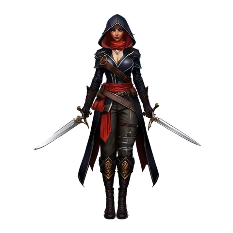

# Assassin

**Where to play:** Discord
{ .where-to-play }

{ .gi .gi-picture width="240" height="240" loading="lazy" }

> In the game: Deep within the realms of ancient lore, whispers of a deadly class known as the Nightblade abound. As a Nightblade, you are the very essence of darkness, seamlessly merging with the shadows of the night. Through relentless training and unwavering dedication, you unlock the true potential of rune-forged weaponry and forbidden enchantments. With each level reached, you master new lethal techniques, including blades infused with insidious poisons, illusions that befuddle even the keenest senses, and an innate ability to seamlessly glide through the inky blackness.

A new Assassin starts with these attributes and its full health, mana and stamina (what the class screen shows); [every class](index.md) side by side.

|  | Assassin |
|---|---|
| Strength | 20 |
| Dexterity | 20 |
| Vitality | 20 |
| Energy | 25 |
| Health per vitality | 3 |
| Mana per energy | 1.75 |
| Stamina per vitality | 1.25 |
| A new character: health, mana, stamina | 60, 44, 95 |

How attributes work: [attributes and combat](../attributes-and-combat.md#attributes).

## Skill trees

{ .gi .gi-inline width="24" height="24" loading="lazy" } **[Martial Arts](../skills/assassin/martial-arts/index.md):** { .gi .gi-mention width="20" height="20" loading="lazy" }&nbsp;[Tiger Strike](../skills/assassin/martial-arts/tiger-strike.md), { .gi .gi-mention width="20" height="20" loading="lazy" }&nbsp;[Dragon Talon](../skills/assassin/martial-arts/dragon-talon.md), { .gi .gi-mention width="20" height="20" loading="lazy" }&nbsp;[Fists of Fire](../skills/assassin/martial-arts/fists-of-fire.md), { .gi .gi-mention width="20" height="20" loading="lazy" }&nbsp;[Dragon Claw](../skills/assassin/martial-arts/dragon-claw.md), { .gi .gi-mention width="20" height="20" loading="lazy" }&nbsp;[Cobra Strike](../skills/assassin/martial-arts/cobra-strike.md), { .gi .gi-mention width="20" height="20" loading="lazy" }&nbsp;[Claws of Thunder](../skills/assassin/martial-arts/claws-of-thunder.md), { .gi .gi-mention width="20" height="20" loading="lazy" }&nbsp;[Dragon Tail](../skills/assassin/martial-arts/dragon-tail.md), { .gi .gi-mention width="20" height="20" loading="lazy" }&nbsp;[Blades of Ice](../skills/assassin/martial-arts/blades-of-ice.md), { .gi .gi-mention width="20" height="20" loading="lazy" }&nbsp;[Dragon Flight](../skills/assassin/martial-arts/dragon-flight.md), { .gi .gi-mention width="20" height="20" loading="lazy" }&nbsp;[Phoenix Strike](../skills/assassin/martial-arts/phoenix-strike.md)

{ .gi .gi-inline width="24" height="24" loading="lazy" } **[Shadow Disciplines](../skills/assassin/shadow-disciplines/index.md):** { .gi .gi-mention width="20" height="20" loading="lazy" }&nbsp;[Claw Mastery](../skills/assassin/shadow-disciplines/claw-mastery.md), { .gi .gi-mention width="20" height="20" loading="lazy" }&nbsp;[Psychic Hammer](../skills/assassin/shadow-disciplines/psychic-hammer.md), { .gi .gi-mention width="20" height="20" loading="lazy" }&nbsp;[Burst of Speed](../skills/assassin/shadow-disciplines/burst-of-speed.md), { .gi .gi-mention width="20" height="20" loading="lazy" }&nbsp;[Weapon Block](../skills/assassin/shadow-disciplines/weapon-block.md), { .gi .gi-mention width="20" height="20" loading="lazy" }&nbsp;[Cloak of Shadows](../skills/assassin/shadow-disciplines/cloak-of-shadows.md), { .gi .gi-mention width="20" height="20" loading="lazy" }&nbsp;[Fade](../skills/assassin/shadow-disciplines/fade.md), { .gi .gi-mention width="20" height="20" loading="lazy" }&nbsp;[Shadow Warrior](../skills/assassin/shadow-disciplines/shadow-warrior.md), { .gi .gi-mention width="20" height="20" loading="lazy" }&nbsp;[Mind Blast](../skills/assassin/shadow-disciplines/mind-blast.md), { .gi .gi-mention width="20" height="20" loading="lazy" }&nbsp;[Venom](../skills/assassin/shadow-disciplines/venom.md), { .gi .gi-mention width="20" height="20" loading="lazy" }&nbsp;[Shadow Master](../skills/assassin/shadow-disciplines/shadow-master.md)

{ .gi .gi-inline width="24" height="24" loading="lazy" } **[Traps](../skills/assassin/traps/index.md):** { .gi .gi-mention width="20" height="20" loading="lazy" }&nbsp;[Fire Blast](../skills/assassin/traps/fire-blast.md), { .gi .gi-mention width="20" height="20" loading="lazy" }&nbsp;[Shock Web](../skills/assassin/traps/shock-web.md), { .gi .gi-mention width="20" height="20" loading="lazy" }&nbsp;[Blade Sentinel](../skills/assassin/traps/blade-sentinel.md), { .gi .gi-mention width="20" height="20" loading="lazy" }&nbsp;[Charged Bolt Sentry](../skills/assassin/traps/charged-bolt-sentry.md), { .gi .gi-mention width="20" height="20" loading="lazy" }&nbsp;[Wake of Fire](../skills/assassin/traps/wake-of-fire.md), { .gi .gi-mention width="20" height="20" loading="lazy" }&nbsp;[Blade Fury](../skills/assassin/traps/blade-fury.md), { .gi .gi-mention width="20" height="20" loading="lazy" }&nbsp;[Lightning Sentry](../skills/assassin/traps/lightning-sentry.md), { .gi .gi-mention width="20" height="20" loading="lazy" }&nbsp;[Wake of Inferno](../skills/assassin/traps/wake-of-inferno.md), { .gi .gi-mention width="20" height="20" loading="lazy" }&nbsp;[Death Sentry](../skills/assassin/traps/death-sentry.md), { .gi .gi-mention width="20" height="20" loading="lazy" }&nbsp;[Blade Shield](../skills/assassin/traps/blade-shield.md)

Every skill at rank 1 and rank 20: { .gi .gi-mention width="20" height="20" loading="lazy" }&nbsp;[Assassin skills](../skills/assassin/index.md).
