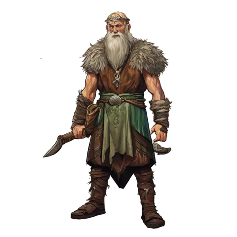
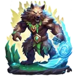

# Druid

**Where to play:** Discord
{ .where-to-play }

{ .gi .gi-picture width="240" height="240" loading="lazy" }

> In the game: The Druid is a master of nature's raw power, seamlessly blending the forces of plant and animal life with potent spellcasting abilities. This versatile class possesses a deep connection with the natural world, granting them the ability to harness elemental energies and transform into ferocious beasts. With a focus on balance and harmony, Druids can seamlessly switch between offensive spellcasting and close-quarter combat, making them formidable adversaries in any situation.

A new Druid starts with these attributes and its full health, mana and stamina (what the class screen shows); [every class](index.md) side by side.

|  | Druid |
|---|---|
| Strength | 15 |
| Dexterity | 20 |
| Vitality | 25 |
| Energy | 20 |
| Health per vitality | 2 |
| Mana per energy | 2 |
| Stamina per vitality | 1 |
| A new character: health, mana, stamina | 50, 40, 84 |

How attributes work: [attributes and combat](../attributes-and-combat.md#attributes).

## Skill trees

{ .gi .gi-inline width="24" height="24" loading="lazy" } **[Elemental Skills](../skills/druid/elemental-skills/index.md):** [Tempest Bind](../skills/druid/elemental-skills/tempest-bind.md), [Firestorm](../skills/druid/elemental-skills/firestorm.md), [Molten Boulder](../skills/druid/elemental-skills/molten-boulder.md), [Arctic Blast](../skills/druid/elemental-skills/arctic-blast.md), [Fissure](../skills/druid/elemental-skills/fissure.md), [Cyclone Armor](../skills/druid/elemental-skills/cyclone-armor.md), [Twister](../skills/druid/elemental-skills/twister.md), [Volcano](../skills/druid/elemental-skills/volcano.md), [Tornado](../skills/druid/elemental-skills/tornado.md), [Armageddon](../skills/druid/elemental-skills/armageddon.md), [Hurricane](../skills/druid/elemental-skills/hurricane.md)

{ .gi .gi-inline width="24" height="24" loading="lazy" } **[Shape Shifting Skills](../skills/druid/shape-shifting-skills/index.md):** [Werewolf](../skills/druid/shape-shifting-skills/werewolf.md), [Lycanthropy](../skills/druid/shape-shifting-skills/lycanthropy.md), [Werebear](../skills/druid/shape-shifting-skills/werebear.md), [Feral Rage](../skills/druid/shape-shifting-skills/feral-rage.md), [Maul](../skills/druid/shape-shifting-skills/maul.md), [Rabies](../skills/druid/shape-shifting-skills/rabies.md), [Fire Claws](../skills/druid/shape-shifting-skills/fire-claws.md), [Hunger](../skills/druid/shape-shifting-skills/hunger.md), [Shock Wave](../skills/druid/shape-shifting-skills/shock-wave.md), [Fury](../skills/druid/shape-shifting-skills/fury.md)

{ .gi .gi-inline width="24" height="24" loading="lazy" } **[Summoning Skills](../skills/druid/summoning-skills/index.md):** [Raven](../skills/druid/summoning-skills/raven.md), [Poison Creeper](../skills/druid/summoning-skills/poison-creeper.md), [Oak Sage](../skills/druid/summoning-skills/oak-sage.md), [Summon Spirit Wolf](../skills/druid/summoning-skills/summon-spirit-wolf.md), [Carrion Vine](../skills/druid/summoning-skills/carrion-vine.md), [Heart of Wolverine](../skills/druid/summoning-skills/heart-of-wolverine.md), [Summon Dire Wolf](../skills/druid/summoning-skills/summon-dire-wolf.md), [Solar Creeper](../skills/druid/summoning-skills/solar-creeper.md), [Spirit of Barbs](../skills/druid/summoning-skills/spirit-of-barbs.md), [Summon Grizzly](../skills/druid/summoning-skills/summon-grizzly.md)

Every skill at rank 1 and rank 20: [Druid skills](../skills/druid/index.md).
