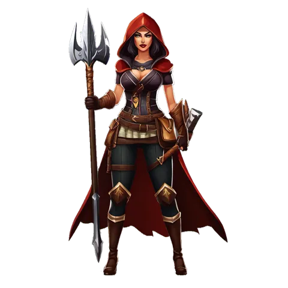

# Hunter

**Where to play:** Discord
{ .where-to-play }

{ .gi .gi-picture width="240" height="240" loading="lazy" }

> In the game: In the realm where ethereal enchantment intertwines with the natural essence, a masterful hunter emerges, harmonized with the untamed wilderness. With every step, this hunter exudes grace and precision, their connection to nature unyielding. Guided by instinct and wielding unmatched prowess with a bow, they traverse the land, leaving a trail of legends in their wake. Their tales are told in soaring melodies and enthralling tales, etching their name among the pantheon of the realm's greatest heroes. As the ancient runes awaken, this gifted hunter eagerly anticipates the joining of kindred spirits, ready to embark on extraordinary quests hand in hand, weaving a tapestry of epic adventures that will be sung for generations to come.

A new Hunter starts with these attributes and its full health, mana and stamina (what the class screen shows); 🎭&nbsp;[every class](index.md) side by side.

|  | Hunter |
|---|---|
| Strength | 20 |
| Dexterity | 25 |
| Vitality | 20 |
| Energy | 15 |
| Health per vitality | 3 |
| Mana per energy | 1.5 |
| Stamina per vitality | 1 |
| A new character: health, mana, stamina | 60, 23, 84 |

How attributes work: 💪&nbsp;[attributes and combat](../attributes-and-combat.md#attributes).

## Skill trees

{ .gi .gi-inline width="24" height="24" loading="lazy" } **[Bow and Crossbow Skills](../skills/hunter/bow-and-crossbow-skills/index.md):** { .gi .gi-mention width="20" height="20" loading="lazy" }&nbsp;[Magic Arrow](../skills/hunter/bow-and-crossbow-skills/magic-arrow.md), { .gi .gi-mention width="20" height="20" loading="lazy" }&nbsp;[Fire Arrow](../skills/hunter/bow-and-crossbow-skills/fire-arrow.md), { .gi .gi-mention width="20" height="20" loading="lazy" }&nbsp;[Cold Arrow](../skills/hunter/bow-and-crossbow-skills/cold-arrow.md), { .gi .gi-mention width="20" height="20" loading="lazy" }&nbsp;[Multiple Shot](../skills/hunter/bow-and-crossbow-skills/multiple-shot.md), { .gi .gi-mention width="20" height="20" loading="lazy" }&nbsp;[Exploding Arrow](../skills/hunter/bow-and-crossbow-skills/exploding-arrow.md), { .gi .gi-mention width="20" height="20" loading="lazy" }&nbsp;[Ice Arrow](../skills/hunter/bow-and-crossbow-skills/ice-arrow.md), { .gi .gi-mention width="20" height="20" loading="lazy" }&nbsp;[Guided Arrow](../skills/hunter/bow-and-crossbow-skills/guided-arrow.md), { .gi .gi-mention width="20" height="20" loading="lazy" }&nbsp;[Strafe](../skills/hunter/bow-and-crossbow-skills/strafe.md), { .gi .gi-mention width="20" height="20" loading="lazy" }&nbsp;[Immolation Arrow](../skills/hunter/bow-and-crossbow-skills/immolation-arrow.md), { .gi .gi-mention width="20" height="20" loading="lazy" }&nbsp;[Freezing Arrow](../skills/hunter/bow-and-crossbow-skills/freezing-arrow.md)

{ .gi .gi-inline width="24" height="24" loading="lazy" } **[Passive and Magic Skills](../skills/hunter/passive-and-magic-skills/index.md):** { .gi .gi-mention width="20" height="20" loading="lazy" }&nbsp;[Inner Sight](../skills/hunter/passive-and-magic-skills/inner-sight.md), { .gi .gi-mention width="20" height="20" loading="lazy" }&nbsp;[Critical Strike](../skills/hunter/passive-and-magic-skills/critical-strike.md), { .gi .gi-mention width="20" height="20" loading="lazy" }&nbsp;[Dodge](../skills/hunter/passive-and-magic-skills/dodge.md), { .gi .gi-mention width="20" height="20" loading="lazy" }&nbsp;[Slow Missiles](../skills/hunter/passive-and-magic-skills/slow-missiles.md), { .gi .gi-mention width="20" height="20" loading="lazy" }&nbsp;[Avoid](../skills/hunter/passive-and-magic-skills/avoid.md), { .gi .gi-mention width="20" height="20" loading="lazy" }&nbsp;[Penetrate](../skills/hunter/passive-and-magic-skills/penetrate.md), { .gi .gi-mention width="20" height="20" loading="lazy" }&nbsp;[Decoy](../skills/hunter/passive-and-magic-skills/decoy.md), { .gi .gi-mention width="20" height="20" loading="lazy" }&nbsp;[Evade](../skills/hunter/passive-and-magic-skills/evade.md), { .gi .gi-mention width="20" height="20" loading="lazy" }&nbsp;[Valkyrie](../skills/hunter/passive-and-magic-skills/valkyrie.md), { .gi .gi-mention width="20" height="20" loading="lazy" }&nbsp;[Pierce](../skills/hunter/passive-and-magic-skills/pierce.md)

{ .gi .gi-inline width="24" height="24" loading="lazy" } **[Javelin and Spear Skills](../skills/hunter/javelin-and-spear-skills/index.md):** { .gi .gi-mention width="20" height="20" loading="lazy" }&nbsp;[Jab](../skills/hunter/javelin-and-spear-skills/jab.md), { .gi .gi-mention width="20" height="20" loading="lazy" }&nbsp;[Power Strike](../skills/hunter/javelin-and-spear-skills/power-strike.md), { .gi .gi-mention width="20" height="20" loading="lazy" }&nbsp;[Poison Javelin](../skills/hunter/javelin-and-spear-skills/poison-javelin.md), { .gi .gi-mention width="20" height="20" loading="lazy" }&nbsp;[Impale](../skills/hunter/javelin-and-spear-skills/impale.md), { .gi .gi-mention width="20" height="20" loading="lazy" }&nbsp;[Lightning Bolt](../skills/hunter/javelin-and-spear-skills/lightning-bolt.md), { .gi .gi-mention width="20" height="20" loading="lazy" }&nbsp;[Charged Strike](../skills/hunter/javelin-and-spear-skills/charged-strike.md), { .gi .gi-mention width="20" height="20" loading="lazy" }&nbsp;[Plague Javelin](../skills/hunter/javelin-and-spear-skills/plague-javelin.md), { .gi .gi-mention width="20" height="20" loading="lazy" }&nbsp;[Fend](../skills/hunter/javelin-and-spear-skills/fend.md), { .gi .gi-mention width="20" height="20" loading="lazy" }&nbsp;[Lightning Strike](../skills/hunter/javelin-and-spear-skills/lightning-strike.md), { .gi .gi-mention width="20" height="20" loading="lazy" }&nbsp;[Lightning Fury](../skills/hunter/javelin-and-spear-skills/lightning-fury.md)

Every skill at rank 1 and rank 20: { .gi .gi-mention width="20" height="20" loading="lazy" }&nbsp;[Hunter skills](../skills/hunter/index.md).
