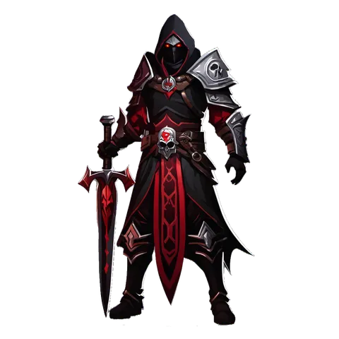

# Necromancer

**Where to play:** Discord
{ .where-to-play }

{ .gi .gi-picture width="240" height="240" loading="lazy" }

> In the game: Amidst the realm where ancient runes intertwine, where the ethereal boundary between life and death grows thin, the Necromancers emerge as masters of the macabre. Steeped in the dark arts of necromancy, they wield formidable power, commanding the spirits of the departed and harnessing the forces that linger beyond the mortal veil. As a harbinger of the necromantic arts, you embark upon a perilous journey, delving ever deeper into the mysteries of death's domain. Through forbidden rituals and sacrilegious rites, you unlock the profound ability to summon and command a legion of undead minions. These loyal servants, bound by your indomitable will, become your unyielding guardians, ready to strike fear into the hearts of your enemies. With each intonation of ancient incantations, you draw upon the dark energies that permeate the cosmos, siphoning the life force of those who oppose you. Your very presence instills dread, as you wield curses capable of unraveling the very fabric of existence. Fear and despair become your allies, driving your enemies to the brink of madness.

A new Necromancer starts with these attributes and its full health, mana and stamina (what the class screen shows); 🎭&nbsp;[every class](index.md) side by side.

|  | Necromancer |
|---|---|
| Strength | 15 |
| Dexterity | 25 |
| Vitality | 15 |
| Energy | 25 |
| Health per vitality | 2 |
| Mana per energy | 2 |
| Stamina per vitality | 1 |
| A new character: health, mana, stamina | 30, 50, 79 |

How attributes work: 💪&nbsp;[attributes and combat](../attributes-and-combat.md#attributes).

## Skill trees

{ .gi .gi-inline width="24" height="24" loading="lazy" } **[Summoning Spells](../skills/necromancer/summoning-spells/index.md):** { .gi .gi-mention width="20" height="20" loading="lazy" }&nbsp;[Raise Skeleton](../skills/necromancer/summoning-spells/raise-skeleton.md), { .gi .gi-mention width="20" height="20" loading="lazy" }&nbsp;[Skeleton Mastery](../skills/necromancer/summoning-spells/skeleton-mastery.md), { .gi .gi-mention width="20" height="20" loading="lazy" }&nbsp;[Clay Golem](../skills/necromancer/summoning-spells/clay-golem.md), { .gi .gi-mention width="20" height="20" loading="lazy" }&nbsp;[Golem Mastery](../skills/necromancer/summoning-spells/golem-mastery.md), { .gi .gi-mention width="20" height="20" loading="lazy" }&nbsp;[Raise Skeletal Mage](../skills/necromancer/summoning-spells/raise-skeletal-mage.md), { .gi .gi-mention width="20" height="20" loading="lazy" }&nbsp;[Blood Golem](../skills/necromancer/summoning-spells/blood-golem.md), { .gi .gi-mention width="20" height="20" loading="lazy" }&nbsp;[Summon Resist](../skills/necromancer/summoning-spells/summon-resist.md), { .gi .gi-mention width="20" height="20" loading="lazy" }&nbsp;[Iron Golem](../skills/necromancer/summoning-spells/iron-golem.md), { .gi .gi-mention width="20" height="20" loading="lazy" }&nbsp;[Fire Golem](../skills/necromancer/summoning-spells/fire-golem.md), { .gi .gi-mention width="20" height="20" loading="lazy" }&nbsp;[Revive](../skills/necromancer/summoning-spells/revive.md)

{ .gi .gi-inline width="24" height="24" loading="lazy" } **[Poison and Bone Spells](../skills/necromancer/poison-and-bone-spells/index.md):** { .gi .gi-mention width="20" height="20" loading="lazy" }&nbsp;[Teeth](../skills/necromancer/poison-and-bone-spells/teeth.md), { .gi .gi-mention width="20" height="20" loading="lazy" }&nbsp;[Bone Armor](../skills/necromancer/poison-and-bone-spells/bone-armor.md), { .gi .gi-mention width="20" height="20" loading="lazy" }&nbsp;[Poison Dagger](../skills/necromancer/poison-and-bone-spells/poison-dagger.md), { .gi .gi-mention width="20" height="20" loading="lazy" }&nbsp;[Corpse Explosion](../skills/necromancer/poison-and-bone-spells/corpse-explosion.md), { .gi .gi-mention width="20" height="20" loading="lazy" }&nbsp;[Bone Wall](../skills/necromancer/poison-and-bone-spells/bone-wall.md), { .gi .gi-mention width="20" height="20" loading="lazy" }&nbsp;[Poison Explosion](../skills/necromancer/poison-and-bone-spells/poison-explosion.md), { .gi .gi-mention width="20" height="20" loading="lazy" }&nbsp;[Bone Spear](../skills/necromancer/poison-and-bone-spells/bone-spear.md), { .gi .gi-mention width="20" height="20" loading="lazy" }&nbsp;[Bone Prison](../skills/necromancer/poison-and-bone-spells/bone-prison.md), { .gi .gi-mention width="20" height="20" loading="lazy" }&nbsp;[Poison Nova](../skills/necromancer/poison-and-bone-spells/poison-nova.md), { .gi .gi-mention width="20" height="20" loading="lazy" }&nbsp;[Bone Spirit](../skills/necromancer/poison-and-bone-spells/bone-spirit.md)

{ .gi .gi-inline width="24" height="24" loading="lazy" } **[Curses](../skills/necromancer/curses/index.md):** { .gi .gi-mention width="20" height="20" loading="lazy" }&nbsp;[Dim Vision](../skills/necromancer/curses/dim-vision.md), { .gi .gi-mention width="20" height="20" loading="lazy" }&nbsp;[Amplify Damage](../skills/necromancer/curses/amplify-damage.md), { .gi .gi-mention width="20" height="20" loading="lazy" }&nbsp;[Weaken](../skills/necromancer/curses/weaken.md), { .gi .gi-mention width="20" height="20" loading="lazy" }&nbsp;[Iron Maiden](../skills/necromancer/curses/iron-maiden.md), { .gi .gi-mention width="20" height="20" loading="lazy" }&nbsp;[Terror](../skills/necromancer/curses/terror.md), { .gi .gi-mention width="20" height="20" loading="lazy" }&nbsp;[Confuse](../skills/necromancer/curses/confuse.md), { .gi .gi-mention width="20" height="20" loading="lazy" }&nbsp;[Life Tap](../skills/necromancer/curses/life-tap.md), { .gi .gi-mention width="20" height="20" loading="lazy" }&nbsp;[Attract](../skills/necromancer/curses/attract.md), { .gi .gi-mention width="20" height="20" loading="lazy" }&nbsp;[Decrepify](../skills/necromancer/curses/decrepify.md), { .gi .gi-mention width="20" height="20" loading="lazy" }&nbsp;[Lower Resist](../skills/necromancer/curses/lower-resist.md)

Every skill at rank 1 and rank 20: { .gi .gi-mention width="20" height="20" loading="lazy" }&nbsp;[Necromancer skills](../skills/necromancer/index.md).
