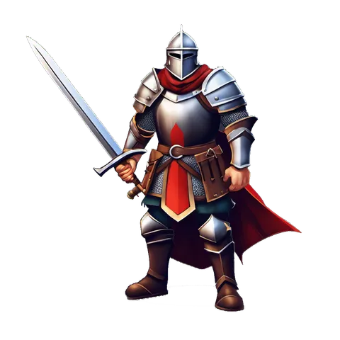
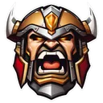

# Warrior

**Where to play:** Discord
{ .where-to-play }

{ .gi .gi-picture width="240" height="240" loading="lazy" }

> In the game: In the mystical realms of the ancient north, a warrior emerges, whose tale is shrouded in the mists of time. This valiant soul has faced the arduous trials of battle and honed their skills in the untamed wilds. Born within the walls of a mighty fortress, they formed unbreakable bonds and embarked on a perilous quest to defeat the encroaching darkness. The echoes of their cataclysmic struggle reverberated throughout the land, etching their name into the annals of legend, their deeds heralded in epic sagas and captivating ballads. Now, awakened by the sacred runes, this warrior yearns to unite with kindred spirits, to carve out new tales and sculpt a destiny destined to be cherished for eternity.

A new Warrior starts with these attributes and its full health, mana and stamina (what the class screen shows); [every class](index.md) side by side.

|  | Warrior |
|---|---|
| Strength | 30 |
| Dexterity | 20 |
| Vitality | 25 |
| Energy | 10 |
| Health per vitality | 4 |
| Mana per energy | 1 |
| Stamina per vitality | 1 |
| A new character: health, mana, stamina | 100, 10, 92 |

How attributes work: [attributes and combat](../attributes-and-combat.md#attributes).

## Skill trees

{ .gi .gi-inline width="24" height="24" loading="lazy" } **[Combat Skills](../skills/warrior/combat-skills/index.md):** [Mirror](../skills/warrior/combat-skills/mirror.md), [Bonk](../skills/warrior/combat-skills/bonk.md), [Parry](../skills/warrior/combat-skills/parry.md), [Double Swing](../skills/warrior/combat-skills/double-swing.md), [Stun](../skills/warrior/combat-skills/stun.md), [Double Throw](../skills/warrior/combat-skills/double-throw.md), [Strategic Strike](../skills/warrior/combat-skills/strategic-strike.md), [Wound](../skills/warrior/combat-skills/wound.md), [Critical Throw](../skills/warrior/combat-skills/critical-throw.md), [Cleave](../skills/warrior/combat-skills/cleave.md), [Concentrated Strike](../skills/warrior/combat-skills/concentrated-strike.md)

{ .gi .gi-inline width="24" height="24" loading="lazy" } **[Warcries](../skills/warrior/warcries/index.md):** [Howl](../skills/warrior/warcries/howl.md), [Relieve](../skills/warrior/warcries/relieve.md), [Strategic Shout](../skills/warrior/warcries/strategic-shout.md), [Screech](../skills/warrior/warcries/screech.md), [Critical Hit](../skills/warrior/warcries/critical-hit.md), [Battle Cry](../skills/warrior/warcries/battle-cry.md), [Battle Orders](../skills/warrior/warcries/battle-orders.md), [Healing Hit](../skills/warrior/warcries/healing-hit.md), [War Cry](../skills/warrior/warcries/war-cry.md), [Battle Command](../skills/warrior/warcries/battle-command.md)

{ .gi .gi-inline width="24" height="24" loading="lazy" } **[Combat Masteries](../skills/warrior/combat-masteries/index.md):** [Swordsman](../skills/warrior/combat-masteries/swordsman.md), [Axeman](../skills/warrior/combat-masteries/axeman.md), [Maceman](../skills/warrior/combat-masteries/maceman.md), [Polearm Master](../skills/warrior/combat-masteries/polearm-master.md), [Throwing Master](../skills/warrior/combat-masteries/throwing-master.md), [Spearman](../skills/warrior/combat-masteries/spearman.md), [Retaliate](../skills/warrior/combat-masteries/retaliate.md), [Though Skin](../skills/warrior/combat-masteries/though-skin.md), [Critical Kick](../skills/warrior/combat-masteries/critical-kick.md), [Resistance](../skills/warrior/combat-masteries/resistance.md)

Every skill at rank 1 and rank 20: [Warrior skills](../skills/warrior/index.md).
