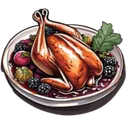
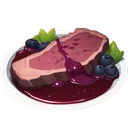
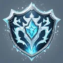
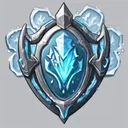
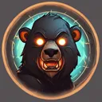
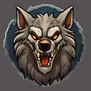
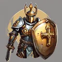

# Quick battles

**Where to play:** Discord
{ .where-to-play }

`/hackslash` → **Quick Battle**: pick the zone (Shadowed Caverns, Twilight Forest, Frozen Tundra), the monster level and the difficulty, then **Start QuickBattle**.

- **Monster level:** 1 to 100, 25 levels a page; the menu opens on your own level. Levels more than 5 below yours say **(No Experience)**: those monsters pay no experience.
- **Difficulty:** ×1 to ×6.75, in steps of 0.25. It multiplies the monsters' health, armor, damage and attack rating, adds the multiplier minus 1 (rounded) to their block, and makes items a little likelier (below).
- **The monsters:** a battle has **2 to 5** of them, of the zone and level you picked. Each is the zone's usual monster unless it rolls one of the others, at the chances the setup screen shows. The rare ones (Werewolf, Werebear, Yeti) come 2% of the time each and are worth 5 experience.
- **A quick battle costs 20 stamina** (less with the { .gi .gi-mention width="20" height="20" loading="lazy" }&nbsp;[Wizard](classes/wizard.md)'s { .gi .gi-mention width="20" height="20" loading="lazy" }&nbsp;[Teleport](skills/wizard/lightning-spells/teleport.md)). Pressed twice with stamina for one battle, it starts one battle and takes the stamina once.
- **Out of stamina:** **Restore Stamina now** spends one **{ .gi .gi-mention width="20" height="20" loading="lazy" }&nbsp;[Pheasant with Blackberry Balsamic Glaze](../../items/dishes.md#pheasant-with-blackberry-balsamic-glaze)** and fills your stamina to its maximum.
- Each click of a skill button is one round: you attack, then the monsters attack you (a stunned monster skips its attack). A double click plays one round: the second click, or a click on an older battle screen, gets a private "That round was already played" and plays nothing.
- **Dying:** a dead character can't start a new battle (nothing is charged). Heal with one **{ .gi .gi-mention width="20" height="20" loading="lazy" }&nbsp;[Anchovy with Anchovy Powder](../../items/dishes.md#anchovy-with-anchovy-powder)** (health and mana back to full), then **Return to QuickBattle** (5 stamina) to finish the same battle.
- **Before a battle**, or on the results screen for the next one, you can pick **{ .gi .gi-mention width="20" height="20" loading="lazy" }&nbsp;[Elk with Huckleberry Sauce](../../items/dishes.md#elk-with-huckleberry-sauce)** (double damage) and **{ .gi .gi-mention width="20" height="20" loading="lazy" }&nbsp;[Baked Cod with Old Bay Butter](../../items/dishes.md#baked-cod-with-old-bay-butter)** (+25% experience); each is spent once. With the first, the battle screen says **+100% Damage Bonus** and your hits deal double damage before the monster's armor.

**During a battle:**

- **Your condition carries over.** Health and mana you lose in a battle stay lost when you win it (the results show them) and when the next one starts; the battle takes 20 stamina. The day's refill fills them again, stamina too, also past 1000.
- **Gear wears** a point at a time (5% a round, 1.5% a monster attack, a random item with durability); every point counts on the results' **Total Durability Lost**, and an item stops at 0 (broken: it gives nothing until repaired).
- **Heal** on the battle screen asks first: **Decline** spends nothing; **Accept** spends one **{ .gi .gi-mention width="20" height="20" loading="lazy" }&nbsp;[Anchovy with Anchovy Powder](../../items/dishes.md#anchovy-with-anchovy-powder)** for full health and mana, and you're back in the same battle, the monsters as they were. Without one, **Accept** is greyed out. Accept clicked twice spends one; so does **Restore Stamina** (one { .gi .gi-mention width="20" height="20" loading="lazy" }&nbsp;[Pheasant with Blackberry Balsamic Glaze](../../items/dishes.md#pheasant-with-blackberry-balsamic-glaze)).
- **Back to Town** leaves the battle open: the Quick Battle screen then offers **Return to QuickBattle #… (Cost: 5 Stamina)**, the monsters as you left them, your poison and minions still with you. If you start a new battle instead, what's on you (poison, minions, buffs) comes along; winning a battle ends all of it.
- **A restart of the bot** doesn't touch an open battle: your battle screen's buttons play on where you were.
- **The animation** can be switched off (and on) with its button on the battle screen; the round's log then shows what happened.

**The monsters' attacks**, as the setup screen lists them (the title shows the difficulty you picked, e.g. ×2):

- Each monster has a default attack and special ones; a special one is used at the chance the screen shows, the default otherwise. Each deals the damage range shown, less your resistance to its damage type (at most 70%, after every buff, aura and curse) and, for physical damage, less what your armor takes.
- **AOE attacks** (the Bear's Claw, the Ice Elemental's Frost Nova) hit you and every minion you have out.
- **Battle Cry** (Werebear, Yeti) gives every monster its % more physical damage, from the monsters after it in that round, for the rounds shown. **Bone Armor** (Frost Wraith) puts a damage shield on every monster that takes the first part of your hits. **Frozen Armor** (Frost Troll) gives every monster its **Armor Bonus %** (+100%, the same at every difficulty) more armor for its rounds: your hits land less often and lose more to the armor. **BloodFang** (Werewolf) heals it by its life steal % of the damage it deals.
- **Poison** (Snake) puts a poison on you (or on the minion it hits) that ticks every round for the rounds shown, starting that round. A second Poison renews it; two never stack. It stays until its rounds run out or you win the battle.
- **Elemental attacks never miss**: Fire Bolt, Venom Strike, Ice Blast, Ice Bolt and Poison always land (the setup screen shows no attack rating for them). Physical attacks (and Stormclaw's Thunderstrike) roll to hit, and your block, dodge and avoid count.
- **Each monster blocks** your physical attacks at the **Block** % the setup screen shows, and takes less physical damage by its **Physical Resistance** (Bear, Wolf, Werewolf, Werebear, Yeti and the tundra monsters; now on the screen too).
- Monsters' own reflect never hurts you.

**Minions** (summons, raised skeletons, a monster your { .gi .gi-mention width="20" height="20" loading="lazy" }&nbsp;[Paladin](classes/paladin.md)'s { .gi .gi-mention width="20" height="20" loading="lazy" }&nbsp;[Conversion](skills/paladin/battle-skills/conversion.md) turns):

- A minion stands on the battle screen with its rounds left and fights from the round you summon it ({ .gi .gi-mention width="20" height="20" loading="lazy" }&nbsp;[Decoy](skills/hunter/passive-and-magic-skills/decoy.md) and { .gi .gi-mention width="20" height="20" loading="lazy" }&nbsp;[Oak Sage](skills/druid/summoning-skills/oak-sage.md) only stand). Monsters attack a minion 40% of the time it's out (never a trap or a { .gi .gi-mention width="20" height="20" loading="lazy" }&nbsp;[Raven](skills/druid/summoning-skills/raven.md)), and how often they hit it depends on the minion's own armor (a fresh skeleton is hit nearly always, a Clay Golem rarely); at 0 health it's gone. Its kills count, and its last kill wins the battle.
- Every summon keeps to its maximum: summoning more of the same replaces the oldest. { .gi .gi-mention width="20" height="20" loading="lazy" }&nbsp;[Raise Skeleton](skills/necromancer/summoning-spells/raise-skeleton.md) at rank 1 keeps 1 skeleton, at rank 20 up to 6. A corpse is raised (or exploded) once: the monster then shows **Raised**, and a skill that needs a corpse turns into your regular attack when none is left.
- A converted (or revived) monster fights for you with the health it had left and keeps all its skills, now for your side: its Battle Cry gives you and every minion of yours its % more physical damage, its Frozen Armor its % more armor (from the next round, for 5 rounds), its Bone Armor shields itself. Also in the [Arena](arena.md).

**The same buff twice never stacks** (as in Diablo II): when a buff is cast on someone who already has it (your own { .gi .gi-mention width="20" height="20" loading="lazy" }&nbsp;[Battle Cry](skills/warrior/warcries/battle-cry.md) and a converted Werebear's, two Werebears' on the monsters), the stronger of the two stays in effect, and either cast refreshes its rounds: the buff lasts the longer of what it had left and the new cast's. A weaker cast never lowers a stronger one; the battle screen lists the buff once. Stronger means the larger value (the larger damage %, armor %, shield left, …; on a tie, the one with more rounds left). A converted monster's buff for your side reaches you and the minions you have out at the cast. A different buff of the same kind ({ .gi .gi-mention width="20" height="20" loading="lazy" }&nbsp;[Shiver Armor](skills/wizard/cold-spells/shiver-armor.md) after { .gi .gi-mention width="20" height="20" loading="lazy" }&nbsp;[Frozen Armor](skills/wizard/cold-spells/frozen-armor.md), { .gi .gi-mention width="20" height="20" loading="lazy" }&nbsp;[Werebear](skills/druid/shape-shifting-skills/werebear.md) after { .gi .gi-mention width="20" height="20" loading="lazy" }&nbsp;[Werewolf](skills/druid/shape-shifting-skills/werewolf.md)) replaces the first. Debuffs work as before: one of a kind at a time, the newest replaces the older (a second Snake's poison renews the first, even a weaker one). The same in the [Arena](arena.md).

**Explosions:** an exploding attack ({ .gi .gi-mention width="20" height="20" loading="lazy" }&nbsp;[Fire Ball](skills/wizard/fire-spells/fire-ball.md), { .gi .gi-mention width="20" height="20" loading="lazy" }&nbsp;[Double Swing](skills/warrior/combat-skills/double-swing.md), …) hits its target with the attack and the explosion and the monsters right next to it with the explosion; a dead monster in between stops it. { .gi .gi-mention width="20" height="20" loading="lazy" }&nbsp;[Corpse Explosion](skills/necromancer/poison-and-bone-spells/corpse-explosion.md) hits the corpse's neighbours with its % of the corpse's maximum health as fire (less their fire resistance); a monster it kills is the next corpse.

**Hitting back:** { .gi .gi-mention width="20" height="20" loading="lazy" }&nbsp;[Thorns](skills/paladin/auras/thorns.md) returns its % of a melee physical hit (not ranged ones, not lightning or fire) through the attacker's armor; gear's **Reflect Physical** returns ranged hits too, and **Reflect Fire** a Fire Bolt; a monster under { .gi .gi-mention width="20" height="20" loading="lazy" }&nbsp;[Iron Maiden](skills/necromancer/curses/iron-maiden.md) takes its physical hits back, ranged too. { .gi .gi-mention width="20" height="20" loading="lazy" }&nbsp;[Retaliate](skills/warrior/combat-masteries/retaliate.md) kicks back a melee hit that landed (with your boots' damage), { .gi .gi-mention width="20" height="20" loading="lazy" }&nbsp;[Radiant Counter](skills/paladin/sanctified-protector/radiant-counter.md) smites back any hit that landed; the battle log says when one of them kills. What comes back by its damage type: a physical part (a reflection, a kick, the shield's smite) rolls to hit with your attack rating, can miss or be blocked, and meets the armor; a fire or magic part (**Reflect Fire**, { .gi .gi-mention width="20" height="20" loading="lazy" }&nbsp;[Radiant Reflection](skills/paladin/sanctified-protector/radiant-reflection.md)'s magic) never misses. The same in the [Arena](arena.md).

**A won battle pays once:**

- **Experience:** 2 per monster, 5 for a rare one, +25% with { .gi .gi-mention width="20" height="20" loading="lazy" }&nbsp;[Baked Cod](../../items/dishes.md#baked-cod-with-old-bay-butter). A monster more than 5 levels below you gives nothing.
- The quick battle leaderboards count the win.
- A roll on the battle prize table (credits go to your wallet).
- Items the monsters drop: each monster rolls once for an item, at the quality chances its setup screen shows (table below); loot each one once into your inventory. The { .gi .gi-mention width="20" height="20" loading="lazy" }&nbsp;[Arcane Reliquary](../../account/buildings.md#what-each-building-does) raises the Magic and Rare chances.
- Dying pays nothing; a battle left unfinished pays nothing, and starting another doesn't pay for it. Clicking the last attack twice, showing the results again or reopening an old battle pays nothing more.
- If the bot restarts right after your winning blow, before the results show, the battle is paid when the bot is back (its experience and loot, once). Its dropped items stay with the battle, as if you'd left the results without looting them.

| Prize | Chance per won battle |
|---|---|
| { .gi .gi-inline width="24" height="24" loading="lazy" } 0.1 to 10 credits | 6.5% |
| { .gi .gi-inline width="24" height="24" loading="lazy" } 1 [Runes Pattern Card](../../items/keys-and-cards.md#runes-pattern-card) | 0.3% |
| { .gi .gi-inline width="24" height="24" loading="lazy" } 1 [Chaos Relic](../../items/keys-and-cards.md#chaos-relic) | 0.3% |
| { .gi .gi-inline width="24" height="24" loading="lazy" } 1 [Leather Scrap](../../items/materials.md#leather-scrap) | 0.5% |
| { .gi .gi-inline width="24" height="24" loading="lazy" } 1 [Metal Scrap](../../items/materials.md#metal-scrap) | 0.5% |
| { .gi .gi-inline width="24" height="24" loading="lazy" } 1 [Wood Scrap](../../items/materials.md#wood-scrap) | 0.5% |
| { .gi .gi-inline width="24" height="24" loading="lazy" } 1 [Nail](../../items/materials.md#nail) | 3% |
| { .gi .gi-inline width="24" height="24" loading="lazy" } 1 [Rope](../../items/materials.md#rope) | 0.5% |
| { .gi .gi-inline width="24" height="24" loading="lazy" } 1 [Engraving Tool](../../items/materials.md#engraving-tool) | 8% |
| nothing | 79.9% |

Which monsters spawn, at level 1 (the same at every level):

| Zone | Monster | Spawns | Experience |
|---|---|---|---|
| Shadowed Caverns | Zombie | the rest (40%) | 2 |
| Shadowed Caverns | Stormclaw | 30% | 2 |
| Shadowed Caverns | Flamecaster | 30% | 2 |
| Twilight Forest | Wolf | the rest (36%) | 2 |
| Twilight Forest | Bear | 30% | 2 |
| Twilight Forest | Snake | 30% | 2 |
| Twilight Forest | Werewolf | 2% | 5 |
| Twilight Forest | Werebear | 2% | 5 |
| Frozen Tundra | Frozen Wolf | the rest (38%) | 2 |
| Frozen Tundra | Yeti | 2% | 5 |
| Frozen Tundra | Ice Elemental | 15% | 2 |
| Frozen Tundra | Frost Wraith | 15% | 2 |
| Frozen Tundra | Frost Troll | 15% | 2 |
| Frozen Tundra | Artic Fox | 15% | 2 |

The item each monster rolls for:

| Item quality | A monster at ×1 | A monster at ×6.75 | A rare monster at ×1 |
|---|---|---|---|
| Low Quality | 0.5% | 0.443% | 0.35% |
| Superior | 0.5% | 0.787% | 1.5% |
| Rare | 0.5% | 1.08% | 33% |
| Magic | 8% | 11.45% | 20% |
| Normal | 25% | 29.03% | 10% |
| no item | 65.5% | 57.22% | 35.15% |

