# { .gi .gi-title width="64" height="64" loading="lazy" } Assassin skills

**Where to play:** Discord
{ .where-to-play }

The { .gi .gi-mention width="20" height="20" loading="lazy" }&nbsp;[Assassin](../../classes/assassin.md)'s three trees, every skill at rank 1 and rank 20 (mana is the cost when used). Each name leads to the skill's page.

| Tree | Skill | Level | Kind | Rank 1 | Rank 20 | Needs |
|---|---|---|---|---|---|---|
| { .gi .gi-mention width="20" height="20" loading="lazy" }&nbsp;[Martial Arts](martial-arts/index.md) | { .gi .gi-inline width="24" height="24" loading="lazy" } [Tiger Strike](martial-arts/tiger-strike.md) | 1 | attack | attack rating bonus 25%, damage bonus 100%, mana 2 | attack rating bonus 215%, damage bonus 480%, mana 2 |  |
| { .gi .gi-mention width="20" height="20" loading="lazy" }&nbsp;[Martial Arts](martial-arts/index.md) | 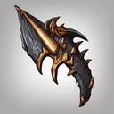{ .gi .gi-inline width="24" height="24" loading="lazy" } [Dragon Talon](martial-arts/dragon-talon.md) | 1 | passive | attack rating bonus 20%, repeated attacks 0 | attack rating bonus 400%, repeated attacks 3 |  |
| { .gi .gi-mention width="20" height="20" loading="lazy" }&nbsp;[Martial Arts](martial-arts/index.md) | { .gi .gi-inline width="24" height="24" loading="lazy" } [Fists of Fire](martial-arts/fists-of-fire.md) | 6 | attack | fire damage 6-10, burn damage 9-15, rounds 3, mana 2 | fire damage 101-105, burn damage 161-167, rounds 7, mana 2 |  |
| { .gi .gi-mention width="20" height="20" loading="lazy" }&nbsp;[Martial Arts](martial-arts/index.md) | 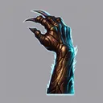{ .gi .gi-inline width="24" height="24" loading="lazy" } [Dragon Claw](martial-arts/dragon-claw.md) | 6 | passive | damage bonus 10% | damage bonus 105% | { .gi .gi-mention width="20" height="20" loading="lazy" }&nbsp;[Dragon Talon](martial-arts/dragon-talon.md) |
| { .gi .gi-mention width="20" height="20" loading="lazy" }&nbsp;[Martial Arts](martial-arts/index.md) | { .gi .gi-inline width="24" height="24" loading="lazy" } [Cobra Strike](martial-arts/cobra-strike.md) | 12 | attack | attack rating bonus 25%, life steal 40%, mana steal 40%, mana 2 | attack rating bonus 215%, life steal 135%, mana steal 135%, mana 2 | { .gi .gi-mention width="20" height="20" loading="lazy" }&nbsp;[Tiger Strike](martial-arts/tiger-strike.md) |
| { .gi .gi-mention width="20" height="20" loading="lazy" }&nbsp;[Martial Arts](martial-arts/index.md) | { .gi .gi-inline width="24" height="24" loading="lazy" } [Claws of Thunder](martial-arts/claws-of-thunder.md) | 18 | attack | attack rating bonus 25%, lightning damage 1-80, targets 3, mana 2 | attack rating bonus 215%, lightning damage 1-460, targets 9, mana 2 | { .gi .gi-mention width="20" height="20" loading="lazy" }&nbsp;[Fists of Fire](martial-arts/fists-of-fire.md) |
| { .gi .gi-mention width="20" height="20" loading="lazy" }&nbsp;[Martial Arts](martial-arts/index.md) | 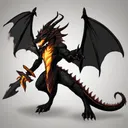{ .gi .gi-inline width="24" height="24" loading="lazy" } [Dragon Tail](martial-arts/dragon-tail.md) | 18 | chain | damage bonus 85%, targets 2, mana 2 | damage bonus 465%, targets 4, mana 21 | { .gi .gi-mention width="20" height="20" loading="lazy" }&nbsp;[Dragon Claw](martial-arts/dragon-claw.md) |
| { .gi .gi-mention width="20" height="20" loading="lazy" }&nbsp;[Martial Arts](martial-arts/index.md) | { .gi .gi-inline width="24" height="24" loading="lazy" } [Blades of Ice](martial-arts/blades-of-ice.md) | 24 | attack | attack rating bonus 25%, cold damage 15-35, freeze chance 20%, rounds 2, mana 2 | attack rating bonus 215%, cold damage 205-225, freeze chance 58%, rounds 6, mana 2 | { .gi .gi-mention width="20" height="20" loading="lazy" }&nbsp;[Claws of Thunder](martial-arts/claws-of-thunder.md) |
| { .gi .gi-mention width="20" height="20" loading="lazy" }&nbsp;[Martial Arts](martial-arts/index.md) | 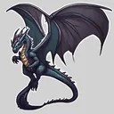{ .gi .gi-inline width="24" height="24" loading="lazy" } [Dragon Flight](martial-arts/dragon-flight.md) | 24 | passive | fire damage 22-44 | fire damage 231-253 | { .gi .gi-mention width="20" height="20" loading="lazy" }&nbsp;[Dragon Tail](martial-arts/dragon-tail.md) |
| { .gi .gi-mention width="20" height="20" loading="lazy" }&nbsp;[Martial Arts](martial-arts/index.md) | 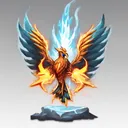{ .gi .gi-inline width="24" height="24" loading="lazy" } [Phoenix Strike](martial-arts/phoenix-strike.md) | 30 | attack | attack rating bonus 25%, cold damage 17-35, fire damage 22-44, lightning damage 1-45, mana 2 | attack rating bonus 215%, cold damage 169-187, fire damage 231-253, lightning damage 1-330, mana 2 | { .gi .gi-mention width="20" height="20" loading="lazy" }&nbsp;[Cobra Strike](martial-arts/cobra-strike.md), { .gi .gi-mention width="20" height="20" loading="lazy" }&nbsp;[Blades of Ice](martial-arts/blades-of-ice.md) |
| { .gi .gi-mention width="20" height="20" loading="lazy" }&nbsp;[Shadow Disciplines](shadow-disciplines/index.md) | 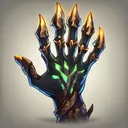{ .gi .gi-inline width="24" height="24" loading="lazy" } [Claw Mastery](shadow-disciplines/claw-mastery.md) | 1 | passive | attack rating bonus 30%, damage bonus 35%, critical strike 3% | attack rating bonus 220%, damage bonus 111%, critical strike 60% | a claw |
| { .gi .gi-mention width="20" height="20" loading="lazy" }&nbsp;[Shadow Disciplines](shadow-disciplines/index.md) | 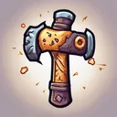{ .gi .gi-inline width="24" height="24" loading="lazy" } [Psychic Hammer](shadow-disciplines/psychic-hammer.md) | 1 | debuff | lowers armor by 20%, stun chance 100%, rounds 2 | lowers armor by 77%, stun chance 100%, rounds 4 |  |
| { .gi .gi-mention width="20" height="20" loading="lazy" }&nbsp;[Shadow Disciplines](shadow-disciplines/index.md) | { .gi .gi-inline width="24" height="24" loading="lazy" } [Burst of Speed](shadow-disciplines/burst-of-speed.md) | 6 | area | damage bonus -50%, attack rating bonus 10% | damage bonus 140%, attack rating bonus 200% | { .gi .gi-mention width="20" height="20" loading="lazy" }&nbsp;[Claw Mastery](shadow-disciplines/claw-mastery.md) |
| { .gi .gi-mention width="20" height="20" loading="lazy" }&nbsp;[Shadow Disciplines](shadow-disciplines/index.md) | { .gi .gi-inline width="24" height="24" loading="lazy" } [Weapon Block](shadow-disciplines/weapon-block.md) | 12 | passive | block chance 15% | block chance 62.5% | a claw, { .gi .gi-mention width="20" height="20" loading="lazy" }&nbsp;[Claw Mastery](shadow-disciplines/claw-mastery.md) |
| { .gi .gi-mention width="20" height="20" loading="lazy" }&nbsp;[Shadow Disciplines](shadow-disciplines/index.md) | { .gi .gi-inline width="24" height="24" loading="lazy" } [Cloak of Shadows](shadow-disciplines/cloak-of-shadows.md) | 12 | buff | dodge 10%, avoid missiles 10%, rounds 15, mana 2 | dodge 57.5%, avoid missiles 57.5%, rounds 110, mana 2 | { .gi .gi-mention width="20" height="20" loading="lazy" }&nbsp;[Psychic Hammer](shadow-disciplines/psychic-hammer.md) |
| { .gi .gi-mention width="20" height="20" loading="lazy" }&nbsp;[Shadow Disciplines](shadow-disciplines/index.md) | { .gi .gi-inline width="24" height="24" loading="lazy" } [Fade](shadow-disciplines/fade.md) | 18 | buff, spell | all resistances 2%, rounds 15, mana 2 | all resistances 40%, rounds 110, mana 2 | { .gi .gi-mention width="20" height="20" loading="lazy" }&nbsp;[Burst of Speed](shadow-disciplines/burst-of-speed.md) |
| { .gi .gi-mention width="20" height="20" loading="lazy" }&nbsp;[Shadow Disciplines](shadow-disciplines/index.md) | 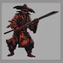{ .gi .gi-inline width="24" height="24" loading="lazy" } [Shadow Warrior](shadow-disciplines/shadow-warrior.md) | 18 | summon | health 376, armor bonus 0%, rounds 6, mana 2 | health 1421, armor bonus 228%, rounds 44, mana 40 | { .gi .gi-mention width="20" height="20" loading="lazy" }&nbsp;[Weapon Block](shadow-disciplines/weapon-block.md), { .gi .gi-mention width="20" height="20" loading="lazy" }&nbsp;[Cloak of Shadows](shadow-disciplines/cloak-of-shadows.md) |
| { .gi .gi-mention width="20" height="20" loading="lazy" }&nbsp;[Shadow Disciplines](shadow-disciplines/index.md) | { .gi .gi-inline width="24" height="24" loading="lazy" } [Mind Blast](shadow-disciplines/mind-blast.md) | 24 | area debuff, spell | confusion 5%, rounds 6, mana 2 | confusion 24%, rounds 44, mana 40 | { .gi .gi-mention width="20" height="20" loading="lazy" }&nbsp;[Cloak of Shadows](shadow-disciplines/cloak-of-shadows.md) |
| { .gi .gi-mention width="20" height="20" loading="lazy" }&nbsp;[Shadow Disciplines](shadow-disciplines/index.md) | { .gi .gi-inline width="24" height="24" loading="lazy" } [Venom](shadow-disciplines/venom.md) | 30 | passive | poison damage 60-80 | poison damage 345-365 | { .gi .gi-mention width="20" height="20" loading="lazy" }&nbsp;[Fade](shadow-disciplines/fade.md) |
| { .gi .gi-mention width="20" height="20" loading="lazy" }&nbsp;[Shadow Disciplines](shadow-disciplines/index.md) | { .gi .gi-inline width="24" height="24" loading="lazy" } [Shadow Master](shadow-disciplines/shadow-master.md) | 30 | passive | damage bonus 20%, rounds 2 | damage bonus 210%, rounds 40 | { .gi .gi-mention width="20" height="20" loading="lazy" }&nbsp;[Shadow Warrior](shadow-disciplines/shadow-warrior.md) |
| { .gi .gi-mention width="20" height="20" loading="lazy" }&nbsp;[Traps](traps/index.md) | { .gi .gi-inline width="24" height="24" loading="lazy" } [Fire Blast](traps/fire-blast.md) | 1 | explodes, spell | fire damage 3-4, mana 2 | fire damage 79-80, mana 2 |  |
| { .gi .gi-mention width="20" height="20" loading="lazy" }&nbsp;[Traps](traps/index.md) | { .gi .gi-inline width="24" height="24" loading="lazy" } [Shock Web](traps/shock-web.md) | 6 | area, spell | lightning damage 1-10, mana 2 | lightning damage 1-143, mana 2 | { .gi .gi-mention width="20" height="20" loading="lazy" }&nbsp;[Fire Blast](traps/fire-blast.md) |
| { .gi .gi-mention width="20" height="20" loading="lazy" }&nbsp;[Traps](traps/index.md) | 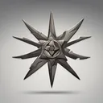{ .gi .gi-inline width="24" height="24" loading="lazy" } [Blade Sentinel](traps/blade-sentinel.md) | 6 | attack, spell | physical damage 6-10, volley 3, mana 2 | physical damage 82-86, volley 9, mana 2 |  |
| { .gi .gi-mention width="20" height="20" loading="lazy" }&nbsp;[Traps](traps/index.md) | 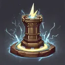{ .gi .gi-inline width="24" height="24" loading="lazy" } [Charged Bolt Sentry](traps/charged-bolt-sentry.md) | 12 | summon, spell | lightning damage 1-7, rounds 4, mana 2 | lightning damage 1-121, rounds 42, mana 2 | { .gi .gi-mention width="20" height="20" loading="lazy" }&nbsp;[Shock Web](traps/shock-web.md) |
| { .gi .gi-mention width="20" height="20" loading="lazy" }&nbsp;[Traps](traps/index.md) | 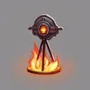{ .gi .gi-inline width="24" height="24" loading="lazy" } [Wake of Fire](traps/wake-of-fire.md) | 12 | summon, spell | fire damage 5-10, rounds 4, mana 2 | fire damage 81-105, rounds 42, mana 2 | { .gi .gi-mention width="20" height="20" loading="lazy" }&nbsp;[Fire Blast](traps/fire-blast.md) |
| { .gi .gi-mention width="20" height="20" loading="lazy" }&nbsp;[Traps](traps/index.md) | { .gi .gi-inline width="24" height="24" loading="lazy" } [Blade Fury](traps/blade-fury.md) | 18 | area, spell | physical damage 11-15, mana 2 | physical damage 125-148, mana 2 | { .gi .gi-mention width="20" height="20" loading="lazy" }&nbsp;[Blade Sentinel](traps/blade-sentinel.md), { .gi .gi-mention width="20" height="20" loading="lazy" }&nbsp;[Wake of Fire](traps/wake-of-fire.md) |
| { .gi .gi-mention width="20" height="20" loading="lazy" }&nbsp;[Traps](traps/index.md) | { .gi .gi-inline width="24" height="24" loading="lazy" } [Lightning Sentry](traps/lightning-sentry.md) | 24 | summon, spell | lightning damage 1-24, rounds 4, mana 2 | lightning damage 1-309, rounds 42, mana 2 | { .gi .gi-mention width="20" height="20" loading="lazy" }&nbsp;[Charged Bolt Sentry](traps/charged-bolt-sentry.md) |
| { .gi .gi-mention width="20" height="20" loading="lazy" }&nbsp;[Traps](traps/index.md) | 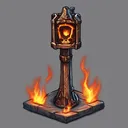{ .gi .gi-inline width="24" height="24" loading="lazy" } [Wake of Inferno](traps/wake-of-inferno.md) | 24 | summon, spell | burn damage 12-30, rounds 4, mana 2 | burn damage 221-239, rounds 42, mana 2 | { .gi .gi-mention width="20" height="20" loading="lazy" }&nbsp;[Wake of Fire](traps/wake-of-fire.md) |
| { .gi .gi-mention width="20" height="20" loading="lazy" }&nbsp;[Traps](traps/index.md) | { .gi .gi-inline width="24" height="24" loading="lazy" } [Death Sentry](traps/death-sentry.md) | 30 | summon, spell | lightning damage 1-56, targets 2, rounds 4, mana 2 | lightning damage 1-531, targets 8, rounds 42, mana 2 | { .gi .gi-mention width="20" height="20" loading="lazy" }&nbsp;[Lightning Sentry](traps/lightning-sentry.md) |
| { .gi .gi-mention width="20" height="20" loading="lazy" }&nbsp;[Traps](traps/index.md) | { .gi .gi-inline width="24" height="24" loading="lazy" } [Blade Shield](traps/blade-shield.md) | 30 | buff, spell | armor bonus 1%, physical damage 1-30, strike chance 100%, rounds 15, mana 2 | armor bonus 20%, physical damage 58-315, strike chance 100%, rounds 72, mana 2 | { .gi .gi-mention width="20" height="20" loading="lazy" }&nbsp;[Blade Fury](traps/blade-fury.md) |
