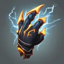
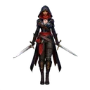
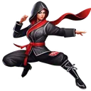
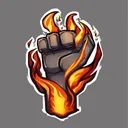
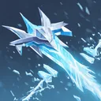

# { .gi .gi-title width="64" height="64" loading="lazy" } Claws of Thunder

**Where to play:** Discord
{ .where-to-play }

- **Class:** { .gi .gi-mention width="20" height="20" loading="lazy" }&nbsp;[Assassin](../../../classes/assassin.md)
- **Tree:** { .gi .gi-mention width="20" height="20" loading="lazy" }&nbsp;[Martial Arts](index.md)
- **Kind:** an attack
- **Learn it from:** level 18 (your rank)
- **Needs first:** { .gi .gi-mention width="20" height="20" loading="lazy" }&nbsp;[Fists of Fire](fists-of-fire.md)
- **Opens:** { .gi .gi-mention width="20" height="20" loading="lazy" }&nbsp;[Blades of Ice](blades-of-ice.md)
- **Weapon:** any
- **Mana:** 2 at rank 1, 2 at rank 20

> In the game: An attack that stores a charge; the third strike deals its lightning damage and releases chain lightning.

## How it works

- It hits the monster you selected.
- Every third use releases its charged effect, then it starts over.
- Its physical damage rolls to hit ([your hit chance](../../../attributes-and-combat.md#hitting-and-missing)), and monsters can block it.
- It costs its mana once, when used. Without enough mana, or without the weapon or shape it needs, its button says **Attack** and makes the regular attack instead, for free.

## Checked in play

- A charged strike, 2 mana each: the first two are your plain hit; the third adds its lightning (1-80 at rank 1, 1-460 at rank 20) and chains to 3 monsters (9), every hop after the first the lightning only. The lightning comes only with the third strike, as its screen says.

## Rank by rank

What its skill screen shows at each rank. The battle uses exactly these numbers (checked at ranks 1 and 20). A skill takes at most 20 points; [skill points and resets](../../index.md).

| Rank | Attack rating bonus (%) | Lightning damage | Targets | Mana |
|---|---|---|---|---|
| 1 | 25 | 1-80 | 3 | 2 |
| 2 | 35 | 1-100 | 3 | 2 |
| 3 | 45 | 1-120 | 4 | 2 |
| 4 | 55 | 1-140 | 4 | 2 |
| 5 | 65 | 1-160 | 4 | 2 |
| 6 | 75 | 1-180 | 5 | 2 |
| 7 | 85 | 1-200 | 5 | 2 |
| 8 | 95 | 1-220 | 5 | 2 |
| 9 | 105 | 1-240 | 5 | 2 |
| 10 | 115 | 1-260 | 6 | 2 |
| 11 | 125 | 1-280 | 6 | 2 |
| 12 | 135 | 1-300 | 6 | 2 |
| 13 | 145 | 1-320 | 7 | 2 |
| 14 | 155 | 1-340 | 7 | 2 |
| 15 | 165 | 1-360 | 7 | 2 |
| 16 | 175 | 1-380 | 8 | 2 |
| 17 | 185 | 1-400 | 8 | 2 |
| 18 | 195 | 1-420 | 8 | 2 |
| 19 | 205 | 1-440 | 8 | 2 |
| 20 | 215 | 1-460 | 9 | 2 |
