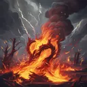
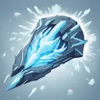
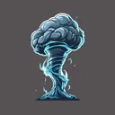
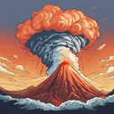

# { .gi .gi-title width="64" height="64" loading="lazy" } Elemental Skills

**Where to play:** Discord
{ .where-to-play }

A { .gi .gi-mention width="20" height="20" loading="lazy" }&nbsp;[Druid](../../../classes/druid.md) skill tree ({ .gi .gi-mention width="20" height="20" loading="lazy" }&nbsp;[all Druid skills](../index.md)): every skill at rank 1 and rank 20.

| Skill | Level | Kind | Rank 1 | Rank 20 | Needs |
|---|---|---|---|---|---|
| { .gi .gi-inline width="24" height="24" loading="lazy" } [Tempest Bind](tempest-bind.md) | 1 | debuff, spell | stun chance 100%, rounds 1, mana 3 | stun chance 100%, rounds 3, mana 3 |  |
| { .gi .gi-inline width="24" height="24" loading="lazy" } [Firestorm](firestorm.md) | 1 | area, spell | fire damage 3-6, mana 2 | fire damage 60-120, mana 2 |  |
| { .gi .gi-inline width="24" height="24" loading="lazy" } [Molten Boulder](molten-boulder.md) | 6 | explodes, spell | fire damage 6-15, mana 2 | fire damage 101-243, mana 2 | { .gi .gi-mention width="20" height="20" loading="lazy" }&nbsp;[Firestorm](firestorm.md) |
| { .gi .gi-inline width="24" height="24" loading="lazy" } [Arctic Blast](arctic-blast.md) | 6 | explodes, spell | cold damage 5-10, freeze chance 15%, rounds 2, mana 3 | cold damage 119-162, freeze chance 63%, rounds 4, mana 3 |  |
| { .gi .gi-inline width="24" height="24" loading="lazy" } [Fissure](fissure.md) | 12 | attack, spell | fire damage 25-35, mana 2 | fire damage 329-434, mana 40 | { .gi .gi-mention width="20" height="20" loading="lazy" }&nbsp;[Molten Boulder](molten-boulder.md) |
| { .gi .gi-inline width="24" height="24" loading="lazy" } [Cyclone Armor](cyclone-armor.md) | 12 | buff, spell | magic damage shield 35, physical damage 10-15, strike chance 100%, rounds 15, mana 2 | magic damage shield 320, physical damage 143-224, strike chance 100%, rounds 72, mana 2 | { .gi .gi-mention width="20" height="20" loading="lazy" }&nbsp;[Arctic Blast](arctic-blast.md) |
| { .gi .gi-inline width="24" height="24" loading="lazy" } [Twister](twister.md) | 18 | chain, spell | physical damage 25-30, stun chance 35%, targets 2, mana 2 | physical damage 253-391, stun chance 54%, targets 5, mana 2 | { .gi .gi-mention width="20" height="20" loading="lazy" }&nbsp;[Cyclone Armor](cyclone-armor.md) |
| { .gi .gi-inline width="24" height="24" loading="lazy" } [Volcano](volcano.md) | 24 | explodes, spell | fire damage 25-35, stun chance 10%, mana 2 | fire damage 329-434, stun chance 67%, mana 40 | { .gi .gi-mention width="20" height="20" loading="lazy" }&nbsp;[Fissure](fissure.md) |
| { .gi .gi-inline width="24" height="24" loading="lazy" } [Tornado](tornado.md) | 24 | attack, spell | physical damage 51-73, stun chance 100%, mana 2 | physical damage 526-738, stun chance 100%, mana 40 | { .gi .gi-mention width="20" height="20" loading="lazy" }&nbsp;[Twister](twister.md) |
| { .gi .gi-inline width="24" height="24" loading="lazy" } [Armageddon](armageddon.md) | 30 | area, spell | fire damage 88-110, stun chance 10%, burn damage 25-48, rounds 2, mana 2 | fire damage 563-623, stun chance 48%, burn damage 310-333, rounds 6, mana 40 | { .gi .gi-mention width="20" height="20" loading="lazy" }&nbsp;[Volcano](volcano.md), { .gi .gi-mention width="20" height="20" loading="lazy" }&nbsp;[Hurricane](hurricane.md) |
| { .gi .gi-inline width="24" height="24" loading="lazy" } [Hurricane](hurricane.md) | 30 | buff, spell | physical damage 23-30, stun chance 3%, rounds 15, mana 2 | physical damage 308-391, stun chance 18%, rounds 72, mana 2 | { .gi .gi-mention width="20" height="20" loading="lazy" }&nbsp;[Tornado](tornado.md) |
