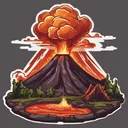

# { .gi .gi-title width="64" height="64" loading="lazy" } Volcano

**Where to play:** Discord
{ .where-to-play }

- **Class:** [Druid](../../../classes/druid.md)
- **Tree:** [Elemental Skills](index.md)
- **Kind:** an exploding attack, a spell
- **Learn it from:** level 24 (your rank)
- **Needs first:** [Fissure](fissure.md)
- **Opens:** [Armageddon](armageddon.md)
- **Weapon:** any
- **Mana:** 2 at rank 1, 40 at rank 20

> In the game: Creates a mini volcano that spurts out fireballs.

## How it works

- It explodes: the monster it hits takes the hit and the explosion, its neighbours the explosion.
- A monster it stuns skips its attack that round.
- Its fire damage never misses: only physical attacks roll to hit.
- It costs its mana once, when used. Without enough mana, or without the weapon or shape it needs, its button says **Attack** and makes the regular attack instead, for free.

## Rank by rank

What its skill screen shows at each rank. The battle uses exactly these numbers (checked at ranks 1 and 20). A skill takes at most 20 points; [skill points and resets](../../index.md).

| Rank | Fire damage | Stun chance (%) | Mana |
|---|---|---|---|
| 1 | 25-35 | 10 | 2 |
| 2 | 41-56 | 13 | 4 |
| 3 | 57-77 | 16 | 6 |
| 4 | 73-98 | 19 | 8 |
| 5 | 89-119 | 22 | 10 |
| 6 | 105-140 | 25 | 12 |
| 7 | 121-161 | 28 | 14 |
| 8 | 137-182 | 31 | 16 |
| 9 | 153-203 | 34 | 18 |
| 10 | 169-224 | 37 | 20 |
| 11 | 185-245 | 40 | 22 |
| 12 | 201-266 | 43 | 24 |
| 13 | 217-287 | 46 | 26 |
| 14 | 233-308 | 49 | 28 |
| 15 | 249-329 | 52 | 30 |
| 16 | 265-350 | 55 | 32 |
| 17 | 281-371 | 58 | 34 |
| 18 | 297-392 | 61 | 36 |
| 19 | 313-413 | 64 | 38 |
| 20 | 329-434 | 67 | 40 |
