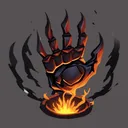

# { .gi .gi-title width="64" height="64" loading="lazy" } Hunger

**Where to play:** Discord
{ .where-to-play }

- **Class:** { .gi .gi-mention width="20" height="20" loading="lazy" }&nbsp;[Druid](../../../classes/druid.md)
- **Tree:** { .gi .gi-mention width="20" height="20" loading="lazy" }&nbsp;[Shape Shifting Skills](index.md)
- **Kind:** an attack
- **Learn it from:** level 24 (your rank)
- **Needs first:** { .gi .gi-mention width="20" height="20" loading="lazy" }&nbsp;[Fire Claws](fire-claws.md)
- **Opens:** no other skill
- **Weapon:** any
- **Mana:** 2 at rank 1, 40 at rank 20

> In the game: Attack an enemy, leeching both life and mana.

## How it works

- It hits the monster you selected.
- Life and mana steal give you their % of the damage dealt.
- It needs the Werewolf or Werebear shape: without it, the button makes the regular attack.
- Its physical damage rolls to hit ([your hit chance](../../../attributes-and-combat.md#hitting-and-missing)), and monsters can block it.
- It costs its mana once, when used. Without enough mana, or without the weapon or shape it needs, its button says **Attack** and makes the regular attack instead, for free.

## Checked in play

- After Werewolf, rank 1 steals 50% of its damage as life and as mana, for 2 mana.

## Rank by rank

What its skill screen shows at each rank. The battle uses exactly these numbers (checked at ranks 1 and 20). A skill takes at most 20 points; [skill points and resets](../../index.md).

| Rank | Life steal (%) | Mana steal (%) | Attack rating bonus (%) | Mana |
|---|---|---|---|---|
| 1 | 50 | 50 | 50 | 2 |
| 2 | 65 | 65 | 60 | 4 |
| 3 | 80 | 80 | 70 | 6 |
| 4 | 95 | 95 | 80 | 8 |
| 5 | 110 | 110 | 90 | 10 |
| 6 | 125 | 125 | 100 | 12 |
| 7 | 140 | 140 | 110 | 14 |
| 8 | 155 | 155 | 120 | 16 |
| 9 | 170 | 170 | 130 | 18 |
| 10 | 185 | 185 | 140 | 20 |
| 11 | 200 | 200 | 150 | 22 |
| 12 | 215 | 215 | 160 | 24 |
| 13 | 230 | 230 | 170 | 26 |
| 14 | 245 | 245 | 180 | 28 |
| 15 | 260 | 260 | 190 | 30 |
| 16 | 275 | 275 | 200 | 32 |
| 17 | 290 | 290 | 210 | 34 |
| 18 | 305 | 305 | 220 | 36 |
| 19 | 320 | 320 | 230 | 38 |
| 20 | 335 | 335 | 240 | 40 |
