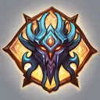

# { .gi .gi-title width="64" height="64" loading="lazy" } Heart of Wolverine

**Where to play:** Discord
{ .where-to-play }

- **Class:** { .gi .gi-mention width="20" height="20" loading="lazy" }&nbsp;[Druid](../../../classes/druid.md)
- **Tree:** { .gi .gi-mention width="20" height="20" loading="lazy" }&nbsp;[Summoning Skills](index.md)
- **Kind:** a passive skill
- **Learn it from:** level 18 (your rank)
- **Needs first:** { .gi .gi-mention width="20" height="20" loading="lazy" }&nbsp;[Oak Sage](oak-sage.md)
- **Opens:** { .gi .gi-mention width="20" height="20" loading="lazy" }&nbsp;[Spirit of Barbs](spirit-of-barbs.md)
- **Weapon:** any

> In the game: Adds lifesteal aura to your Oak Sage

## How it works

- Life and mana steal give you their % of the damage dealt.
- It's always on: nothing to select, no mana.

## Checked in play

- While your Oak Sage stands your hits steal 5% of their damage as life (62% at rank 20).

## Rank by rank

What its skill screen shows at each rank. A skill takes at most 20 points; [skill points and resets](../../index.md).

| Rank | Life steal (%) |
|---|---|
| 1 | 5 |
| 2 | 8 |
| 3 | 11 |
| 4 | 14 |
| 5 | 17 |
| 6 | 20 |
| 7 | 23 |
| 8 | 26 |
| 9 | 29 |
| 10 | 32 |
| 11 | 35 |
| 12 | 38 |
| 13 | 41 |
| 14 | 44 |
| 15 | 47 |
| 16 | 50 |
| 17 | 53 |
| 18 | 56 |
| 19 | 59 |
| 20 | 62 |
