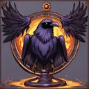
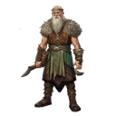
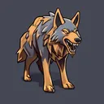

# { .gi .gi-title width="64" height="64" loading="lazy" } Raven

**Where to play:** Discord
{ .where-to-play }

- **Class:** { .gi .gi-mention width="20" height="20" loading="lazy" }&nbsp;[Druid](../../../classes/druid.md)
- **Tree:** { .gi .gi-mention width="20" height="20" loading="lazy" }&nbsp;[Summoning Skills](index.md)
- **Kind:** a summon, a spell
- **Learn it from:** level 1 (your rank)
- **Needs first:** no other skill
- **Opens:** { .gi .gi-mention width="20" height="20" loading="lazy" }&nbsp;[Summon Spirit Wolf](summon-spirit-wolf.md)
- **Weapon:** any
- **Mana:** 2 at rank 1, 2 at rank 20

> In the game: Summon Ravens to peck out the eyes of your enemies.

## How it works

- A minion fights at your side for its rounds.
- It costs its mana once, when used. Without enough mana, or without the weapon or shape it needs, its button says **Attack** and makes the regular attack instead, for free.

## Checked in play

- Ravens peck a monster each round with 2-3 physical (40-60 at rank 20), with your strength bonus, for 15 rounds (72); each cast adds one, up to 1 raven (3). A raven has 1 health and the monsters can't attack it. 2 mana.

## Rank by rank

What its skill screen shows at each rank. Its mana, rounds and number of minions are what the battle uses (checked at ranks 1 and 20). A skill takes at most 20 points; [skill points and resets](../../index.md).

| Rank | Physical damage | Raised at most | Rounds | Mana |
|---|---|---|---|---|
| 1 | 2-3 | 1 | 15 | 2 |
| 2 | 4-6 | 1 | 18 | 2 |
| 3 | 6-9 | 1 | 21 | 2 |
| 4 | 8-12 | 1 | 24 | 2 |
| 5 | 10-15 | 1 | 27 | 2 |
| 6 | 12-18 | 1 | 30 | 2 |
| 7 | 14-21 | 1 | 33 | 2 |
| 8 | 16-24 | 2 | 36 | 2 |
| 9 | 18-27 | 2 | 39 | 2 |
| 10 | 20-30 | 2 | 42 | 2 |
| 11 | 22-33 | 2 | 45 | 2 |
| 12 | 24-36 | 2 | 48 | 2 |
| 13 | 26-39 | 2 | 51 | 2 |
| 14 | 28-42 | 2 | 54 | 2 |
| 15 | 30-45 | 2 | 57 | 2 |
| 16 | 32-48 | 2 | 60 | 2 |
| 17 | 34-51 | 2 | 63 | 2 |
| 18 | 36-54 | 2 | 66 | 2 |
| 19 | 38-57 | 2 | 69 | 2 |
| 20 | 40-60 | 3 | 72 | 2 |
