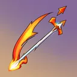

# { .gi .gi-title width="64" height="64" loading="lazy" } Fire Arrow

**Where to play:** Discord
{ .where-to-play }

- **Class:** { .gi .gi-mention width="20" height="20" loading="lazy" }&nbsp;[Hunter](../../../classes/hunter.md)
- **Tree:** { .gi .gi-mention width="20" height="20" loading="lazy" }&nbsp;[Bow and Crossbow Skills](index.md)
- **Kind:** an attack
- **Learn it from:** level 1 (your rank)
- **Needs first:** no other skill
- **Opens:** { .gi .gi-mention width="20" height="20" loading="lazy" }&nbsp;[Exploding Arrow](exploding-arrow.md)
- **Weapon:** [a bow](../../../gear-and-crafting.md#weapons-that-skills-need)
- **Mana:** 3 at rank 1, 3 at rank 20

> In the game: Enchants an arrow with fire, allowing it to deal additional magic damage.

## How it works

- It hits the monster you selected.
- Its fire damage never misses: only physical attacks roll to hit.
- It costs its mana once, when used. Without enough mana, or without the weapon or shape it needs, its button says **Attack** and makes the regular attack instead, for free.

## Checked in play

- Your arrow plus its fire, at its damage bonus, on the monster you selected: +3% and 3-5 fire at rank 1, +41% and 60-100 at rank 20. 3 mana.

## Rank by rank

What its skill screen shows at each rank. The battle uses exactly these numbers (checked at ranks 1 and 20). A skill takes at most 20 points; 💥&nbsp;[skill points and resets](../../index.md).

| Rank | Fire damage | Attack rating bonus (%) | Damage bonus (%) | Mana |
|---|---|---|---|---|
| 1 | 3-5 | 10 | 3 | 3 |
| 2 | 6-10 | 19 | 5 | 3 |
| 3 | 9-15 | 28 | 7 | 3 |
| 4 | 12-20 | 37 | 9 | 3 |
| 5 | 15-25 | 46 | 11 | 3 |
| 6 | 18-30 | 55 | 13 | 3 |
| 7 | 21-35 | 64 | 15 | 3 |
| 8 | 24-40 | 73 | 17 | 3 |
| 9 | 27-45 | 82 | 19 | 3 |
| 10 | 30-50 | 91 | 21 | 3 |
| 11 | 33-55 | 100 | 23 | 3 |
| 12 | 36-60 | 109 | 25 | 3 |
| 13 | 39-65 | 118 | 27 | 3 |
| 14 | 42-70 | 127 | 29 | 3 |
| 15 | 45-75 | 136 | 31 | 3 |
| 16 | 48-80 | 145 | 33 | 3 |
| 17 | 51-85 | 154 | 35 | 3 |
| 18 | 54-90 | 163 | 37 | 3 |
| 19 | 57-95 | 172 | 39 | 3 |
| 20 | 60-100 | 181 | 41 | 3 |
