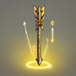
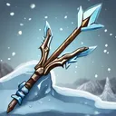
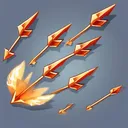
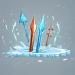

# { .gi .gi-title width="64" height="64" loading="lazy" } Guided Arrow

**Where to play:** Discord
{ .where-to-play }

- **Class:** { .gi .gi-mention width="20" height="20" loading="lazy" }&nbsp;[Hunter](../../../classes/hunter.md)
- **Tree:** { .gi .gi-mention width="20" height="20" loading="lazy" }&nbsp;[Bow and Crossbow Skills](index.md)
- **Kind:** a chain attack
- **Learn it from:** level 18 (your rank)
- **Needs first:** { .gi .gi-mention width="20" height="20" loading="lazy" }&nbsp;[Cold Arrow](cold-arrow.md), { .gi .gi-mention width="20" height="20" loading="lazy" }&nbsp;[Multiple Shot](multiple-shot.md)
- **Opens:** { .gi .gi-mention width="20" height="20" loading="lazy" }&nbsp;[Strafe](strafe.md), { .gi .gi-mention width="20" height="20" loading="lazy" }&nbsp;[Freezing Arrow](freezing-arrow.md)
- **Weapon:** [a bow](../../../gear-and-crafting.md#weapons-that-skills-need)
- **Mana:** 3 at rank 1, 9 at rank 20

> In the game: Imbues an arrow with the ability to seek its nearest target.

## How it works

- "targets N" hits N times, hopping between the monsters.
- Its physical damage rolls to hit ([your hit chance](../../../attributes-and-combat.md#hitting-and-missing)), and monsters can block it.
- It costs its mana once, when used. Without enough mana, or without the weapon or shape it needs, its button says **Attack** and makes the regular attack instead, for free.

## Checked in play

- Rank 1 ("targets 4") hits 4 times.

## Rank by rank

What its skill screen shows at each rank. The battle uses exactly these numbers (checked at ranks 1 and 20). A skill takes at most 20 points; [skill points and resets](../../index.md).

| Rank | Targets | Damage bonus (%) | Mana |
|---|---|---|---|
| 1 | 4 | -18 | 3 |
| 2 | 4 | -11 | 3 |
| 3 | 5 | -4 | 4 |
| 4 | 5 | 3 | 4 |
| 5 | 5 | 10 | 4 |
| 6 | 6 | 17 | 5 |
| 7 | 6 | 24 | 5 |
| 8 | 6 | 31 | 5 |
| 9 | 6 | 38 | 5 |
| 10 | 7 | 45 | 6 |
| 11 | 7 | 52 | 6 |
| 12 | 7 | 59 | 6 |
| 13 | 8 | 66 | 7 |
| 14 | 8 | 73 | 7 |
| 15 | 8 | 80 | 7 |
| 16 | 9 | 87 | 8 |
| 17 | 9 | 94 | 8 |
| 18 | 9 | 101 | 8 |
| 19 | 9 | 108 | 8 |
| 20 | 10 | 115 | 9 |
