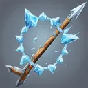

# { .gi .gi-title width="64" height="64" loading="lazy" } Ice Arrow

**Where to play:** Discord
{ .where-to-play }

- **Class:** { .gi .gi-mention width="20" height="20" loading="lazy" }&nbsp;[Hunter](../../../classes/hunter.md)
- **Tree:** { .gi .gi-mention width="20" height="20" loading="lazy" }&nbsp;[Bow and Crossbow Skills](index.md)
- **Kind:** an attack
- **Learn it from:** level 18 (your rank)
- **Needs first:** { .gi .gi-mention width="20" height="20" loading="lazy" }&nbsp;[Cold Arrow](cold-arrow.md)
- **Opens:** { .gi .gi-mention width="20" height="20" loading="lazy" }&nbsp;[Freezing Arrow](freezing-arrow.md)
- **Weapon:** [a bow](../../../gear-and-crafting.md#weapons-that-skills-need)
- **Mana:** 3 at rank 1, 3 at rank 20

> In the game: Arrows have additional cold damage and momentarily freeze the target

## How it works

- It hits the monster you selected.
- Its cold damage never misses: only physical attacks roll to hit.
- It costs its mana once, when used. Without enough mana, or without the weapon or shape it needs, its button says **Attack** and makes the regular attack instead, for free.

## Checked in play

- Your arrow plus its cold (6-10 at rank 1, 120-124 at rank 20); a freezing hit (20%, 77% at rank 20) freezes the monster for 2 rounds (6), the round it lands included. 3 mana.

## Rank by rank

What its skill screen shows at each rank. The battle uses exactly these numbers (checked at ranks 1 and 20). A skill takes at most 20 points; 💥&nbsp;[skill points and resets](../../index.md).

| Rank | Cold damage | Attack rating bonus (%) | Freeze chance (%) | Rounds | Mana |
|---|---|---|---|---|---|
| 1 | 6-10 | 20 | 20 | 2 | 3 |
| 2 | 12-16 | 29 | 23 | 2 | 3 |
| 3 | 18-22 | 38 | 26 | 2 | 3 |
| 4 | 24-28 | 47 | 29 | 3 | 3 |
| 5 | 30-34 | 56 | 32 | 3 | 3 |
| 6 | 36-40 | 65 | 35 | 3 | 3 |
| 7 | 42-46 | 74 | 38 | 3 | 3 |
| 8 | 48-52 | 83 | 41 | 3 | 3 |
| 9 | 54-58 | 92 | 44 | 4 | 3 |
| 10 | 60-64 | 101 | 47 | 4 | 3 |
| 11 | 66-70 | 110 | 50 | 4 | 3 |
| 12 | 72-76 | 119 | 53 | 4 | 3 |
| 13 | 78-82 | 128 | 56 | 4 | 3 |
| 14 | 84-88 | 137 | 59 | 5 | 3 |
| 15 | 90-94 | 146 | 62 | 5 | 3 |
| 16 | 96-100 | 155 | 65 | 5 | 3 |
| 17 | 102-106 | 164 | 68 | 5 | 3 |
| 18 | 108-112 | 173 | 71 | 5 | 3 |
| 19 | 114-118 | 182 | 74 | 6 | 3 |
| 20 | 120-124 | 191 | 77 | 6 | 3 |
