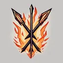

# { .gi .gi-title width="64" height="64" loading="lazy" } Bow and Crossbow Skills

**Where to play:** Discord
{ .where-to-play }

A [Hunter](../../../classes/hunter.md) skill tree ([all Hunter skills](../index.md)): every skill at rank 1 and rank 20.

| Skill | Level | Kind | Rank 1 | Rank 20 | Needs |
|---|---|---|---|---|---|
| { .gi .gi-inline width="24" height="24" loading="lazy" } [Magic Arrow](magic-arrow.md) | 1 | attack | magic damage 2-5, attack rating bonus 10%, damage bonus 10%, mana 2 | magic damage 40-100, attack rating bonus 181%, damage bonus 105%, mana 0 | a bow |
| { .gi .gi-inline width="24" height="24" loading="lazy" } [Fire Arrow](fire-arrow.md) | 1 | attack | fire damage 3-5, attack rating bonus 10%, damage bonus 3%, mana 3 | fire damage 60-100, attack rating bonus 181%, damage bonus 41%, mana 3 | a bow |
| { .gi .gi-inline width="24" height="24" loading="lazy" } [Cold Arrow](cold-arrow.md) | 6 | attack | cold damage 1-1, attack rating bonus 10%, damage bonus 3%, freeze chance 15%, rounds 2, mana 3 | cold damage 20-20, attack rating bonus 181%, damage bonus 41%, freeze chance 72%, rounds 12, mana 3 | a bow |
| { .gi .gi-inline width="24" height="24" loading="lazy" } [Multiple Shot](multiple-shot.md) | 6 | area | damage bonus -45%, mana 2 | damage bonus 240%, mana 2 | a bow, [Magic Arrow](magic-arrow.md) |
| { .gi .gi-inline width="24" height="24" loading="lazy" } [Exploding Arrow](exploding-arrow.md) | 12 | explodes | fire damage 10-15, damage bonus -30%, mana 2 | fire damage 124-186, damage bonus 122%, mana 2 | a bow, [Fire Arrow](fire-arrow.md) |
| { .gi .gi-inline width="24" height="24" loading="lazy" } [Ice Arrow](ice-arrow.md) | 18 | attack | cold damage 6-10, attack rating bonus 20%, freeze chance 20%, rounds 2, mana 3 | cold damage 120-124, attack rating bonus 191%, freeze chance 77%, rounds 6, mana 3 | a bow, [Cold Arrow](cold-arrow.md) |
| { .gi .gi-inline width="24" height="24" loading="lazy" } [Guided Arrow](guided-arrow.md) | 18 | chain | targets 4, damage bonus -18%, mana 3 | targets 10, damage bonus 115%, mana 9 | a bow, [Cold Arrow](cold-arrow.md), [Multiple Shot](multiple-shot.md) |
| { .gi .gi-inline width="24" height="24" loading="lazy" } [Strafe](strafe.md) | 24 | attack | volley 3, damage bonus 5%, attack rating bonus 30%, mana 2 | volley 11, damage bonus 100%, attack rating bonus 125%, mana 2 | a bow, [Guided Arrow](guided-arrow.md) |
| { .gi .gi-inline width="24" height="24" loading="lazy" } [Immolation Arrow](immolation-arrow.md) | 24 | attack | fire damage 20-20, burn damage 13-25, rounds 2, mana 2 | fire damage 115-115, burn damage 260-272, rounds 8, mana 2 | a bow, [Exploding Arrow](exploding-arrow.md) |
| { .gi .gi-inline width="24" height="24" loading="lazy" } [Freezing Arrow](freezing-arrow.md) | 30 | explodes | cold damage 40-50, attack rating bonus 40%, freeze chance 40%, rounds 2, mana 3 | cold damage 230-240, attack rating bonus 211%, freeze chance 78%, rounds 6, mana 3 | a bow, [Guided Arrow](guided-arrow.md), [Ice Arrow](ice-arrow.md) |
