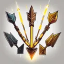

# { .gi .gi-title width="64" height="64" loading="lazy" } Strafe

**Where to play:** Discord
{ .where-to-play }

- **Class:** [Hunter](../../../classes/hunter.md)
- **Tree:** [Bow and Crossbow Skills](index.md)
- **Kind:** an attack
- **Learn it from:** level 24 (your rank)
- **Needs first:** [Guided Arrow](guided-arrow.md)
- **Opens:** no other skill
- **Weapon:** [a bow](../../../gear-and-crafting.md#weapons-that-skills-need)
- **Mana:** 2 at rank 1, 2 at rank 20

> In the game: Fires a volley of arrows at multiple targets.

## How it works

- It shoots a volley: "volley N" is N hits, the first on the monster you selected, the others on random living monsters.
- Its physical damage rolls to hit ([your hit chance](../../../attributes-and-combat.md#hitting-and-missing)), and monsters can block it.
- It costs its mana once, when used. Without enough mana, or without the weapon or shape it needs, its button says **Attack** and makes the regular attack instead, for free.

## Checked in play

- Rank 1 shoots 3 arrows, each with its +5% damage, after the first on random living monsters.

## Rank by rank

What its skill screen shows at each rank. The battle uses exactly these numbers (checked at ranks 1 and 20). A skill takes at most 20 points; [skill points and resets](../../index.md).

| Rank | Volley | Damage bonus (%) | Attack rating bonus (%) | Mana |
|---|---|---|---|---|
| 1 | 3 | 5 | 30 | 2 |
| 2 | 3 | 10 | 35 | 2 |
| 3 | 4 | 15 | 40 | 2 |
| 4 | 4 | 20 | 45 | 2 |
| 5 | 5 | 25 | 50 | 2 |
| 6 | 5 | 30 | 55 | 2 |
| 7 | 5 | 35 | 60 | 2 |
| 8 | 6 | 40 | 65 | 2 |
| 9 | 6 | 45 | 70 | 2 |
| 10 | 7 | 50 | 75 | 2 |
| 11 | 7 | 55 | 80 | 2 |
| 12 | 7 | 60 | 85 | 2 |
| 13 | 8 | 65 | 90 | 2 |
| 14 | 8 | 70 | 95 | 2 |
| 15 | 9 | 75 | 100 | 2 |
| 16 | 9 | 80 | 105 | 2 |
| 17 | 9 | 85 | 110 | 2 |
| 18 | 10 | 90 | 115 | 2 |
| 19 | 10 | 95 | 120 | 2 |
| 20 | 11 | 100 | 125 | 2 |
