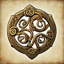
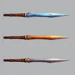
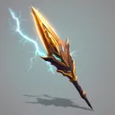

# { .gi .gi-title width="64" height="64" loading="lazy" } Hunter skills

**Where to play:** Discord
{ .where-to-play }

The [Hunter](../../classes/hunter.md)'s three trees, every skill at rank 1 and rank 20 (mana is the cost when used). Each name leads to the skill's page.

| Tree | Skill | Level | Kind | Rank 1 | Rank 20 | Needs |
|---|---|---|---|---|---|---|
| [Bow and Crossbow Skills](bow-and-crossbow-skills/index.md) | { .gi .gi-inline width="24" height="24" loading="lazy" } [Magic Arrow](bow-and-crossbow-skills/magic-arrow.md) | 1 | attack | magic damage 2-5, attack rating bonus 10%, damage bonus 10%, mana 2 | magic damage 40-100, attack rating bonus 181%, damage bonus 105%, mana 0 | a bow |
| [Bow and Crossbow Skills](bow-and-crossbow-skills/index.md) | { .gi .gi-inline width="24" height="24" loading="lazy" } [Fire Arrow](bow-and-crossbow-skills/fire-arrow.md) | 1 | attack | fire damage 3-5, attack rating bonus 10%, damage bonus 3%, mana 3 | fire damage 60-100, attack rating bonus 181%, damage bonus 41%, mana 3 | a bow |
| [Bow and Crossbow Skills](bow-and-crossbow-skills/index.md) | { .gi .gi-inline width="24" height="24" loading="lazy" } [Cold Arrow](bow-and-crossbow-skills/cold-arrow.md) | 6 | attack | cold damage 1-1, attack rating bonus 10%, damage bonus 3%, freeze chance 15%, rounds 2, mana 3 | cold damage 20-20, attack rating bonus 181%, damage bonus 41%, freeze chance 72%, rounds 12, mana 3 | a bow |
| [Bow and Crossbow Skills](bow-and-crossbow-skills/index.md) | { .gi .gi-inline width="24" height="24" loading="lazy" } [Multiple Shot](bow-and-crossbow-skills/multiple-shot.md) | 6 | area | damage bonus -45%, mana 2 | damage bonus 240%, mana 2 | a bow, [Magic Arrow](bow-and-crossbow-skills/magic-arrow.md) |
| [Bow and Crossbow Skills](bow-and-crossbow-skills/index.md) | { .gi .gi-inline width="24" height="24" loading="lazy" } [Exploding Arrow](bow-and-crossbow-skills/exploding-arrow.md) | 12 | explodes | fire damage 10-15, damage bonus -30%, mana 2 | fire damage 124-186, damage bonus 122%, mana 2 | a bow, [Fire Arrow](bow-and-crossbow-skills/fire-arrow.md) |
| [Bow and Crossbow Skills](bow-and-crossbow-skills/index.md) | { .gi .gi-inline width="24" height="24" loading="lazy" } [Ice Arrow](bow-and-crossbow-skills/ice-arrow.md) | 18 | attack | cold damage 6-10, attack rating bonus 20%, freeze chance 20%, rounds 2, mana 3 | cold damage 120-124, attack rating bonus 191%, freeze chance 77%, rounds 6, mana 3 | a bow, [Cold Arrow](bow-and-crossbow-skills/cold-arrow.md) |
| [Bow and Crossbow Skills](bow-and-crossbow-skills/index.md) | { .gi .gi-inline width="24" height="24" loading="lazy" } [Guided Arrow](bow-and-crossbow-skills/guided-arrow.md) | 18 | chain | targets 4, damage bonus -18%, mana 3 | targets 10, damage bonus 115%, mana 9 | a bow, [Cold Arrow](bow-and-crossbow-skills/cold-arrow.md), [Multiple Shot](bow-and-crossbow-skills/multiple-shot.md) |
| [Bow and Crossbow Skills](bow-and-crossbow-skills/index.md) | { .gi .gi-inline width="24" height="24" loading="lazy" } [Strafe](bow-and-crossbow-skills/strafe.md) | 24 | attack | volley 3, damage bonus 5%, attack rating bonus 30%, mana 2 | volley 11, damage bonus 100%, attack rating bonus 125%, mana 2 | a bow, [Guided Arrow](bow-and-crossbow-skills/guided-arrow.md) |
| [Bow and Crossbow Skills](bow-and-crossbow-skills/index.md) | { .gi .gi-inline width="24" height="24" loading="lazy" } [Immolation Arrow](bow-and-crossbow-skills/immolation-arrow.md) | 24 | attack | fire damage 20-20, burn damage 13-25, rounds 2, mana 2 | fire damage 115-115, burn damage 260-272, rounds 8, mana 2 | a bow, [Exploding Arrow](bow-and-crossbow-skills/exploding-arrow.md) |
| [Bow and Crossbow Skills](bow-and-crossbow-skills/index.md) | { .gi .gi-inline width="24" height="24" loading="lazy" } [Freezing Arrow](bow-and-crossbow-skills/freezing-arrow.md) | 30 | explodes | cold damage 40-50, attack rating bonus 40%, freeze chance 40%, rounds 2, mana 3 | cold damage 230-240, attack rating bonus 211%, freeze chance 78%, rounds 6, mana 3 | a bow, [Guided Arrow](bow-and-crossbow-skills/guided-arrow.md), [Ice Arrow](bow-and-crossbow-skills/ice-arrow.md) |
| [Passive and Magic Skills](passive-and-magic-skills/index.md) | { .gi .gi-inline width="24" height="24" loading="lazy" } [Inner Sight](passive-and-magic-skills/inner-sight.md) | 1 | area debuff | lowers armor by 40, rounds 4, mana 2 | lowers armor by 325, rounds 12, mana 2 |  |
| [Passive and Magic Skills](passive-and-magic-skills/index.md) | { .gi .gi-inline width="24" height="24" loading="lazy" } [Critical Strike](passive-and-magic-skills/critical-strike.md) | 1 | passive | critical strike 10% | critical strike 67% |  |
| [Passive and Magic Skills](passive-and-magic-skills/index.md) | { .gi .gi-inline width="24" height="24" loading="lazy" } [Dodge](passive-and-magic-skills/dodge.md) | 6 | passive | dodge 5% | dodge 43% |  |
| [Passive and Magic Skills](passive-and-magic-skills/index.md) | { .gi .gi-inline width="24" height="24" loading="lazy" } [Slow Missiles](passive-and-magic-skills/slow-missiles.md) | 12 | buff | less missile damage 5%, rounds 6, mana 2 | less missile damage 43%, rounds 44, mana 2 | [Inner Sight](passive-and-magic-skills/inner-sight.md) |
| [Passive and Magic Skills](passive-and-magic-skills/index.md) | { .gi .gi-inline width="24" height="24" loading="lazy" } [Avoid](passive-and-magic-skills/avoid.md) | 12 | passive | avoid missiles 5% | avoid missiles 43% | [Dodge](passive-and-magic-skills/dodge.md) |
| [Passive and Magic Skills](passive-and-magic-skills/index.md) | { .gi .gi-inline width="24" height="24" loading="lazy" } [Penetrate](passive-and-magic-skills/penetrate.md) | 18 | passive | attack rating bonus 35% | attack rating bonus 225% | [Critical Strike](passive-and-magic-skills/critical-strike.md) |
| [Passive and Magic Skills](passive-and-magic-skills/index.md) | { .gi .gi-inline width="24" height="24" loading="lazy" } [Decoy](passive-and-magic-skills/decoy.md) | 24 | summon | health bonus -30%, rounds 10, mana 2 | health bonus 65%, rounds 48, mana 2 | [Slow Missiles](passive-and-magic-skills/slow-missiles.md) |
| [Passive and Magic Skills](passive-and-magic-skills/index.md) | { .gi .gi-inline width="24" height="24" loading="lazy" } [Evade](passive-and-magic-skills/evade.md) | 24 | passive | dodge 3%, avoid missiles 3% | dodge 22%, avoid missiles 22% | [Avoid](passive-and-magic-skills/avoid.md) |
| [Passive and Magic Skills](passive-and-magic-skills/index.md) | { .gi .gi-inline width="24" height="24" loading="lazy" } [Valkyrie](passive-and-magic-skills/valkyrie.md) | 30 | summon | health 528, damage bonus 0%, attack rating bonus 40%, armor bonus 0%, rounds 6, mana 2 | health 2200, damage bonus 475%, attack rating bonus 800%, armor bonus 190%, rounds 44, mana 40 | [Evade](passive-and-magic-skills/evade.md), [Decoy](passive-and-magic-skills/decoy.md) |
| [Passive and Magic Skills](passive-and-magic-skills/index.md) | { .gi .gi-inline width="24" height="24" loading="lazy" } [Pierce](passive-and-magic-skills/pierce.md) | 30 | passive | pierce 20% | pierce 58% | [Penetrate](passive-and-magic-skills/penetrate.md) |
| [Javelin and Spear Skills](javelin-and-spear-skills/index.md) | { .gi .gi-inline width="24" height="24" loading="lazy" } [Jab](javelin-and-spear-skills/jab.md) | 1 | attack | volley 3, damage bonus -15%, attack rating bonus 10%, mana 2 | volley 3, damage bonus 42%, attack rating bonus 181%, mana 40 | a javelin, a spear or javelin |
| [Javelin and Spear Skills](javelin-and-spear-skills/index.md) | { .gi .gi-inline width="24" height="24" loading="lazy" } [Power Strike](javelin-and-spear-skills/power-strike.md) | 6 | attack | lightning damage 1-16, attack rating bonus 20%, mana 2 | lightning damage 1-358, attack rating bonus 248%, mana 40 | a javelin, a spear or javelin, [Jab](javelin-and-spear-skills/jab.md) |
| [Javelin and Spear Skills](javelin-and-spear-skills/index.md) | { .gi .gi-inline width="24" height="24" loading="lazy" } [Poison Javelin](javelin-and-spear-skills/poison-javelin.md) | 6 | attack | poison damage 25-37, mana 2 | poison damage 424-512, mana 40 | a javelin, a throwing weapon |
| [Javelin and Spear Skills](javelin-and-spear-skills/index.md) | { .gi .gi-inline width="24" height="24" loading="lazy" } [Impale](javelin-and-spear-skills/impale.md) | 12 | attack | damage bonus 300%, critical strike 5%, mana 2 | damage bonus 775%, critical strike 43%, mana 40 | a javelin, a spear or javelin, [Jab](javelin-and-spear-skills/jab.md) |
| [Javelin and Spear Skills](javelin-and-spear-skills/index.md) | { .gi .gi-inline width="24" height="24" loading="lazy" } [Lightning Bolt](javelin-and-spear-skills/lightning-bolt.md) | 12 | attack | lightning damage 1-40, mana 2 | lightning damage 1-610, mana 40 | a javelin, a throwing weapon, [Poison Javelin](javelin-and-spear-skills/poison-javelin.md) |
| [Javelin and Spear Skills](javelin-and-spear-skills/index.md) | { .gi .gi-inline width="24" height="24" loading="lazy" } [Charged Strike](javelin-and-spear-skills/charged-strike.md) | 18 | explodes | lightning damage 1-30, mana 2 | lightning damage 1-334, mana 40 | a javelin, a spear or javelin, [Lightning Bolt](javelin-and-spear-skills/lightning-bolt.md), [Power Strike](javelin-and-spear-skills/power-strike.md) |
| [Javelin and Spear Skills](javelin-and-spear-skills/index.md) | { .gi .gi-inline width="24" height="24" loading="lazy" } [Plague Javelin](javelin-and-spear-skills/plague-javelin.md) | 18 | explodes | poison damage 23-37, attack rating bonus 30%, mana 2 | poison damage 384-455, attack rating bonus 201%, mana 40 | a javelin, a throwing weapon, [Lightning Bolt](javelin-and-spear-skills/lightning-bolt.md) |
| [Javelin and Spear Skills](javelin-and-spear-skills/index.md) | { .gi .gi-inline width="24" height="24" loading="lazy" } [Fend](javelin-and-spear-skills/fend.md) | 24 | area | damage bonus 70%, attack rating bonus 40%, mana 2 | damage bonus 260%, attack rating bonus 230%, mana 40 | a javelin, a spear or javelin, [Impale](javelin-and-spear-skills/impale.md) |
| [Javelin and Spear Skills](javelin-and-spear-skills/index.md) | { .gi .gi-inline width="24" height="24" loading="lazy" } [Lightning Strike](javelin-and-spear-skills/lightning-strike.md) | 30 | chain | targets 2, lightning damage 1-25, mana 2 | targets 10, lightning damage 1-310, mana 40 | a javelin, a spear or javelin, [Charged Strike](javelin-and-spear-skills/charged-strike.md) |
| [Javelin and Spear Skills](javelin-and-spear-skills/index.md) | { .gi .gi-inline width="24" height="24" loading="lazy" } [Lightning Fury](javelin-and-spear-skills/lightning-fury.md) | 30 | area | lightning damage 1-60, mana 2 | lightning damage 1-725, mana 40 | a javelin, a throwing weapon, [Plague Javelin](javelin-and-spear-skills/plague-javelin.md) |
