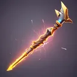

# { .gi .gi-title width="64" height="64" loading="lazy" } Charged Strike

**Where to play:** Discord
{ .where-to-play }

- **Class:** [Hunter](../../../classes/hunter.md)
- **Tree:** [Javelin and Spear Skills](index.md)
- **Kind:** an exploding attack
- **Learn it from:** level 18 (your rank)
- **Needs first:** [Lightning Bolt](lightning-bolt.md), [Power Strike](power-strike.md)
- **Opens:** [Lightning Strike](lightning-strike.md)
- **Weapon:** [a javelin and a spear or javelin](../../../gear-and-crafting.md#weapons-that-skills-need)
- **Mana:** 2 at rank 1, 40 at rank 20

> In the game: Upon striking an enemy, the Hunter's Javelin explodes with Lightning Damage.

## How it works

- It explodes: the monster it hits takes the hit and the explosion, its neighbours the explosion.
- Its physical damage rolls to hit ([your hit chance](../../../attributes-and-combat.md#hitting-and-missing)), and monsters can block it.
- It costs its mana once, when used. Without enough mana, or without the weapon or shape it needs, its button says **Attack** and makes the regular attack instead, for free.

## Rank by rank

What its skill screen shows at each rank. The battle uses exactly these numbers (checked at ranks 1 and 20). A skill takes at most 20 points; [skill points and resets](../../index.md).

| Rank | Lightning damage | Mana |
|---|---|---|
| 1 | 1-30 | 2 |
| 2 | 1-46 | 4 |
| 3 | 1-62 | 6 |
| 4 | 1-78 | 8 |
| 5 | 1-94 | 10 |
| 6 | 1-110 | 12 |
| 7 | 1-126 | 14 |
| 8 | 1-142 | 16 |
| 9 | 1-158 | 18 |
| 10 | 1-174 | 20 |
| 11 | 1-190 | 22 |
| 12 | 1-206 | 24 |
| 13 | 1-222 | 26 |
| 14 | 1-238 | 28 |
| 15 | 1-254 | 30 |
| 16 | 1-270 | 32 |
| 17 | 1-286 | 34 |
| 18 | 1-302 | 36 |
| 19 | 1-318 | 38 |
| 20 | 1-334 | 40 |
