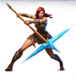

# { .gi .gi-title width="64" height="64" loading="lazy" } Fend

**Where to play:** Discord
{ .where-to-play }

- **Class:** { .gi .gi-mention width="20" height="20" loading="lazy" }&nbsp;[Hunter](../../../classes/hunter.md)
- **Tree:** { .gi .gi-mention width="20" height="20" loading="lazy" }&nbsp;[Javelin and Spear Skills](index.md)
- **Kind:** an area attack
- **Learn it from:** level 24 (your rank)
- **Needs first:** { .gi .gi-mention width="20" height="20" loading="lazy" }&nbsp;[Impale](impale.md)
- **Opens:** no other skill
- **Weapon:** [a javelin and a spear or javelin](../../../gear-and-crafting.md#weapons-that-skills-need)
- **Mana:** 2 at rank 1, 40 at rank 20

> In the game: strikes all enemy targets.

## How it works

- It hits every monster.
- Its physical damage rolls to hit ([your hit chance](../../../attributes-and-combat.md#hitting-and-missing)), and monsters can block it.
- It costs its mana once, when used. Without enough mana, or without the weapon or shape it needs, its button says **Attack** and makes the regular attack instead, for free.

## Checked in play

- Every monster takes your thrust at its damage bonus: +70% at rank 1, +260% at rank 20. 2 mana, 40 at rank 20.

## Rank by rank

What its skill screen shows at each rank. The battle uses exactly these numbers (checked at ranks 1 and 20). A skill takes at most 20 points; [skill points and resets](../../index.md).

| Rank | Damage bonus (%) | Attack rating bonus (%) | Mana |
|---|---|---|---|
| 1 | 70 | 40 | 2 |
| 2 | 80 | 50 | 4 |
| 3 | 90 | 60 | 6 |
| 4 | 100 | 70 | 8 |
| 5 | 110 | 80 | 10 |
| 6 | 120 | 90 | 12 |
| 7 | 130 | 100 | 14 |
| 8 | 140 | 110 | 16 |
| 9 | 150 | 120 | 18 |
| 10 | 160 | 130 | 20 |
| 11 | 170 | 140 | 22 |
| 12 | 180 | 150 | 24 |
| 13 | 190 | 160 | 26 |
| 14 | 200 | 170 | 28 |
| 15 | 210 | 180 | 30 |
| 16 | 220 | 190 | 32 |
| 17 | 230 | 200 | 34 |
| 18 | 240 | 210 | 36 |
| 19 | 250 | 220 | 38 |
| 20 | 260 | 230 | 40 |
