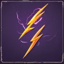

# { .gi .gi-title width="64" height="64" loading="lazy" } Lightning Bolt

**Where to play:** Discord
{ .where-to-play }

- **Class:** [Hunter](../../../classes/hunter.md)
- **Tree:** [Javelin and Spear Skills](index.md)
- **Kind:** an attack
- **Learn it from:** level 12 (your rank)
- **Needs first:** [Poison Javelin](poison-javelin.md)
- **Opens:** [Charged Strike](charged-strike.md), [Plague Javelin](plague-javelin.md)
- **Weapon:** [a javelin and a throwing weapon](../../../gear-and-crafting.md#weapons-that-skills-need)
- **Mana:** 2 at rank 1, 40 at rank 20

> In the game: Causes a thrown javelin to deal lightning damage.

## How it works

- It hits the monster you selected.
- Its lightning damage never misses: only physical attacks roll to hit.
- It costs its mana once, when used. Without enough mana, or without the weapon or shape it needs, its button says **Attack** and makes the regular attack instead, for free.

## Rank by rank

What its skill screen shows at each rank. The battle uses exactly these numbers (checked at ranks 1 and 20). A skill takes at most 20 points; [skill points and resets](../../index.md).

| Rank | Lightning damage | Mana |
|---|---|---|
| 1 | 1-40 | 2 |
| 2 | 1-70 | 4 |
| 3 | 1-100 | 6 |
| 4 | 1-130 | 8 |
| 5 | 1-160 | 10 |
| 6 | 1-190 | 12 |
| 7 | 1-220 | 14 |
| 8 | 1-250 | 16 |
| 9 | 1-280 | 18 |
| 10 | 1-310 | 20 |
| 11 | 1-340 | 22 |
| 12 | 1-370 | 24 |
| 13 | 1-400 | 26 |
| 14 | 1-430 | 28 |
| 15 | 1-460 | 30 |
| 16 | 1-490 | 32 |
| 17 | 1-520 | 34 |
| 18 | 1-550 | 36 |
| 19 | 1-580 | 38 |
| 20 | 1-610 | 40 |
