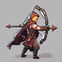
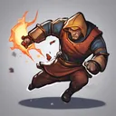
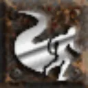

# { .gi .gi-title width="64" height="64" loading="lazy" } Avoid

**Where to play:** Discord
{ .where-to-play }

- **Class:** { .gi .gi-mention width="20" height="20" loading="lazy" }&nbsp;[Hunter](../../../classes/hunter.md)
- **Tree:** { .gi .gi-mention width="20" height="20" loading="lazy" }&nbsp;[Passive and Magic Skills](index.md)
- **Kind:** a passive skill
- **Learn it from:** level 12 (your rank)
- **Needs first:** { .gi .gi-mention width="20" height="20" loading="lazy" }&nbsp;[Dodge](dodge.md)
- **Opens:** { .gi .gi-mention width="20" height="20" loading="lazy" }&nbsp;[Evade](evade.md)
- **Weapon:** any

> In the game: Grants a chance to move out of the way of a missile attacks

## How it works

- It's always on: nothing to select, no mana.
- What it adds to your character is what its screen shows (checked at ranks 1 and 20).

## Rank by rank

What its skill screen shows at each rank. A skill takes at most 20 points; [skill points and resets](../../index.md).

| Rank | Avoid missiles (%) |
|---|---|
| 1 | 5 |
| 2 | 7 |
| 3 | 9 |
| 4 | 11 |
| 5 | 13 |
| 6 | 15 |
| 7 | 17 |
| 8 | 19 |
| 9 | 21 |
| 10 | 23 |
| 11 | 25 |
| 12 | 27 |
| 13 | 29 |
| 14 | 31 |
| 15 | 33 |
| 16 | 35 |
| 17 | 37 |
| 18 | 39 |
| 19 | 41 |
| 20 | 43 |
