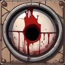

# { .gi .gi-title width="64" height="64" loading="lazy" } Pierce

**Where to play:** Discord
{ .where-to-play }

- **Class:** { .gi .gi-mention width="20" height="20" loading="lazy" }&nbsp;[Hunter](../../../classes/hunter.md)
- **Tree:** { .gi .gi-mention width="20" height="20" loading="lazy" }&nbsp;[Passive and Magic Skills](index.md)
- **Kind:** a passive skill
- **Learn it from:** level 30 (your rank)
- **Needs first:** { .gi .gi-mention width="20" height="20" loading="lazy" }&nbsp;[Penetrate](penetrate.md)
- **Opens:** no other skill
- **Weapon:** any

> In the game: Grants a chance for your missile attacks to continue through its victim.

## How it works

- It's always on: nothing to select, no mana.
- What it adds to your character is what its screen shows (checked at ranks 1 and 20).

## Rank by rank

What its skill screen shows at each rank. A skill takes at most 20 points; [skill points and resets](../../index.md).

| Rank | Pierce (%) |
|---|---|
| 1 | 20 |
| 2 | 22 |
| 3 | 24 |
| 4 | 26 |
| 5 | 28 |
| 6 | 30 |
| 7 | 32 |
| 8 | 34 |
| 9 | 36 |
| 10 | 38 |
| 11 | 40 |
| 12 | 42 |
| 13 | 44 |
| 14 | 46 |
| 15 | 48 |
| 16 | 50 |
| 17 | 52 |
| 18 | 54 |
| 19 | 56 |
| 20 | 58 |
