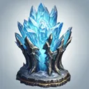
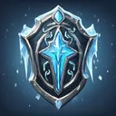
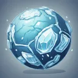
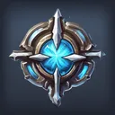

# Skills

**Where to play:** Discord
{ .where-to-play }

Each class has three skill trees.

- **Skill points:** one per level, and the default Throw skill holds one, so a level-3 character has 2 to spend. You can't spend more than you have, and a skill takes at most 20 points.
- A skill needs its level and the skills listed before it (each skill's page says which).
- **Reset:** 5 { .gi .gi-mention width="20" height="20" loading="lazy" }&nbsp;[Grilled Sardines with Sumac Yogurt Sauce](../../../items/dishes.md#grilled-sardines-with-sumac-yogurt-sauce) in total, whatever the points; it leaves only the base skills.
- **Using skills:** on the battle screen you pick a main and a secondary skill; each is a button with its mana cost ("{ .gi .gi-mention width="20" height="20" loading="lazy" }&nbsp;[Bonk](warrior/combat-skills/bonk.md) [💙2]"), charged once when used. A skill you can't use (not enough mana, not in the right shape, or without the weapon it needs, like { .gi .gi-mention width="20" height="20" loading="lazy" }&nbsp;[Magic Arrow](hunter/bow-and-crossbow-skills/magic-arrow.md) without a bow) shows as **Attack** and makes the regular attack instead, for free.
- **What a skill does at each rank is what its skill screen shows**: the battle uses the same numbers.

## Free resets at the release

Every character that existed before this release gets **one free attribute reset and one free skill reset**: the reset screen says **free**, nothing is spent, and it's used once (also on a double click). After it, resets cost their steaks and sardines again. New characters don't get them.

## How skills work in battle

| Kind | What happens (examples the tests play) |
|---|---|
| attack | hits the selected monster ({ .gi .gi-mention width="20" height="20" loading="lazy" }&nbsp;[Bonk](warrior/combat-skills/bonk.md) adds its flat damage, then its %) |
| area | hits every monster ({ .gi .gi-mention width="20" height="20" loading="lazy" }&nbsp;[Cleave](warrior/combat-skills/cleave.md)) |
| volley | several hits, after the first on random living monsters ({ .gi .gi-mention width="20" height="20" loading="lazy" }&nbsp;[Strafe](hunter/bow-and-crossbow-skills/strafe.md) rank 1: 3 arrows) |
| chain | "targets N" hits N times, hopping between monsters ({ .gi .gi-mention width="20" height="20" loading="lazy" }&nbsp;[Guided Arrow](hunter/bow-and-crossbow-skills/guided-arrow.md) rank 1: 4 hits) |
| explodes | the target takes the hit and the explosion, its neighbours the explosion ({ .gi .gi-mention width="20" height="20" loading="lazy" }&nbsp;[Fire Ball](wizard/fire-spells/fire-ball.md)) |
| burn, poison | ticks once a round for its rounds ({ .gi .gi-mention width="20" height="20" loading="lazy" }&nbsp;[Inferno](wizard/fire-spells/inferno.md) "rounds 4" ticks 4 times; { .gi .gi-mention width="20" height="20" loading="lazy" }&nbsp;[Fire Wall](wizard/fire-spells/fire-wall.md) burns every monster) |
| buff | on you for its rounds ({ .gi .gi-mention width="20" height="20" loading="lazy" }&nbsp;[Battle Cry](warrior/warcries/battle-cry.md) +35% damage, { .gi .gi-mention width="20" height="20" loading="lazy" }&nbsp;[Battle Orders](warrior/warcries/battle-orders.md) +40% health, { .gi .gi-mention width="20" height="20" loading="lazy" }&nbsp;[Strategic Shout](warrior/warcries/strategic-shout.md) +40% attack rating, { .gi .gi-mention width="20" height="20" loading="lazy" }&nbsp;[Cloak of Shadows](assassin/shadow-disciplines/cloak-of-shadows.md) dodge and avoid, { .gi .gi-mention width="20" height="20" loading="lazy" }&nbsp;[War Cry](warrior/warcries/war-cry.md) parry) |
| debuff | on the monster ({ .gi .gi-mention width="20" height="20" loading="lazy" }&nbsp;[Amplify Damage](necromancer/curses/amplify-damage.md): +15% physical damage taken; { .gi .gi-mention width="20" height="20" loading="lazy" }&nbsp;[Inner Sight](hunter/passive-and-magic-skills/inner-sight.md): −40 armor on every monster; { .gi .gi-mention width="20" height="20" loading="lazy" }&nbsp;[Howl](warrior/warcries/howl.md): −10% armor). Casting it again replaces it |
| aura | works while it's your main or secondary skill ({ .gi .gi-mention width="20" height="20" loading="lazy" }&nbsp;[Might](paladin/auras/might.md) +20% physical damage, { .gi .gi-mention width="20" height="20" loading="lazy" }&nbsp;[Holy Fire](paladin/auras/holy-fire.md) burns every monster, { .gi .gi-mention width="20" height="20" loading="lazy" }&nbsp;[Concentration](paladin/auras/concentration.md) mana steal) |
| heal | { .gi .gi-mention width="20" height="20" loading="lazy" }&nbsp;[Paladin](../classes/paladin.md) { .gi .gi-mention width="20" height="20" loading="lazy" }&nbsp;[Heal](paladin/sanctified-protector/heal.md): 10% of your maximum health |
| stun | a stunned monster skips its attack ({ .gi .gi-mention width="20" height="20" loading="lazy" }&nbsp;[Tornado](druid/elemental-skills/tornado.md); a { .gi .gi-mention width="20" height="20" loading="lazy" }&nbsp;[Screech](warrior/warcries/screech.md) stun lasts the round; [Tempest Bind](druid/elemental-skills/tempest-bind.md) for its rounds) |
| shapeshift | { .gi .gi-mention width="20" height="20" loading="lazy" }&nbsp;[Werewolf](druid/shape-shifting-skills/werewolf.md) and { .gi .gi-mention width="20" height="20" loading="lazy" }&nbsp;[Werebear](druid/shape-shifting-skills/werebear.md): the { .gi .gi-mention width="20" height="20" loading="lazy" }&nbsp;[Druid](../classes/druid.md) skills that need the shape fall back to the regular attack without it |
| summon | a minion fights at your side for its rounds ({ .gi .gi-mention width="20" height="20" loading="lazy" }&nbsp;[Clay Golem](necromancer/summoning-spells/clay-golem.md) rank 1: 275 health, 10 rounds; { .gi .gi-mention width="20" height="20" loading="lazy" }&nbsp;[Raise Skeleton](necromancer/summoning-spells/raise-skeleton.md) needs a corpse) |
| charges | every third use releases the charged effect ({ .gi .gi-mention width="20" height="20" loading="lazy" }&nbsp;[Tiger Strike](assassin/martial-arts/tiger-strike.md)) |
| passive | always on (some only with their weapon) |

{ .gi .gi-mention width="20" height="20" loading="lazy" }&nbsp;[Mirror](warrior/combat-skills/mirror.md) ({ .gi .gi-mention width="20" height="20" loading="lazy" }&nbsp;[Warrior](../classes/warrior.md)) copies your attack at its own damage bonus (−50% at rank 1). Paladin { .gi .gi-mention width="20" height="20" loading="lazy" }&nbsp;[Cleansing](paladin/sanctified-protector/cleansing.md) removes your debuffs and heals 5%.

## Every class's skills

Each class's three trees; every name leads to the skill's page, with its numbers at every rank, what it needs and what it opens.

| Class | Tree | Skills |
|---|---|---|
| { .gi .gi-inline width="24" height="24" loading="lazy" } [Warrior](warrior/index.md) | { .gi .gi-inline width="24" height="24" loading="lazy" } [Combat Skills](warrior/combat-skills/index.md) | { .gi .gi-mention width="20" height="20" loading="lazy" }&nbsp;[Mirror](warrior/combat-skills/mirror.md), { .gi .gi-mention width="20" height="20" loading="lazy" }&nbsp;[Bonk](warrior/combat-skills/bonk.md), { .gi .gi-mention width="20" height="20" loading="lazy" }&nbsp;[Parry](warrior/combat-skills/parry.md), { .gi .gi-mention width="20" height="20" loading="lazy" }&nbsp;[Double Swing](warrior/combat-skills/double-swing.md), { .gi .gi-mention width="20" height="20" loading="lazy" }&nbsp;[Stun](warrior/combat-skills/stun.md), { .gi .gi-mention width="20" height="20" loading="lazy" }&nbsp;[Double Throw](warrior/combat-skills/double-throw.md), { .gi .gi-mention width="20" height="20" loading="lazy" }&nbsp;[Strategic Strike](warrior/combat-skills/strategic-strike.md), { .gi .gi-mention width="20" height="20" loading="lazy" }&nbsp;[Wound](warrior/combat-skills/wound.md), { .gi .gi-mention width="20" height="20" loading="lazy" }&nbsp;[Critical Throw](warrior/combat-skills/critical-throw.md), { .gi .gi-mention width="20" height="20" loading="lazy" }&nbsp;[Cleave](warrior/combat-skills/cleave.md), { .gi .gi-mention width="20" height="20" loading="lazy" }&nbsp;[Concentrated Strike](warrior/combat-skills/concentrated-strike.md) |
| { .gi .gi-inline width="24" height="24" loading="lazy" } [Warrior](warrior/index.md) | { .gi .gi-inline width="24" height="24" loading="lazy" } [Warcries](warrior/warcries/index.md) | { .gi .gi-mention width="20" height="20" loading="lazy" }&nbsp;[Howl](warrior/warcries/howl.md), { .gi .gi-mention width="20" height="20" loading="lazy" }&nbsp;[Relieve](warrior/warcries/relieve.md), { .gi .gi-mention width="20" height="20" loading="lazy" }&nbsp;[Strategic Shout](warrior/warcries/strategic-shout.md), { .gi .gi-mention width="20" height="20" loading="lazy" }&nbsp;[Screech](warrior/warcries/screech.md), { .gi .gi-mention width="20" height="20" loading="lazy" }&nbsp;[Critical Hit](warrior/warcries/critical-hit.md), { .gi .gi-mention width="20" height="20" loading="lazy" }&nbsp;[Battle Cry](warrior/warcries/battle-cry.md), { .gi .gi-mention width="20" height="20" loading="lazy" }&nbsp;[Battle Orders](warrior/warcries/battle-orders.md), { .gi .gi-mention width="20" height="20" loading="lazy" }&nbsp;[Healing Hit](warrior/warcries/healing-hit.md), { .gi .gi-mention width="20" height="20" loading="lazy" }&nbsp;[War Cry](warrior/warcries/war-cry.md), { .gi .gi-mention width="20" height="20" loading="lazy" }&nbsp;[Battle Command](warrior/warcries/battle-command.md) |
| { .gi .gi-inline width="24" height="24" loading="lazy" } [Warrior](warrior/index.md) | { .gi .gi-inline width="24" height="24" loading="lazy" } [Combat Masteries](warrior/combat-masteries/index.md) | { .gi .gi-mention width="20" height="20" loading="lazy" }&nbsp;[Swordsman](warrior/combat-masteries/swordsman.md), { .gi .gi-mention width="20" height="20" loading="lazy" }&nbsp;[Axeman](warrior/combat-masteries/axeman.md), { .gi .gi-mention width="20" height="20" loading="lazy" }&nbsp;[Maceman](warrior/combat-masteries/maceman.md), { .gi .gi-mention width="20" height="20" loading="lazy" }&nbsp;[Polearm Master](warrior/combat-masteries/polearm-master.md), { .gi .gi-mention width="20" height="20" loading="lazy" }&nbsp;[Throwing Master](warrior/combat-masteries/throwing-master.md), { .gi .gi-mention width="20" height="20" loading="lazy" }&nbsp;[Spearman](warrior/combat-masteries/spearman.md), { .gi .gi-mention width="20" height="20" loading="lazy" }&nbsp;[Retaliate](warrior/combat-masteries/retaliate.md), { .gi .gi-mention width="20" height="20" loading="lazy" }&nbsp;[Though Skin](warrior/combat-masteries/though-skin.md), { .gi .gi-mention width="20" height="20" loading="lazy" }&nbsp;[Critical Kick](warrior/combat-masteries/critical-kick.md), { .gi .gi-mention width="20" height="20" loading="lazy" }&nbsp;[Resistance](warrior/combat-masteries/resistance.md) |
| { .gi .gi-inline width="24" height="24" loading="lazy" } [Hunter](hunter/index.md) | { .gi .gi-inline width="24" height="24" loading="lazy" } [Bow and Crossbow Skills](hunter/bow-and-crossbow-skills/index.md) | { .gi .gi-mention width="20" height="20" loading="lazy" }&nbsp;[Magic Arrow](hunter/bow-and-crossbow-skills/magic-arrow.md), { .gi .gi-mention width="20" height="20" loading="lazy" }&nbsp;[Fire Arrow](hunter/bow-and-crossbow-skills/fire-arrow.md), { .gi .gi-mention width="20" height="20" loading="lazy" }&nbsp;[Cold Arrow](hunter/bow-and-crossbow-skills/cold-arrow.md), { .gi .gi-mention width="20" height="20" loading="lazy" }&nbsp;[Multiple Shot](hunter/bow-and-crossbow-skills/multiple-shot.md), { .gi .gi-mention width="20" height="20" loading="lazy" }&nbsp;[Exploding Arrow](hunter/bow-and-crossbow-skills/exploding-arrow.md), { .gi .gi-mention width="20" height="20" loading="lazy" }&nbsp;[Ice Arrow](hunter/bow-and-crossbow-skills/ice-arrow.md), { .gi .gi-mention width="20" height="20" loading="lazy" }&nbsp;[Guided Arrow](hunter/bow-and-crossbow-skills/guided-arrow.md), { .gi .gi-mention width="20" height="20" loading="lazy" }&nbsp;[Strafe](hunter/bow-and-crossbow-skills/strafe.md), { .gi .gi-mention width="20" height="20" loading="lazy" }&nbsp;[Immolation Arrow](hunter/bow-and-crossbow-skills/immolation-arrow.md), { .gi .gi-mention width="20" height="20" loading="lazy" }&nbsp;[Freezing Arrow](hunter/bow-and-crossbow-skills/freezing-arrow.md) |
| { .gi .gi-inline width="24" height="24" loading="lazy" } [Hunter](hunter/index.md) | { .gi .gi-inline width="24" height="24" loading="lazy" } [Passive and Magic Skills](hunter/passive-and-magic-skills/index.md) | { .gi .gi-mention width="20" height="20" loading="lazy" }&nbsp;[Inner Sight](hunter/passive-and-magic-skills/inner-sight.md), { .gi .gi-mention width="20" height="20" loading="lazy" }&nbsp;[Critical Strike](hunter/passive-and-magic-skills/critical-strike.md), { .gi .gi-mention width="20" height="20" loading="lazy" }&nbsp;[Dodge](hunter/passive-and-magic-skills/dodge.md), { .gi .gi-mention width="20" height="20" loading="lazy" }&nbsp;[Slow Missiles](hunter/passive-and-magic-skills/slow-missiles.md), { .gi .gi-mention width="20" height="20" loading="lazy" }&nbsp;[Avoid](hunter/passive-and-magic-skills/avoid.md), { .gi .gi-mention width="20" height="20" loading="lazy" }&nbsp;[Penetrate](hunter/passive-and-magic-skills/penetrate.md), { .gi .gi-mention width="20" height="20" loading="lazy" }&nbsp;[Decoy](hunter/passive-and-magic-skills/decoy.md), { .gi .gi-mention width="20" height="20" loading="lazy" }&nbsp;[Evade](hunter/passive-and-magic-skills/evade.md), { .gi .gi-mention width="20" height="20" loading="lazy" }&nbsp;[Valkyrie](hunter/passive-and-magic-skills/valkyrie.md), { .gi .gi-mention width="20" height="20" loading="lazy" }&nbsp;[Pierce](hunter/passive-and-magic-skills/pierce.md) |
| { .gi .gi-inline width="24" height="24" loading="lazy" } [Hunter](hunter/index.md) | { .gi .gi-inline width="24" height="24" loading="lazy" } [Javelin and Spear Skills](hunter/javelin-and-spear-skills/index.md) | { .gi .gi-mention width="20" height="20" loading="lazy" }&nbsp;[Jab](hunter/javelin-and-spear-skills/jab.md), { .gi .gi-mention width="20" height="20" loading="lazy" }&nbsp;[Power Strike](hunter/javelin-and-spear-skills/power-strike.md), { .gi .gi-mention width="20" height="20" loading="lazy" }&nbsp;[Poison Javelin](hunter/javelin-and-spear-skills/poison-javelin.md), { .gi .gi-mention width="20" height="20" loading="lazy" }&nbsp;[Impale](hunter/javelin-and-spear-skills/impale.md), { .gi .gi-mention width="20" height="20" loading="lazy" }&nbsp;[Lightning Bolt](hunter/javelin-and-spear-skills/lightning-bolt.md), { .gi .gi-mention width="20" height="20" loading="lazy" }&nbsp;[Charged Strike](hunter/javelin-and-spear-skills/charged-strike.md), { .gi .gi-mention width="20" height="20" loading="lazy" }&nbsp;[Plague Javelin](hunter/javelin-and-spear-skills/plague-javelin.md), { .gi .gi-mention width="20" height="20" loading="lazy" }&nbsp;[Fend](hunter/javelin-and-spear-skills/fend.md), { .gi .gi-mention width="20" height="20" loading="lazy" }&nbsp;[Lightning Strike](hunter/javelin-and-spear-skills/lightning-strike.md), { .gi .gi-mention width="20" height="20" loading="lazy" }&nbsp;[Lightning Fury](hunter/javelin-and-spear-skills/lightning-fury.md) |
| { .gi .gi-inline width="24" height="24" loading="lazy" } [Wizard](wizard/index.md) | { .gi .gi-inline width="24" height="24" loading="lazy" } [Fire Spells](wizard/fire-spells/index.md) | { .gi .gi-mention width="20" height="20" loading="lazy" }&nbsp;[Fire Bolt](wizard/fire-spells/fire-bolt.md), { .gi .gi-mention width="20" height="20" loading="lazy" }&nbsp;[Warmth](wizard/fire-spells/warmth.md), { .gi .gi-mention width="20" height="20" loading="lazy" }&nbsp;[Inferno](wizard/fire-spells/inferno.md), { .gi .gi-mention width="20" height="20" loading="lazy" }&nbsp;[Blaze](wizard/fire-spells/blaze.md), { .gi .gi-mention width="20" height="20" loading="lazy" }&nbsp;[Fire Ball](wizard/fire-spells/fire-ball.md), { .gi .gi-mention width="20" height="20" loading="lazy" }&nbsp;[Fire Wall](wizard/fire-spells/fire-wall.md), { .gi .gi-mention width="20" height="20" loading="lazy" }&nbsp;[Enchant](wizard/fire-spells/enchant.md), { .gi .gi-mention width="20" height="20" loading="lazy" }&nbsp;[Meteor](wizard/fire-spells/meteor.md), { .gi .gi-mention width="20" height="20" loading="lazy" }&nbsp;[Fire Mastery](wizard/fire-spells/fire-mastery.md), { .gi .gi-mention width="20" height="20" loading="lazy" }&nbsp;[Hydra](wizard/fire-spells/hydra.md) |
| { .gi .gi-inline width="24" height="24" loading="lazy" } [Wizard](wizard/index.md) | { .gi .gi-inline width="24" height="24" loading="lazy" } [Lightning Spells](wizard/lightning-spells/index.md) | { .gi .gi-mention width="20" height="20" loading="lazy" }&nbsp;[Charged Bolt](wizard/lightning-spells/charged-bolt.md), { .gi .gi-mention width="20" height="20" loading="lazy" }&nbsp;[Static Field](wizard/lightning-spells/static-field.md), { .gi .gi-mention width="20" height="20" loading="lazy" }&nbsp;[Telekinesis](wizard/lightning-spells/telekinesis.md), { .gi .gi-mention width="20" height="20" loading="lazy" }&nbsp;[Nova](wizard/lightning-spells/nova.md), { .gi .gi-mention width="20" height="20" loading="lazy" }&nbsp;[Lightning](wizard/lightning-spells/lightning.md), { .gi .gi-mention width="20" height="20" loading="lazy" }&nbsp;[Chain Lightning](wizard/lightning-spells/chain-lightning.md), { .gi .gi-mention width="20" height="20" loading="lazy" }&nbsp;[Teleport](wizard/lightning-spells/teleport.md), { .gi .gi-mention width="20" height="20" loading="lazy" }&nbsp;[Thunder Storm](wizard/lightning-spells/thunder-storm.md), { .gi .gi-mention width="20" height="20" loading="lazy" }&nbsp;[Energy Shield](wizard/lightning-spells/energy-shield.md), { .gi .gi-mention width="20" height="20" loading="lazy" }&nbsp;[Lightning Mastery](wizard/lightning-spells/lightning-mastery.md) |
| { .gi .gi-inline width="24" height="24" loading="lazy" } [Wizard](wizard/index.md) | { .gi .gi-inline width="24" height="24" loading="lazy" } [Cold Spells](wizard/cold-spells/index.md) | { .gi .gi-mention width="20" height="20" loading="lazy" }&nbsp;[Ice Bolt](wizard/cold-spells/ice-bolt.md), { .gi .gi-mention width="20" height="20" loading="lazy" }&nbsp;[Frozen Armor](wizard/cold-spells/frozen-armor.md), { .gi .gi-mention width="20" height="20" loading="lazy" }&nbsp;[Frost Nova](wizard/cold-spells/frost-nova.md), { .gi .gi-mention width="20" height="20" loading="lazy" }&nbsp;[Ice Blast](wizard/cold-spells/ice-blast.md), { .gi .gi-mention width="20" height="20" loading="lazy" }&nbsp;[Shiver Armor](wizard/cold-spells/shiver-armor.md), { .gi .gi-mention width="20" height="20" loading="lazy" }&nbsp;[Glacial Spike](wizard/cold-spells/glacial-spike.md), { .gi .gi-mention width="20" height="20" loading="lazy" }&nbsp;[Blizzard](wizard/cold-spells/blizzard.md), { .gi .gi-mention width="20" height="20" loading="lazy" }&nbsp;[Chilling Armor](wizard/cold-spells/chilling-armor.md), { .gi .gi-mention width="20" height="20" loading="lazy" }&nbsp;[Frozen Orb](wizard/cold-spells/frozen-orb.md), { .gi .gi-mention width="20" height="20" loading="lazy" }&nbsp;[Cold Mastery](wizard/cold-spells/cold-mastery.md) |
| { .gi .gi-inline width="24" height="24" loading="lazy" } [Assassin](assassin/index.md) | { .gi .gi-inline width="24" height="24" loading="lazy" } [Martial Arts](assassin/martial-arts/index.md) | { .gi .gi-mention width="20" height="20" loading="lazy" }&nbsp;[Tiger Strike](assassin/martial-arts/tiger-strike.md), { .gi .gi-mention width="20" height="20" loading="lazy" }&nbsp;[Dragon Talon](assassin/martial-arts/dragon-talon.md), { .gi .gi-mention width="20" height="20" loading="lazy" }&nbsp;[Fists of Fire](assassin/martial-arts/fists-of-fire.md), { .gi .gi-mention width="20" height="20" loading="lazy" }&nbsp;[Dragon Claw](assassin/martial-arts/dragon-claw.md), { .gi .gi-mention width="20" height="20" loading="lazy" }&nbsp;[Cobra Strike](assassin/martial-arts/cobra-strike.md), { .gi .gi-mention width="20" height="20" loading="lazy" }&nbsp;[Claws of Thunder](assassin/martial-arts/claws-of-thunder.md), { .gi .gi-mention width="20" height="20" loading="lazy" }&nbsp;[Dragon Tail](assassin/martial-arts/dragon-tail.md), { .gi .gi-mention width="20" height="20" loading="lazy" }&nbsp;[Blades of Ice](assassin/martial-arts/blades-of-ice.md), { .gi .gi-mention width="20" height="20" loading="lazy" }&nbsp;[Dragon Flight](assassin/martial-arts/dragon-flight.md), { .gi .gi-mention width="20" height="20" loading="lazy" }&nbsp;[Phoenix Strike](assassin/martial-arts/phoenix-strike.md) |
| { .gi .gi-inline width="24" height="24" loading="lazy" } [Assassin](assassin/index.md) | { .gi .gi-inline width="24" height="24" loading="lazy" } [Shadow Disciplines](assassin/shadow-disciplines/index.md) | { .gi .gi-mention width="20" height="20" loading="lazy" }&nbsp;[Claw Mastery](assassin/shadow-disciplines/claw-mastery.md), { .gi .gi-mention width="20" height="20" loading="lazy" }&nbsp;[Psychic Hammer](assassin/shadow-disciplines/psychic-hammer.md), { .gi .gi-mention width="20" height="20" loading="lazy" }&nbsp;[Burst of Speed](assassin/shadow-disciplines/burst-of-speed.md), { .gi .gi-mention width="20" height="20" loading="lazy" }&nbsp;[Weapon Block](assassin/shadow-disciplines/weapon-block.md), { .gi .gi-mention width="20" height="20" loading="lazy" }&nbsp;[Cloak of Shadows](assassin/shadow-disciplines/cloak-of-shadows.md), { .gi .gi-mention width="20" height="20" loading="lazy" }&nbsp;[Fade](assassin/shadow-disciplines/fade.md), { .gi .gi-mention width="20" height="20" loading="lazy" }&nbsp;[Shadow Warrior](assassin/shadow-disciplines/shadow-warrior.md), { .gi .gi-mention width="20" height="20" loading="lazy" }&nbsp;[Mind Blast](assassin/shadow-disciplines/mind-blast.md), { .gi .gi-mention width="20" height="20" loading="lazy" }&nbsp;[Venom](assassin/shadow-disciplines/venom.md), { .gi .gi-mention width="20" height="20" loading="lazy" }&nbsp;[Shadow Master](assassin/shadow-disciplines/shadow-master.md) |
| { .gi .gi-inline width="24" height="24" loading="lazy" } [Assassin](assassin/index.md) | { .gi .gi-inline width="24" height="24" loading="lazy" } [Traps](assassin/traps/index.md) | { .gi .gi-mention width="20" height="20" loading="lazy" }&nbsp;[Fire Blast](assassin/traps/fire-blast.md), { .gi .gi-mention width="20" height="20" loading="lazy" }&nbsp;[Shock Web](assassin/traps/shock-web.md), { .gi .gi-mention width="20" height="20" loading="lazy" }&nbsp;[Blade Sentinel](assassin/traps/blade-sentinel.md), { .gi .gi-mention width="20" height="20" loading="lazy" }&nbsp;[Charged Bolt Sentry](assassin/traps/charged-bolt-sentry.md), { .gi .gi-mention width="20" height="20" loading="lazy" }&nbsp;[Wake of Fire](assassin/traps/wake-of-fire.md), { .gi .gi-mention width="20" height="20" loading="lazy" }&nbsp;[Blade Fury](assassin/traps/blade-fury.md), { .gi .gi-mention width="20" height="20" loading="lazy" }&nbsp;[Lightning Sentry](assassin/traps/lightning-sentry.md), { .gi .gi-mention width="20" height="20" loading="lazy" }&nbsp;[Wake of Inferno](assassin/traps/wake-of-inferno.md), { .gi .gi-mention width="20" height="20" loading="lazy" }&nbsp;[Death Sentry](assassin/traps/death-sentry.md), { .gi .gi-mention width="20" height="20" loading="lazy" }&nbsp;[Blade Shield](assassin/traps/blade-shield.md) |
| { .gi .gi-inline width="24" height="24" loading="lazy" } [Necromancer](necromancer/index.md) | { .gi .gi-inline width="24" height="24" loading="lazy" } [Summoning Spells](necromancer/summoning-spells/index.md) | { .gi .gi-mention width="20" height="20" loading="lazy" }&nbsp;[Raise Skeleton](necromancer/summoning-spells/raise-skeleton.md), { .gi .gi-mention width="20" height="20" loading="lazy" }&nbsp;[Skeleton Mastery](necromancer/summoning-spells/skeleton-mastery.md), { .gi .gi-mention width="20" height="20" loading="lazy" }&nbsp;[Clay Golem](necromancer/summoning-spells/clay-golem.md), { .gi .gi-mention width="20" height="20" loading="lazy" }&nbsp;[Golem Mastery](necromancer/summoning-spells/golem-mastery.md), { .gi .gi-mention width="20" height="20" loading="lazy" }&nbsp;[Raise Skeletal Mage](necromancer/summoning-spells/raise-skeletal-mage.md), { .gi .gi-mention width="20" height="20" loading="lazy" }&nbsp;[Blood Golem](necromancer/summoning-spells/blood-golem.md), { .gi .gi-mention width="20" height="20" loading="lazy" }&nbsp;[Summon Resist](necromancer/summoning-spells/summon-resist.md), { .gi .gi-mention width="20" height="20" loading="lazy" }&nbsp;[Iron Golem](necromancer/summoning-spells/iron-golem.md), { .gi .gi-mention width="20" height="20" loading="lazy" }&nbsp;[Fire Golem](necromancer/summoning-spells/fire-golem.md), { .gi .gi-mention width="20" height="20" loading="lazy" }&nbsp;[Revive](necromancer/summoning-spells/revive.md) |
| { .gi .gi-inline width="24" height="24" loading="lazy" } [Necromancer](necromancer/index.md) | { .gi .gi-inline width="24" height="24" loading="lazy" } [Poison and Bone Spells](necromancer/poison-and-bone-spells/index.md) | { .gi .gi-mention width="20" height="20" loading="lazy" }&nbsp;[Teeth](necromancer/poison-and-bone-spells/teeth.md), { .gi .gi-mention width="20" height="20" loading="lazy" }&nbsp;[Bone Armor](necromancer/poison-and-bone-spells/bone-armor.md), { .gi .gi-mention width="20" height="20" loading="lazy" }&nbsp;[Poison Dagger](necromancer/poison-and-bone-spells/poison-dagger.md), { .gi .gi-mention width="20" height="20" loading="lazy" }&nbsp;[Corpse Explosion](necromancer/poison-and-bone-spells/corpse-explosion.md), { .gi .gi-mention width="20" height="20" loading="lazy" }&nbsp;[Bone Wall](necromancer/poison-and-bone-spells/bone-wall.md), { .gi .gi-mention width="20" height="20" loading="lazy" }&nbsp;[Poison Explosion](necromancer/poison-and-bone-spells/poison-explosion.md), { .gi .gi-mention width="20" height="20" loading="lazy" }&nbsp;[Bone Spear](necromancer/poison-and-bone-spells/bone-spear.md), { .gi .gi-mention width="20" height="20" loading="lazy" }&nbsp;[Bone Prison](necromancer/poison-and-bone-spells/bone-prison.md), { .gi .gi-mention width="20" height="20" loading="lazy" }&nbsp;[Poison Nova](necromancer/poison-and-bone-spells/poison-nova.md), { .gi .gi-mention width="20" height="20" loading="lazy" }&nbsp;[Bone Spirit](necromancer/poison-and-bone-spells/bone-spirit.md) |
| { .gi .gi-inline width="24" height="24" loading="lazy" } [Necromancer](necromancer/index.md) | { .gi .gi-inline width="24" height="24" loading="lazy" } [Curses](necromancer/curses/index.md) | { .gi .gi-mention width="20" height="20" loading="lazy" }&nbsp;[Dim Vision](necromancer/curses/dim-vision.md), { .gi .gi-mention width="20" height="20" loading="lazy" }&nbsp;[Amplify Damage](necromancer/curses/amplify-damage.md), { .gi .gi-mention width="20" height="20" loading="lazy" }&nbsp;[Weaken](necromancer/curses/weaken.md), { .gi .gi-mention width="20" height="20" loading="lazy" }&nbsp;[Iron Maiden](necromancer/curses/iron-maiden.md), { .gi .gi-mention width="20" height="20" loading="lazy" }&nbsp;[Terror](necromancer/curses/terror.md), { .gi .gi-mention width="20" height="20" loading="lazy" }&nbsp;[Confuse](necromancer/curses/confuse.md), { .gi .gi-mention width="20" height="20" loading="lazy" }&nbsp;[Life Tap](necromancer/curses/life-tap.md), { .gi .gi-mention width="20" height="20" loading="lazy" }&nbsp;[Attract](necromancer/curses/attract.md), { .gi .gi-mention width="20" height="20" loading="lazy" }&nbsp;[Decrepify](necromancer/curses/decrepify.md), { .gi .gi-mention width="20" height="20" loading="lazy" }&nbsp;[Lower Resist](necromancer/curses/lower-resist.md) |
| { .gi .gi-inline width="24" height="24" loading="lazy" } [Paladin](paladin/index.md) | { .gi .gi-inline width="24" height="24" loading="lazy" } [Battle Skills](paladin/battle-skills/index.md) | { .gi .gi-mention width="20" height="20" loading="lazy" }&nbsp;[Sacrifice](paladin/battle-skills/sacrifice.md), { .gi .gi-mention width="20" height="20" loading="lazy" }&nbsp;[Smite](paladin/battle-skills/smite.md), { .gi .gi-mention width="20" height="20" loading="lazy" }&nbsp;[Holy Bolt](paladin/battle-skills/holy-bolt.md), { .gi .gi-mention width="20" height="20" loading="lazy" }&nbsp;[Zeal](paladin/battle-skills/zeal.md), { .gi .gi-mention width="20" height="20" loading="lazy" }&nbsp;[Charge](paladin/battle-skills/charge.md), { .gi .gi-mention width="20" height="20" loading="lazy" }&nbsp;[Vengeance](paladin/battle-skills/vengeance.md), { .gi .gi-mention width="20" height="20" loading="lazy" }&nbsp;[Blessed Hammer](paladin/battle-skills/blessed-hammer.md), { .gi .gi-mention width="20" height="20" loading="lazy" }&nbsp;[Conversion](paladin/battle-skills/conversion.md), { .gi .gi-mention width="20" height="20" loading="lazy" }&nbsp;[Holy Shield](paladin/battle-skills/holy-shield.md), { .gi .gi-mention width="20" height="20" loading="lazy" }&nbsp;[Fist of the Heavens](paladin/battle-skills/fist-of-the-heavens.md) |
| { .gi .gi-inline width="24" height="24" loading="lazy" } [Paladin](paladin/index.md) | { .gi .gi-inline width="24" height="24" loading="lazy" } [Sanctified Protector](paladin/sanctified-protector/index.md) | { .gi .gi-mention width="20" height="20" loading="lazy" }&nbsp;[Prayer](paladin/sanctified-protector/prayer.md), { .gi .gi-mention width="20" height="20" loading="lazy" }&nbsp;[Radiant Counter](paladin/sanctified-protector/radiant-counter.md), { .gi .gi-mention width="20" height="20" loading="lazy" }&nbsp;[Defiance](paladin/sanctified-protector/defiance.md), { .gi .gi-mention width="20" height="20" loading="lazy" }&nbsp;[Radiant Reflection](paladin/sanctified-protector/radiant-reflection.md), { .gi .gi-mention width="20" height="20" loading="lazy" }&nbsp;[Heal](paladin/sanctified-protector/heal.md), { .gi .gi-mention width="20" height="20" loading="lazy" }&nbsp;[Radiant Explosion](paladin/sanctified-protector/radiant-explosion.md), { .gi .gi-mention width="20" height="20" loading="lazy" }&nbsp;[Summon Divine Protector](paladin/sanctified-protector/summon-divine-protector.md), { .gi .gi-mention width="20" height="20" loading="lazy" }&nbsp;[Cleansing](paladin/sanctified-protector/cleansing.md), { .gi .gi-mention width="20" height="20" loading="lazy" }&nbsp;[Sanctified Divine Ward](paladin/sanctified-protector/sanctified-divine-ward.md), { .gi .gi-mention width="20" height="20" loading="lazy" }&nbsp;[Salvation](paladin/sanctified-protector/salvation.md) |
| { .gi .gi-inline width="24" height="24" loading="lazy" } [Paladin](paladin/index.md) | { .gi .gi-inline width="24" height="24" loading="lazy" } [Auras](paladin/auras/index.md) | { .gi .gi-mention width="20" height="20" loading="lazy" }&nbsp;[Might](paladin/auras/might.md), { .gi .gi-mention width="20" height="20" loading="lazy" }&nbsp;[Holy Fire](paladin/auras/holy-fire.md), { .gi .gi-mention width="20" height="20" loading="lazy" }&nbsp;[Thorns](paladin/auras/thorns.md), { .gi .gi-mention width="20" height="20" loading="lazy" }&nbsp;[Blessed Aim](paladin/auras/blessed-aim.md), { .gi .gi-mention width="20" height="20" loading="lazy" }&nbsp;[Concentration](paladin/auras/concentration.md), { .gi .gi-mention width="20" height="20" loading="lazy" }&nbsp;[Holy Freeze](paladin/auras/holy-freeze.md), { .gi .gi-mention width="20" height="20" loading="lazy" }&nbsp;[Holy Shock](paladin/auras/holy-shock.md), { .gi .gi-mention width="20" height="20" loading="lazy" }&nbsp;[Sanctuary](paladin/auras/sanctuary.md), { .gi .gi-mention width="20" height="20" loading="lazy" }&nbsp;[Fanaticism](paladin/auras/fanaticism.md), { .gi .gi-mention width="20" height="20" loading="lazy" }&nbsp;[Conviction](paladin/auras/conviction.md) |
| { .gi .gi-inline width="24" height="24" loading="lazy" } [Druid](druid/index.md) | { .gi .gi-inline width="24" height="24" loading="lazy" } [Elemental Skills](druid/elemental-skills/index.md) | [Tempest Bind](druid/elemental-skills/tempest-bind.md), { .gi .gi-mention width="20" height="20" loading="lazy" }&nbsp;[Firestorm](druid/elemental-skills/firestorm.md), { .gi .gi-mention width="20" height="20" loading="lazy" }&nbsp;[Molten Boulder](druid/elemental-skills/molten-boulder.md), { .gi .gi-mention width="20" height="20" loading="lazy" }&nbsp;[Arctic Blast](druid/elemental-skills/arctic-blast.md), { .gi .gi-mention width="20" height="20" loading="lazy" }&nbsp;[Fissure](druid/elemental-skills/fissure.md), { .gi .gi-mention width="20" height="20" loading="lazy" }&nbsp;[Cyclone Armor](druid/elemental-skills/cyclone-armor.md), { .gi .gi-mention width="20" height="20" loading="lazy" }&nbsp;[Twister](druid/elemental-skills/twister.md), { .gi .gi-mention width="20" height="20" loading="lazy" }&nbsp;[Volcano](druid/elemental-skills/volcano.md), { .gi .gi-mention width="20" height="20" loading="lazy" }&nbsp;[Tornado](druid/elemental-skills/tornado.md), { .gi .gi-mention width="20" height="20" loading="lazy" }&nbsp;[Armageddon](druid/elemental-skills/armageddon.md), { .gi .gi-mention width="20" height="20" loading="lazy" }&nbsp;[Hurricane](druid/elemental-skills/hurricane.md) |
| { .gi .gi-inline width="24" height="24" loading="lazy" } [Druid](druid/index.md) | { .gi .gi-inline width="24" height="24" loading="lazy" } [Shape Shifting Skills](druid/shape-shifting-skills/index.md) | { .gi .gi-mention width="20" height="20" loading="lazy" }&nbsp;[Werewolf](druid/shape-shifting-skills/werewolf.md), { .gi .gi-mention width="20" height="20" loading="lazy" }&nbsp;[Lycanthropy](druid/shape-shifting-skills/lycanthropy.md), { .gi .gi-mention width="20" height="20" loading="lazy" }&nbsp;[Werebear](druid/shape-shifting-skills/werebear.md), { .gi .gi-mention width="20" height="20" loading="lazy" }&nbsp;[Feral Rage](druid/shape-shifting-skills/feral-rage.md), { .gi .gi-mention width="20" height="20" loading="lazy" }&nbsp;[Maul](druid/shape-shifting-skills/maul.md), { .gi .gi-mention width="20" height="20" loading="lazy" }&nbsp;[Rabies](druid/shape-shifting-skills/rabies.md), { .gi .gi-mention width="20" height="20" loading="lazy" }&nbsp;[Fire Claws](druid/shape-shifting-skills/fire-claws.md), { .gi .gi-mention width="20" height="20" loading="lazy" }&nbsp;[Hunger](druid/shape-shifting-skills/hunger.md), { .gi .gi-mention width="20" height="20" loading="lazy" }&nbsp;[Shock Wave](druid/shape-shifting-skills/shock-wave.md), { .gi .gi-mention width="20" height="20" loading="lazy" }&nbsp;[Fury](druid/shape-shifting-skills/fury.md) |
| { .gi .gi-inline width="24" height="24" loading="lazy" } [Druid](druid/index.md) | { .gi .gi-inline width="24" height="24" loading="lazy" } [Summoning Skills](druid/summoning-skills/index.md) | { .gi .gi-mention width="20" height="20" loading="lazy" }&nbsp;[Raven](druid/summoning-skills/raven.md), { .gi .gi-mention width="20" height="20" loading="lazy" }&nbsp;[Poison Creeper](druid/summoning-skills/poison-creeper.md), { .gi .gi-mention width="20" height="20" loading="lazy" }&nbsp;[Oak Sage](druid/summoning-skills/oak-sage.md), { .gi .gi-mention width="20" height="20" loading="lazy" }&nbsp;[Summon Spirit Wolf](druid/summoning-skills/summon-spirit-wolf.md), { .gi .gi-mention width="20" height="20" loading="lazy" }&nbsp;[Carrion Vine](druid/summoning-skills/carrion-vine.md), { .gi .gi-mention width="20" height="20" loading="lazy" }&nbsp;[Heart of Wolverine](druid/summoning-skills/heart-of-wolverine.md), { .gi .gi-mention width="20" height="20" loading="lazy" }&nbsp;[Summon Dire Wolf](druid/summoning-skills/summon-dire-wolf.md), { .gi .gi-mention width="20" height="20" loading="lazy" }&nbsp;[Solar Creeper](druid/summoning-skills/solar-creeper.md), { .gi .gi-mention width="20" height="20" loading="lazy" }&nbsp;[Spirit of Barbs](druid/summoning-skills/spirit-of-barbs.md), { .gi .gi-mention width="20" height="20" loading="lazy" }&nbsp;[Summon Grizzly](druid/summoning-skills/summon-grizzly.md) |

