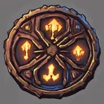

# { .gi .gi-title width="64" height="64" loading="lazy" } Necromancer skills

**Where to play:** Discord
{ .where-to-play }

The { .gi .gi-mention width="20" height="20" loading="lazy" }&nbsp;[Necromancer](../../classes/necromancer.md)'s three trees, every skill at rank 1 and rank 20 (mana is the cost when used). Each name leads to the skill's page.

| Tree | Skill | Level | Kind | Rank 1 | Rank 20 | Needs |
|---|---|---|---|---|---|---|
| { .gi .gi-mention width="20" height="20" loading="lazy" }&nbsp;[Summoning Spells](summoning-spells/index.md) | { .gi .gi-inline width="24" height="24" loading="lazy" } [Raise Skeleton](summoning-spells/raise-skeleton.md) | 1 | summon, spell | health 35, armor 30, raised at most 1, physical damage 3-5, rounds 30, mana 2 | health 510, armor 410, raised at most 6, physical damage 60-100, rounds 68, mana 40 |  |
| { .gi .gi-mention width="20" height="20" loading="lazy" }&nbsp;[Summoning Spells](summoning-spells/index.md) | { .gi .gi-inline width="24" height="24" loading="lazy" } [Skeleton Mastery](summoning-spells/skeleton-mastery.md) | 1 | passive | health bonus 2.5%, rounds 2 | health bonus 50%, rounds 21 | { .gi .gi-mention width="20" height="20" loading="lazy" }&nbsp;[Raise Skeleton](summoning-spells/raise-skeleton.md) |
| { .gi .gi-mention width="20" height="20" loading="lazy" }&nbsp;[Summoning Spells](summoning-spells/index.md) | { .gi .gi-inline width="24" height="24" loading="lazy" } [Clay Golem](summoning-spells/clay-golem.md) | 6 | summon, spell | health 275, physical damage 4-9, attack rating bonus 40%, rounds 10, mana 2 | health 2175, physical damage 42-85, attack rating bonus 800%, rounds 67, mana 40 |  |
| { .gi .gi-mention width="20" height="20" loading="lazy" }&nbsp;[Summoning Spells](summoning-spells/index.md) | { .gi .gi-inline width="24" height="24" loading="lazy" } [Golem Mastery](summoning-spells/golem-mastery.md) | 12 | passive | health bonus 2.5%, rounds 3 | health bonus 50%, rounds 60 | { .gi .gi-mention width="20" height="20" loading="lazy" }&nbsp;[Clay Golem](summoning-spells/clay-golem.md) |
| { .gi .gi-mention width="20" height="20" loading="lazy" }&nbsp;[Summoning Spells](summoning-spells/index.md) | { .gi .gi-inline width="24" height="24" loading="lazy" } [Raise Skeletal Mage](summoning-spells/raise-skeletal-mage.md) | 12 | summon, spell | health 80, armor 10, raised at most 1, rounds 30, mana 2 | health 555, armor 200, raised at most 6, rounds 68, mana 40 | { .gi .gi-mention width="20" height="20" loading="lazy" }&nbsp;[Raise Skeleton](summoning-spells/raise-skeleton.md) |
| { .gi .gi-mention width="20" height="20" loading="lazy" }&nbsp;[Summoning Spells](summoning-spells/index.md) | { .gi .gi-inline width="24" height="24" loading="lazy" } [Blood Golem](summoning-spells/blood-golem.md) | 18 | summon, spell | health 637, physical damage 12-33, life steal 25%, rounds 6, mana 2 | health 3240, physical damage 145-318, life steal 44%, rounds 44, mana 40 | { .gi .gi-mention width="20" height="20" loading="lazy" }&nbsp;[Clay Golem](summoning-spells/clay-golem.md) |
| { .gi .gi-mention width="20" height="20" loading="lazy" }&nbsp;[Summoning Spells](summoning-spells/index.md) | { .gi .gi-inline width="24" height="24" loading="lazy" } [Summon Resist](summoning-spells/summon-resist.md) | 24 | passive | all resistances 15% | all resistances 53% | { .gi .gi-mention width="20" height="20" loading="lazy" }&nbsp;[Golem Mastery](summoning-spells/golem-mastery.md) |
| { .gi .gi-mention width="20" height="20" loading="lazy" }&nbsp;[Summoning Spells](summoning-spells/index.md) | { .gi .gi-inline width="24" height="24" loading="lazy" } [Iron Golem](summoning-spells/iron-golem.md) | 24 | summon, spell | health 1000, physical damage 4-5, armor bonus 0%, rounds 20, mana 2 | health 10500, physical damage 80-100, armor bonus 380%, rounds 210, mana 40 | { .gi .gi-mention width="20" height="20" loading="lazy" }&nbsp;[Blood Golem](summoning-spells/blood-golem.md) |
| { .gi .gi-mention width="20" height="20" loading="lazy" }&nbsp;[Summoning Spells](summoning-spells/index.md) | { .gi .gi-inline width="24" height="24" loading="lazy" } [Fire Golem](summoning-spells/fire-golem.md) | 30 | summon, spell | health 1013, fire damage 52-128, rounds 6, mana 2 | health 3236, fire damage 527-603, rounds 44, mana 40 | { .gi .gi-mention width="20" height="20" loading="lazy" }&nbsp;[Iron Golem](summoning-spells/iron-golem.md) |
| { .gi .gi-mention width="20" height="20" loading="lazy" }&nbsp;[Summoning Spells](summoning-spells/index.md) | { .gi .gi-inline width="24" height="24" loading="lazy" } [Revive](summoning-spells/revive.md) | 30 | summon, spell | damage bonus 15%, raised at most 4, rounds 10, mana 2 | damage bonus 300%, raised at most 6, rounds 48, mana 40 | { .gi .gi-mention width="20" height="20" loading="lazy" }&nbsp;[Iron Golem](summoning-spells/iron-golem.md), { .gi .gi-mention width="20" height="20" loading="lazy" }&nbsp;[Raise Skeletal Mage](summoning-spells/raise-skeletal-mage.md) |
| { .gi .gi-mention width="20" height="20" loading="lazy" }&nbsp;[Poison and Bone Spells](poison-and-bone-spells/index.md) | { .gi .gi-inline width="24" height="24" loading="lazy" } [Teeth](poison-and-bone-spells/teeth.md) | 1 | area, spell | magic damage 3-5, mana 2 | magic damage 41-62, mana 2 |  |
| { .gi .gi-mention width="20" height="20" loading="lazy" }&nbsp;[Poison and Bone Spells](poison-and-bone-spells/index.md) | { .gi .gi-inline width="24" height="24" loading="lazy" } [Bone Armor](poison-and-bone-spells/bone-armor.md) | 1 | buff, spell | physical damage shield 30, rounds 5, mana 2 | physical damage shield 315, rounds 43, mana 2 |  |
| { .gi .gi-mention width="20" height="20" loading="lazy" }&nbsp;[Poison and Bone Spells](poison-and-bone-spells/index.md) | { .gi .gi-inline width="24" height="24" loading="lazy" } [Poison Dagger](poison-and-bone-spells/poison-dagger.md) | 6 | passive | poison damage 7-15 | poison damage 121-167 |  |
| { .gi .gi-mention width="20" height="20" loading="lazy" }&nbsp;[Poison and Bone Spells](poison-and-bone-spells/index.md) | { .gi .gi-inline width="24" height="24" loading="lazy" } [Corpse Explosion](poison-and-bone-spells/corpse-explosion.md) | 6 | attack, spell | corpse explosion 30%, mana 2 | corpse explosion 125%, mana 2 | { .gi .gi-mention width="20" height="20" loading="lazy" }&nbsp;[Teeth](poison-and-bone-spells/teeth.md) |
| { .gi .gi-mention width="20" height="20" loading="lazy" }&nbsp;[Poison and Bone Spells](poison-and-bone-spells/index.md) | { .gi .gi-inline width="24" height="24" loading="lazy" } [Bone Wall](poison-and-bone-spells/bone-wall.md) | 12 | passive | magic damage shield 30 | magic damage shield 315 | { .gi .gi-mention width="20" height="20" loading="lazy" }&nbsp;[Bone Armor](poison-and-bone-spells/bone-armor.md) |
| { .gi .gi-mention width="20" height="20" loading="lazy" }&nbsp;[Poison and Bone Spells](poison-and-bone-spells/index.md) | { .gi .gi-inline width="24" height="24" loading="lazy" } [Poison Explosion](poison-and-bone-spells/poison-explosion.md) | 18 | explodes, spell | poison damage 15-42, rounds 3, mana 2 | poison damage 167-365, rounds 5, mana 2 | { .gi .gi-mention width="20" height="20" loading="lazy" }&nbsp;[Poison Dagger](poison-and-bone-spells/poison-dagger.md), { .gi .gi-mention width="20" height="20" loading="lazy" }&nbsp;[Corpse Explosion](poison-and-bone-spells/corpse-explosion.md) |
| { .gi .gi-mention width="20" height="20" loading="lazy" }&nbsp;[Poison and Bone Spells](poison-and-bone-spells/index.md) | { .gi .gi-inline width="24" height="24" loading="lazy" } [Bone Spear](poison-and-bone-spells/bone-spear.md) | 18 | attack, spell | magic damage 20-40, mana 2 | magic damage 210-420, mana 2 | { .gi .gi-mention width="20" height="20" loading="lazy" }&nbsp;[Corpse Explosion](poison-and-bone-spells/corpse-explosion.md) |
| { .gi .gi-mention width="20" height="20" loading="lazy" }&nbsp;[Poison and Bone Spells](poison-and-bone-spells/index.md) | { .gi .gi-inline width="24" height="24" loading="lazy" } [Bone Prison](poison-and-bone-spells/bone-prison.md) | 24 | passive | magic damage 15-25 | magic damage 148-310 | { .gi .gi-mention width="20" height="20" loading="lazy" }&nbsp;[Bone Wall](poison-and-bone-spells/bone-wall.md), { .gi .gi-mention width="20" height="20" loading="lazy" }&nbsp;[Bone Spear](poison-and-bone-spells/bone-spear.md) |
| { .gi .gi-mention width="20" height="20" loading="lazy" }&nbsp;[Poison and Bone Spells](poison-and-bone-spells/index.md) | { .gi .gi-inline width="24" height="24" loading="lazy" } [Poison Nova](poison-and-bone-spells/poison-nova.md) | 30 | area, spell | poison damage 35-62, rounds 3, mana 2 | poison damage 377-632, rounds 5, mana 2 | { .gi .gi-mention width="20" height="20" loading="lazy" }&nbsp;[Poison Explosion](poison-and-bone-spells/poison-explosion.md) |
| { .gi .gi-mention width="20" height="20" loading="lazy" }&nbsp;[Poison and Bone Spells](poison-and-bone-spells/index.md) | { .gi .gi-inline width="24" height="24" loading="lazy" } [Bone Spirit](poison-and-bone-spells/bone-spirit.md) | 30 | chain, spell | magic damage 20-40, targets 2, mana 2 | magic damage 210-420, targets 7, mana 2 | { .gi .gi-mention width="20" height="20" loading="lazy" }&nbsp;[Bone Spear](poison-and-bone-spells/bone-spear.md) |
| { .gi .gi-mention width="20" height="20" loading="lazy" }&nbsp;[Curses](curses/index.md) | { .gi .gi-inline width="24" height="24" loading="lazy" } [Dim Vision](curses/dim-vision.md) | 1 | area debuff, spell | lowers magic resistance by 15%, rounds 10, mana 2 | lowers magic resistance by 110%, rounds 105, mana 2 |  |
| { .gi .gi-mention width="20" height="20" loading="lazy" }&nbsp;[Curses](curses/index.md) | { .gi .gi-inline width="24" height="24" loading="lazy" } [Amplify Damage](curses/amplify-damage.md) | 1 | area debuff, spell | more physical damage taken 15%, rounds 10, mana 2 | more physical damage taken 110%, rounds 105, mana 2 |  |
| { .gi .gi-mention width="20" height="20" loading="lazy" }&nbsp;[Curses](curses/index.md) | { .gi .gi-inline width="24" height="24" loading="lazy" } [Weaken](curses/weaken.md) | 6 | area debuff, spell | lowers damage dealt by 10%, rounds 10, mana 2 | lowers damage dealt by 48%, rounds 105, mana 2 | { .gi .gi-mention width="20" height="20" loading="lazy" }&nbsp;[Amplify Damage](curses/amplify-damage.md) |
| { .gi .gi-mention width="20" height="20" loading="lazy" }&nbsp;[Curses](curses/index.md) | { .gi .gi-inline width="24" height="24" loading="lazy" } [Iron Maiden](curses/iron-maiden.md) | 12 | area debuff, spell | reflects physical damage 100%, rounds 10, mana 2 | reflects physical damage 290%, rounds 105, mana 2 | { .gi .gi-mention width="20" height="20" loading="lazy" }&nbsp;[Amplify Damage](curses/amplify-damage.md) |
| { .gi .gi-mention width="20" height="20" loading="lazy" }&nbsp;[Curses](curses/index.md) | { .gi .gi-inline width="24" height="24" loading="lazy" } [Terror](curses/terror.md) | 12 | area debuff, spell | stun chance 10%, rounds 10, mana 2 | stun chance 48%, rounds 105, mana 2 | { .gi .gi-mention width="20" height="20" loading="lazy" }&nbsp;[Weaken](curses/weaken.md) |
| { .gi .gi-mention width="20" height="20" loading="lazy" }&nbsp;[Curses](curses/index.md) | { .gi .gi-inline width="24" height="24" loading="lazy" } [Confuse](curses/confuse.md) | 18 | area debuff, spell | confusion 10%, rounds 10, mana 2 | confusion 48%, rounds 105, mana 2 | { .gi .gi-mention width="20" height="20" loading="lazy" }&nbsp;[Dim Vision](curses/dim-vision.md) |
| { .gi .gi-mention width="20" height="20" loading="lazy" }&nbsp;[Curses](curses/index.md) | { .gi .gi-inline width="24" height="24" loading="lazy" } [Life Tap](curses/life-tap.md) | 18 | area debuff, spell | life tap 10%, rounds 10, mana 2 | life tap 48%, rounds 105, mana 2 | { .gi .gi-mention width="20" height="20" loading="lazy" }&nbsp;[Iron Maiden](curses/iron-maiden.md) |
| { .gi .gi-mention width="20" height="20" loading="lazy" }&nbsp;[Curses](curses/index.md) | { .gi .gi-inline width="24" height="24" loading="lazy" } [Attract](curses/attract.md) | 24 | area debuff, spell | attract to minions 1%, rounds 10, mana 2 | attract to minions 20%, rounds 105, mana 2 | { .gi .gi-mention width="20" height="20" loading="lazy" }&nbsp;[Confuse](curses/confuse.md) |
| { .gi .gi-mention width="20" height="20" loading="lazy" }&nbsp;[Curses](curses/index.md) | { .gi .gi-inline width="24" height="24" loading="lazy" } [Decrepify](curses/decrepify.md) | 24 | area debuff, spell | lowers armor by 5%, stun chance 2%, rounds 10, mana 2 | lowers armor by 62%, stun chance 12%, rounds 105, mana 2 | { .gi .gi-mention width="20" height="20" loading="lazy" }&nbsp;[Terror](curses/terror.md) |
| { .gi .gi-mention width="20" height="20" loading="lazy" }&nbsp;[Curses](curses/index.md) | { .gi .gi-inline width="24" height="24" loading="lazy" } [Lower Resist](curses/lower-resist.md) | 30 | area debuff, spell | lowers resistances by 10%, rounds 10, mana 2 | lowers resistances by 48%, rounds 105, mana 2 | { .gi .gi-mention width="20" height="20" loading="lazy" }&nbsp;[Life Tap](curses/life-tap.md), { .gi .gi-mention width="20" height="20" loading="lazy" }&nbsp;[Decrepify](curses/decrepify.md) |
