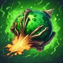
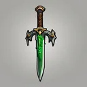

# { .gi .gi-title width="64" height="64" loading="lazy" } Poison Explosion

**Where to play:** Discord
{ .where-to-play }

- **Class:** { .gi .gi-mention width="20" height="20" loading="lazy" }&nbsp;[Necromancer](../../../classes/necromancer.md)
- **Tree:** { .gi .gi-mention width="20" height="20" loading="lazy" }&nbsp;[Poison and Bone Spells](index.md)
- **Kind:** an exploding attack, a spell
- **Learn it from:** level 18 (your rank)
- **Needs first:** { .gi .gi-mention width="20" height="20" loading="lazy" }&nbsp;[Poison Dagger](poison-dagger.md), { .gi .gi-mention width="20" height="20" loading="lazy" }&nbsp;[Corpse Explosion](corpse-explosion.md)
- **Opens:** { .gi .gi-mention width="20" height="20" loading="lazy" }&nbsp;[Poison Nova](poison-nova.md)
- **Weapon:** any
- **Mana:** 2 at rank 1, 2 at rank 20

> In the game: Releases a cloud of poisonous gas.

## How it works

- It explodes: the monster it hits takes the hit and the explosion, its neighbours the explosion.
- Its burn or poison ticks once a round for its rounds.
- Its poison damage never misses: only physical attacks roll to hit.
- It costs its mana once, when used. Without enough mana, or without the weapon or shape it needs, its button says **Attack** and makes the regular attack instead, for free.

## Checked in play

- The monster it hits and its neighbours are poisoned from that round: its poison damage every round for its rounds (15-42 for 3 rounds at rank 1, 167-365 for 5 at rank 20).

## Rank by rank

What its skill screen shows at each rank. The battle uses exactly these numbers (checked at ranks 1 and 20). A skill takes at most 20 points; 💥&nbsp;[skill points and resets](../../index.md).

| Rank | Poison damage | Rounds | Mana |
|---|---|---|---|
| 1 | 15-42 | 3 | 2 |
| 2 | 23-59 | 3 | 2 |
| 3 | 31-76 | 3 | 2 |
| 4 | 39-93 | 3 | 2 |
| 5 | 47-110 | 3 | 2 |
| 6 | 55-127 | 4 | 2 |
| 7 | 63-144 | 4 | 2 |
| 8 | 71-161 | 4 | 2 |
| 9 | 79-178 | 4 | 2 |
| 10 | 87-195 | 4 | 2 |
| 11 | 95-212 | 4 | 2 |
| 12 | 103-229 | 4 | 2 |
| 13 | 111-246 | 4 | 2 |
| 14 | 119-263 | 4 | 2 |
| 15 | 127-280 | 4 | 2 |
| 16 | 135-297 | 5 | 2 |
| 17 | 143-314 | 5 | 2 |
| 18 | 151-331 | 5 | 2 |
| 19 | 159-348 | 5 | 2 |
| 20 | 167-365 | 5 | 2 |
