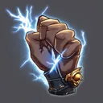

# { .gi .gi-title width="64" height="64" loading="lazy" } Conversion

**Where to play:** Discord
{ .where-to-play }

- **Class:** { .gi .gi-mention width="20" height="20" loading="lazy" }&nbsp;[Paladin](../../../classes/paladin.md)
- **Tree:** { .gi .gi-mention width="20" height="20" loading="lazy" }&nbsp;[Battle Skills](index.md)
- **Kind:** an attack
- **Learn it from:** level 24 (your rank)
- **Needs first:** { .gi .gi-mention width="20" height="20" loading="lazy" }&nbsp;[Vengeance](vengeance.md)
- **Opens:** { .gi .gi-mention width="20" height="20" loading="lazy" }&nbsp;[Fist of the Heavens](fist-of-the-heavens.md)
- **Weapon:** any
- **Mana:** 2 at rank 1, 2 at rank 20

> In the game: Adds a small chance to convert the target to fight for the paladin

## How it works

- It hits the monster you selected.
- Its physical damage rolls to hit ([your hit chance](../../../attributes-and-combat.md#hitting-and-missing)), and monsters can block it.
- It costs its mana once, when used. Without enough mana, or without the weapon or shape it needs, its button says **Attack** and makes the regular attack instead, for free.

## Checked in play

- A hit that lands has its chance (1% at rank 1, 4.8% at rank 20) to turn the monster into a minion that fights for you with the health it had left, for its rounds (10, 48); at most 1 at once (3 at rank 20). A monster the hit kills isn't converted. The converted monster keeps all its skills, now for your side: its Battle Cry or Frozen Armor buffs you and your minions, its Bone Armor shields itself. The same buff from two sources never stacks: the stronger stays, either cast refreshes its rounds.
- In the Arena it never converts your opponent, as in Diablo II: the hit deals its damage and they fight on; it can convert one of their minions.

## Rank by rank

What its skill screen shows at each rank. The battle uses exactly these numbers (checked at ranks 1 and 20). A skill takes at most 20 points; 💥&nbsp;[skill points and resets](../../index.md).

| Rank | Conversion chance (%) | Raised at most | Rounds | Mana |
|---|---|---|---|---|
| 1 | 1 | 1 | 10 | 2 |
| 2 | 1.2 | 1 | 12 | 2 |
| 3 | 1.4 | 1 | 14 | 2 |
| 4 | 1.6 | 1 | 16 | 2 |
| 5 | 1.8 | 1 | 18 | 2 |
| 6 | 2 | 1 | 20 | 2 |
| 7 | 2.2 | 1 | 22 | 2 |
| 8 | 2.4 | 2 | 24 | 2 |
| 9 | 2.6 | 2 | 26 | 2 |
| 10 | 2.8 | 2 | 28 | 2 |
| 11 | 3 | 2 | 30 | 2 |
| 12 | 3.2 | 2 | 32 | 2 |
| 13 | 3.4 | 2 | 34 | 2 |
| 14 | 3.6 | 2 | 36 | 2 |
| 15 | 3.8 | 2 | 38 | 2 |
| 16 | 4 | 2 | 40 | 2 |
| 17 | 4.2 | 2 | 42 | 2 |
| 18 | 4.4 | 2 | 44 | 2 |
| 19 | 4.6 | 2 | 46 | 2 |
| 20 | 4.8 | 3 | 48 | 2 |
