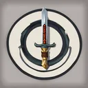
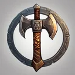
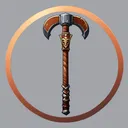
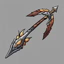
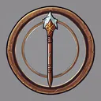

# { .gi .gi-title width="64" height="64" loading="lazy" } Combat Masteries

**Where to play:** Discord
{ .where-to-play }

A [Warrior](../../../classes/warrior.md) skill tree ([all Warrior skills](../index.md)): every skill at rank 1 and rank 20.

| Skill | Level | Kind | Rank 1 | Rank 20 | Needs |
|---|---|---|---|---|---|
| { .gi .gi-inline width="24" height="24" loading="lazy" } [Swordsman](swordsman.md) | 1 | passive | damage bonus 28%, attack rating bonus 40%, critical strike 5% | damage bonus 123%, attack rating bonus 192%, critical strike 81% | a sword |
| { .gi .gi-inline width="24" height="24" loading="lazy" } [Axeman](axeman.md) | 1 | passive | damage bonus 28%, attack rating bonus 40%, critical strike 5% | damage bonus 123%, attack rating bonus 192%, critical strike 81% | an axe |
| { .gi .gi-inline width="24" height="24" loading="lazy" } [Maceman](maceman.md) | 1 | passive | damage bonus 28%, attack rating bonus 40%, critical strike 5% | damage bonus 123%, attack rating bonus 192%, critical strike 81% | a mace |
| { .gi .gi-inline width="24" height="24" loading="lazy" } [Polearm Master](polearm-master.md) | 6 | passive | damage bonus 28%, attack rating bonus 40%, critical strike 5% | damage bonus 123%, attack rating bonus 192%, critical strike 81% | a polearm |
| { .gi .gi-inline width="24" height="24" loading="lazy" } [Throwing Master](throwing-master.md) | 6 | passive | damage bonus 28%, attack rating bonus 40%, critical strike 5% | damage bonus 123%, attack rating bonus 192%, critical strike 81% | a throwing weapon |
| { .gi .gi-inline width="24" height="24" loading="lazy" } [Spearman](spearman.md) | 6 | passive | damage bonus 28%, attack rating bonus 40%, critical strike 5% | damage bonus 123%, attack rating bonus 192%, critical strike 81% | a spear or javelin |
| { .gi .gi-inline width="24" height="24" loading="lazy" } [Retaliate](retaliate.md) | 12 | passive | retaliation chance 10% | retaliation chance 67% |  |
| { .gi .gi-inline width="24" height="24" loading="lazy" } [Though Skin](though-skin.md) | 18 | passive | armor bonus 50% | armor bonus 145% |  |
| { .gi .gi-inline width="24" height="24" loading="lazy" } [Critical Kick](critical-kick.md) | 24 | passive | critical strike 5% | critical strike 24% | [Retaliate](retaliate.md) |
| { .gi .gi-inline width="24" height="24" loading="lazy" } [Resistance](resistance.md) | 30 | passive | resistances 2% | resistances 40% | [Though Skin](though-skin.md) |
