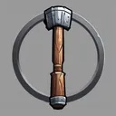
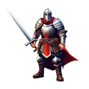

# { .gi .gi-title width="64" height="64" loading="lazy" } Maceman

**Where to play:** Discord
{ .where-to-play }

- **Class:** { .gi .gi-mention width="20" height="20" loading="lazy" }&nbsp;[Warrior](../../../classes/warrior.md)
- **Tree:** { .gi .gi-mention width="20" height="20" loading="lazy" }&nbsp;[Combat Masteries](index.md)
- **Kind:** a passive skill
- **Learn it from:** level 1 (your rank)
- **Needs first:** no other skill
- **Opens:** no other skill
- **Weapon:** [a mace](../../../gear-and-crafting.md#weapons-that-skills-need)

> In the game: Deal Extra damage with Maces

## How it works

- It's always on: nothing to select, no mana.
- What it adds to your character is what its screen shows (checked at ranks 1 and 20).

## Rank by rank

What its skill screen shows at each rank. A skill takes at most 20 points; 💥&nbsp;[skill points and resets](../../index.md).

| Rank | Damage bonus (%) | Attack rating bonus (%) | Critical strike (%) |
|---|---|---|---|
| 1 | 28 | 40 | 5 |
| 2 | 33 | 48 | 9 |
| 3 | 38 | 56 | 13 |
| 4 | 43 | 64 | 17 |
| 5 | 48 | 72 | 21 |
| 6 | 53 | 80 | 25 |
| 7 | 58 | 88 | 29 |
| 8 | 63 | 96 | 33 |
| 9 | 68 | 104 | 37 |
| 10 | 73 | 112 | 41 |
| 11 | 78 | 120 | 45 |
| 12 | 83 | 128 | 49 |
| 13 | 88 | 136 | 53 |
| 14 | 93 | 144 | 57 |
| 15 | 98 | 152 | 61 |
| 16 | 103 | 160 | 65 |
| 17 | 108 | 168 | 69 |
| 18 | 113 | 176 | 73 |
| 19 | 118 | 184 | 77 |
| 20 | 123 | 192 | 81 |
