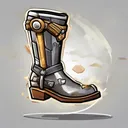

# { .gi .gi-title width="64" height="64" loading="lazy" } Retaliate

**Where to play:** Discord
{ .where-to-play }

- **Class:** { .gi .gi-mention width="20" height="20" loading="lazy" }&nbsp;[Warrior](../../../classes/warrior.md)
- **Tree:** { .gi .gi-mention width="20" height="20" loading="lazy" }&nbsp;[Combat Masteries](index.md)
- **Kind:** a passive skill
- **Learn it from:** level 12 (your rank)
- **Needs first:** no other skill
- **Opens:** { .gi .gi-mention width="20" height="20" loading="lazy" }&nbsp;[Critical Kick](critical-kick.md)
- **Weapon:** any

> In the game: Chance to Kick enemy when receiving non-ranged damage

## How it works

- It's always on: nothing to select, no mana.
- What it adds to your character is what its screen shows (checked at ranks 1 and 20).

## Checked in play

- It kicks back a monster whose melee hit on you landed; a ranged hit or a miss isn't answered. The kick rolls to hit like any physical attack (it can miss or be blocked) and meets the monster's armor: your boots' damage matters.

## Rank by rank

What its skill screen shows at each rank. A skill takes at most 20 points; 💥&nbsp;[skill points and resets](../../index.md).

| Rank | Retaliation chance (%) |
|---|---|
| 1 | 10 |
| 2 | 13 |
| 3 | 16 |
| 4 | 19 |
| 5 | 22 |
| 6 | 25 |
| 7 | 28 |
| 8 | 31 |
| 9 | 34 |
| 10 | 37 |
| 11 | 40 |
| 12 | 43 |
| 13 | 46 |
| 14 | 49 |
| 15 | 52 |
| 16 | 55 |
| 17 | 58 |
| 18 | 61 |
| 19 | 64 |
| 20 | 67 |
