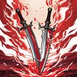

# { .gi .gi-title width="64" height="64" loading="lazy" } Double Swing

**Where to play:** Discord
{ .where-to-play }

- **Class:** [Warrior](../../../classes/warrior.md)
- **Tree:** [Combat Skills](index.md)
- **Kind:** an exploding attack
- **Learn it from:** level 6 (your rank)
- **Needs first:** [Bonk](bonk.md)
- **Opens:** [Double Throw](double-throw.md)
- **Weapon:** any
- **Mana:** 2 at rank 1, 2 at rank 20

> In the game: Double Weapon damage + damage increase

## How it works

- It explodes: the monster it hits takes the hit and the explosion, its neighbours the explosion.
- Its physical damage rolls to hit ([your hit chance](../../../attributes-and-combat.md#hitting-and-missing)), and monsters can block it.
- It costs its mana once, when used. Without enough mana, or without the weapon or shape it needs, its button says **Attack** and makes the regular attack instead, for free.

## Rank by rank

What its skill screen shows at each rank. The battle uses exactly these numbers (checked at ranks 1 and 20). A skill takes at most 20 points; [skill points and resets](../../index.md).

| Rank | Damage bonus (%) | Attack rating bonus (%) | Mana |
|---|---|---|---|
| 1 | 100 | 15 | 2 |
| 2 | 100 | 20 | 2 |
| 3 | 100 | 25 | 2 |
| 4 | 100 | 30 | 2 |
| 5 | 100 | 35 | 2 |
| 6 | 100 | 40 | 2 |
| 7 | 100 | 45 | 2 |
| 8 | 100 | 50 | 2 |
| 9 | 100 | 55 | 2 |
| 10 | 100 | 60 | 2 |
| 11 | 100 | 65 | 2 |
| 12 | 100 | 70 | 2 |
| 13 | 100 | 75 | 2 |
| 14 | 100 | 80 | 2 |
| 15 | 100 | 85 | 2 |
| 16 | 100 | 90 | 2 |
| 17 | 100 | 95 | 2 |
| 18 | 100 | 100 | 2 |
| 19 | 100 | 105 | 2 |
| 20 | 100 | 110 | 2 |
