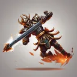

# { .gi .gi-title width="64" height="64" loading="lazy" } Parry

**Where to play:** Discord
{ .where-to-play }

- **Class:** { .gi .gi-mention width="20" height="20" loading="lazy" }&nbsp;[Warrior](../../../classes/warrior.md)
- **Tree:** { .gi .gi-mention width="20" height="20" loading="lazy" }&nbsp;[Combat Skills](index.md)
- **Kind:** a passive skill
- **Learn it from:** level 6 (your rank)
- **Needs first:** no other skill
- **Opens:** { .gi .gi-mention width="20" height="20" loading="lazy" }&nbsp;[Strategic Strike](strategic-strike.md)
- **Weapon:** any

> In the game: Gives chance to parry incoming monster attacks

## How it works

- It's always on: nothing to select, no mana.
- What it adds to your character is what its screen shows (checked at ranks 1 and 20).

## Rank by rank

What its skill screen shows at each rank. A skill takes at most 20 points; 💥&nbsp;[skill points and resets](../../index.md).

| Rank | Parry (%) |
|---|---|
| 1 | 5 |
| 2 | 6 |
| 3 | 7 |
| 4 | 8 |
| 5 | 9 |
| 6 | 10 |
| 7 | 11 |
| 8 | 12 |
| 9 | 13 |
| 10 | 14 |
| 11 | 15 |
| 12 | 16 |
| 13 | 17 |
| 14 | 18 |
| 15 | 19 |
| 16 | 20 |
| 17 | 21 |
| 18 | 22 |
| 19 | 23 |
| 20 | 24 |
