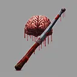

# { .gi .gi-title width="64" height="64" loading="lazy" } Wound

**Where to play:** Discord
{ .where-to-play }

- **Class:** { .gi .gi-mention width="20" height="20" loading="lazy" }&nbsp;[Warrior](../../../classes/warrior.md)
- **Tree:** { .gi .gi-mention width="20" height="20" loading="lazy" }&nbsp;[Combat Skills](index.md)
- **Kind:** a debuff
- **Learn it from:** level 18 (your rank)
- **Needs first:** { .gi .gi-mention width="20" height="20" loading="lazy" }&nbsp;[Stun](stun.md)
- **Opens:** { .gi .gi-mention width="20" height="20" loading="lazy" }&nbsp;[Cleave](cleave.md), { .gi .gi-mention width="20" height="20" loading="lazy" }&nbsp;[Concentrated Strike](concentrated-strike.md)
- **Weapon:** any
- **Mana:** 2 at rank 1, 2 at rank 20

> In the game: Put a bleeding effect on the enemy

## How it works

- It stays on the monster for its rounds and keeps the monster's other debuffs. Cast again (or the same debuff from another source), it never stacks: the stronger of the two stays and its rounds refresh, a weaker cast never lowers it.
- It costs its mana once, when used. Without enough mana, or without the weapon or shape it needs, its button says **Attack** and makes the regular attack instead, for free.

## Checked in play

- The monster bleeds from the next round: 50% of your weapon's damage (with your strength bonus) a round for 4 rounds at rank 1, 145% for 10 rounds at rank 20. 2 mana.

## Rank by rank

What its skill screen shows at each rank. The battle uses exactly these numbers (checked at ranks 1 and 20). A skill takes at most 20 points; [skill points and resets](../../index.md).

| Rank | Damage (%) | Rounds | Mana |
|---|---|---|---|
| 1 | 50 | 4 | 2 |
| 2 | 55 | 4 | 2 |
| 3 | 60 | 5 | 2 |
| 4 | 65 | 5 | 2 |
| 5 | 70 | 5 | 2 |
| 6 | 75 | 6 | 2 |
| 7 | 80 | 6 | 2 |
| 8 | 85 | 6 | 2 |
| 9 | 90 | 6 | 2 |
| 10 | 95 | 7 | 2 |
| 11 | 100 | 7 | 2 |
| 12 | 105 | 7 | 2 |
| 13 | 110 | 8 | 2 |
| 14 | 115 | 8 | 2 |
| 15 | 120 | 8 | 2 |
| 16 | 125 | 9 | 2 |
| 17 | 130 | 9 | 2 |
| 18 | 135 | 9 | 2 |
| 19 | 140 | 9 | 2 |
| 20 | 145 | 10 | 2 |
