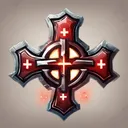
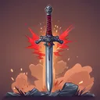

# { .gi .gi-title width="64" height="64" loading="lazy" } Relieve

**Where to play:** Discord
{ .where-to-play }

- **Class:** { .gi .gi-mention width="20" height="20" loading="lazy" }&nbsp;[Warrior](../../../classes/warrior.md)
- **Tree:** { .gi .gi-mention width="20" height="20" loading="lazy" }&nbsp;[Warcries](index.md)
- **Kind:** a passive skill
- **Learn it from:** level 1 (your rank)
- **Needs first:** no other skill
- **Opens:** { .gi .gi-mention width="20" height="20" loading="lazy" }&nbsp;[Critical Hit](critical-hit.md)
- **Weapon:** any

> In the game: Heal after Winning a battle

## How it works

- It's always on: nothing to select, no mana.

## Checked in play

- When you win a battle you heal 10% of your maximum health (29% at rank 20); nothing while the battle goes on.

## Rank by rank

What its skill screen shows at each rank. A skill takes at most 20 points; 💥&nbsp;[skill points and resets](../../index.md).

| Rank | Heal (%) |
|---|---|
| 1 | 10 |
| 2 | 11 |
| 3 | 12 |
| 4 | 13 |
| 5 | 14 |
| 6 | 15 |
| 7 | 16 |
| 8 | 17 |
| 9 | 18 |
| 10 | 19 |
| 11 | 20 |
| 12 | 21 |
| 13 | 22 |
| 14 | 23 |
| 15 | 24 |
| 16 | 25 |
| 17 | 26 |
| 18 | 27 |
| 19 | 28 |
| 20 | 29 |
