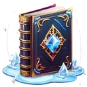

# { .gi .gi-title width="64" height="64" loading="lazy" } Frozen Armor

**Where to play:** Discord
{ .where-to-play }

- **Class:** { .gi .gi-mention width="20" height="20" loading="lazy" }&nbsp;[Wizard](../../../classes/wizard.md)
- **Tree:** { .gi .gi-mention width="20" height="20" loading="lazy" }&nbsp;[Cold Spells](index.md)
- **Kind:** a buff, a spell
- **Learn it from:** level 1 (your rank)
- **Needs first:** no other skill
- **Opens:** { .gi .gi-mention width="20" height="20" loading="lazy" }&nbsp;[Shiver Armor](shiver-armor.md)
- **Weapon:** any
- **Mana:** 2 at rank 1, 21 at rank 20

> In the game: Confers a defense bonus

## How it works

- It's on you for its rounds.
- It costs its mana once, when used. Without enough mana, or without the weapon or shape it needs, its button says **Attack** and makes the regular attack instead, for free.

## Checked in play

- Its % is added to your armor for its rounds (+50% for 20 rounds at rank 1, +145% for 115 at rank 20): monsters miss you more often. Shiver Armor and Chilling Armor replace it, and it replaces them.

## Rank by rank

What its skill screen shows at each rank. The battle uses exactly these numbers (checked at ranks 1 and 20). A skill takes at most 20 points; 💥&nbsp;[skill points and resets](../../index.md).

| Rank | Armor bonus (%) | Rounds | Mana |
|---|---|---|---|
| 1 | 50 | 20 | 2 |
| 2 | 55 | 25 | 3 |
| 3 | 60 | 30 | 4 |
| 4 | 65 | 35 | 5 |
| 5 | 70 | 40 | 6 |
| 6 | 75 | 45 | 7 |
| 7 | 80 | 50 | 8 |
| 8 | 85 | 55 | 9 |
| 9 | 90 | 60 | 10 |
| 10 | 95 | 65 | 11 |
| 11 | 100 | 70 | 12 |
| 12 | 105 | 75 | 13 |
| 13 | 110 | 80 | 14 |
| 14 | 115 | 85 | 15 |
| 15 | 120 | 90 | 16 |
| 16 | 125 | 95 | 17 |
| 17 | 130 | 100 | 18 |
| 18 | 135 | 105 | 19 |
| 19 | 140 | 110 | 20 |
| 20 | 145 | 115 | 21 |
