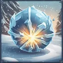

# { .gi .gi-title width="64" height="64" loading="lazy" } Ice Blast

**Where to play:** Discord
{ .where-to-play }

- **Class:** [Wizard](../../../classes/wizard.md)
- **Tree:** [Cold Spells](index.md)
- **Kind:** an attack, a spell
- **Learn it from:** level 6 (your rank)
- **Needs first:** [Ice Bolt](ice-bolt.md)
- **Opens:** [Shiver Armor](shiver-armor.md), [Glacial Spike](glacial-spike.md)
- **Weapon:** any
- **Mana:** 3 at rank 1, 22 at rank 20

> In the game: Creates a bolt of ice that has a chance to freeze the target.

## How it works

- It hits the monster you selected.
- Its cold damage never misses: only physical attacks roll to hit.
- It costs its mana once, when used. Without enough mana, or without the weapon or shape it needs, its button says **Attack** and makes the regular attack instead, for free.

## Rank by rank

What its skill screen shows at each rank. The battle uses exactly these numbers (checked at ranks 1 and 20). A skill takes at most 20 points; [skill points and resets](../../index.md).

| Rank | Cold damage | Freeze chance (%) | Rounds | Mana |
|---|---|---|---|---|
| 1 | 8-12 | 20 | 2 | 3 |
| 2 | 18-26 | 24 | 2 | 4 |
| 3 | 28-40 | 28 | 2 | 5 |
| 4 | 38-54 | 32 | 2 | 6 |
| 5 | 48-68 | 36 | 2 | 7 |
| 6 | 58-82 | 40 | 3 | 8 |
| 7 | 68-96 | 44 | 3 | 9 |
| 8 | 78-110 | 48 | 3 | 10 |
| 9 | 88-124 | 52 | 3 | 11 |
| 10 | 98-138 | 56 | 3 | 12 |
| 11 | 108-152 | 60 | 3 | 13 |
| 12 | 118-166 | 64 | 3 | 14 |
| 13 | 128-180 | 68 | 3 | 15 |
| 14 | 138-194 | 72 | 3 | 16 |
| 15 | 148-208 | 76 | 3 | 17 |
| 16 | 158-222 | 80 | 4 | 18 |
| 17 | 168-236 | 84 | 4 | 19 |
| 18 | 178-250 | 88 | 4 | 20 |
| 19 | 188-264 | 92 | 4 | 21 |
| 20 | 198-278 | 96 | 4 | 22 |
