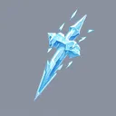

# { .gi .gi-title width="64" height="64" loading="lazy" } Ice Bolt

**Where to play:** Discord
{ .where-to-play }

- **Class:** { .gi .gi-mention width="20" height="20" loading="lazy" }&nbsp;[Wizard](../../../classes/wizard.md)
- **Tree:** { .gi .gi-mention width="20" height="20" loading="lazy" }&nbsp;[Cold Spells](index.md)
- **Kind:** an attack, a spell
- **Learn it from:** level 1 (your rank)
- **Needs first:** no other skill
- **Opens:** { .gi .gi-mention width="20" height="20" loading="lazy" }&nbsp;[Ice Blast](ice-blast.md)
- **Weapon:** any
- **Mana:** 2 at rank 1, 2 at rank 20

> In the game: Shoots a bolt of ice that damages your victim.

## How it works

- It hits the monster you selected.
- Its cold damage never misses: only physical attacks roll to hit.
- It costs its mana once, when used. Without enough mana, or without the weapon or shape it needs, its button says **Attack** and makes the regular attack instead, for free.

## Checked in play

- The monster you selected takes its cold damage: 3-6 at rank 1, 79-120 at rank 20, for 2 mana at every rank.

## Rank by rank

What its skill screen shows at each rank. The battle uses exactly these numbers (checked at ranks 1 and 20). A skill takes at most 20 points; [skill points and resets](../../index.md).

| Rank | Cold damage | Mana |
|---|---|---|
| 1 | 3-6 | 2 |
| 2 | 7-12 | 2 |
| 3 | 11-18 | 2 |
| 4 | 15-24 | 2 |
| 5 | 19-30 | 2 |
| 6 | 23-36 | 2 |
| 7 | 27-42 | 2 |
| 8 | 31-48 | 2 |
| 9 | 35-54 | 2 |
| 10 | 39-60 | 2 |
| 11 | 43-66 | 2 |
| 12 | 47-72 | 2 |
| 13 | 51-78 | 2 |
| 14 | 55-84 | 2 |
| 15 | 59-90 | 2 |
| 16 | 63-96 | 2 |
| 17 | 67-102 | 2 |
| 18 | 71-108 | 2 |
| 19 | 75-114 | 2 |
| 20 | 79-120 | 2 |
