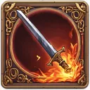

# { .gi .gi-title width="64" height="64" loading="lazy" } Fire Ball

**Where to play:** Discord
{ .where-to-play }

- **Class:** { .gi .gi-mention width="20" height="20" loading="lazy" }&nbsp;[Wizard](../../../classes/wizard.md)
- **Tree:** { .gi .gi-mention width="20" height="20" loading="lazy" }&nbsp;[Fire Spells](index.md)
- **Kind:** an exploding attack, a spell
- **Learn it from:** level 12 (your rank)
- **Needs first:** { .gi .gi-mention width="20" height="20" loading="lazy" }&nbsp;[Fire Bolt](fire-bolt.md)
- **Opens:** { .gi .gi-mention width="20" height="20" loading="lazy" }&nbsp;[Enchant](enchant.md), { .gi .gi-mention width="20" height="20" loading="lazy" }&nbsp;[Meteor](meteor.md)
- **Weapon:** any
- **Mana:** 2 at rank 1, 21 at rank 20

> In the game: Creates a ball of fire that explodes on impact.

## How it works

- It explodes: the monster it hits takes the hit and the explosion, its neighbours the explosion.
- Its fire damage never misses: only physical attacks roll to hit.
- It costs its mana once, when used. Without enough mana, or without the weapon or shape it needs, its button says **Attack** and makes the regular attack instead, for free.

## Checked in play

- Rank 1 hits the target twice (the hit and the explosion) and each neighbour once.

## Rank by rank

What its skill screen shows at each rank. The battle uses exactly these numbers (checked at ranks 1 and 20). A skill takes at most 20 points; [skill points and resets](../../index.md).

| Rank | Fire damage | Mana |
|---|---|---|
| 1 | 6-15 | 2 |
| 2 | 11-27 | 3 |
| 3 | 16-39 | 4 |
| 4 | 21-51 | 5 |
| 5 | 26-63 | 6 |
| 6 | 31-75 | 7 |
| 7 | 36-87 | 8 |
| 8 | 41-99 | 9 |
| 9 | 46-111 | 10 |
| 10 | 51-123 | 11 |
| 11 | 56-135 | 12 |
| 12 | 61-147 | 13 |
| 13 | 66-159 | 14 |
| 14 | 71-171 | 15 |
| 15 | 76-183 | 16 |
| 16 | 81-195 | 17 |
| 17 | 86-207 | 18 |
| 18 | 91-219 | 19 |
| 19 | 96-231 | 20 |
| 20 | 101-243 | 21 |
