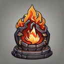

# { .gi .gi-title width="64" height="64" loading="lazy" } Fire Spells

**Where to play:** Discord
{ .where-to-play }

A { .gi .gi-mention width="20" height="20" loading="lazy" }&nbsp;[Wizard](../../../classes/wizard.md) skill tree ({ .gi .gi-mention width="20" height="20" loading="lazy" }&nbsp;[all Wizard skills](../index.md)): every skill at rank 1 and rank 20.

| Skill | Level | Kind | Rank 1 | Rank 20 | Needs |
|---|---|---|---|---|---|
| { .gi .gi-inline width="24" height="24" loading="lazy" } [Fire Bolt](fire-bolt.md) | 1 | attack, spell | fire damage 4-7, mana 2 | fire damage 61-121, mana 21 |  |
| { .gi .gi-inline width="24" height="24" loading="lazy" } [Warmth](warmth.md) | 1 | passive | mana regeneration 2% | mana regeneration 24.8% |  |
| { .gi .gi-inline width="24" height="24" loading="lazy" } [Inferno](inferno.md) | 6 | attack, spell | burn damage 13-25, rounds 4, mana 2 | burn damage 260-272, rounds 14, mana 21 |  |
| { .gi .gi-inline width="24" height="24" loading="lazy" } [Blaze](blaze.md) | 12 | buff, spell | fire damage bonus 15%, rounds 4, mana 2 | fire damage bonus 72%, rounds 23, mana 21 | { .gi .gi-mention width="20" height="20" loading="lazy" }&nbsp;[Inferno](inferno.md) |
| { .gi .gi-inline width="24" height="24" loading="lazy" } [Fire Ball](fire-ball.md) | 12 | explodes, spell | fire damage 6-15, mana 2 | fire damage 101-243, mana 21 | { .gi .gi-mention width="20" height="20" loading="lazy" }&nbsp;[Fire Bolt](fire-bolt.md) |
| { .gi .gi-inline width="24" height="24" loading="lazy" } [Fire Wall](fire-wall.md) | 18 | area debuff, spell | burn damage 10-12, rounds 10, mana 2 | burn damage 181-202, rounds 48, mana 21 | { .gi .gi-mention width="20" height="20" loading="lazy" }&nbsp;[Blaze](blaze.md) |
| { .gi .gi-inline width="24" height="24" loading="lazy" } [Enchant](enchant.md) | 18 | buff | fire damage on your weapon 6-15, rounds 10, mana 2 | fire damage on your weapon 101-243, rounds 105, mana 21 | { .gi .gi-mention width="20" height="20" loading="lazy" }&nbsp;[Warmth](warmth.md), { .gi .gi-mention width="20" height="20" loading="lazy" }&nbsp;[Fire Ball](fire-ball.md) |
| { .gi .gi-inline width="24" height="24" loading="lazy" } [Meteor](meteor.md) | 24 | explodes, spell | fire damage 88-110, stun chance 10%, burn damage 25-48, rounds 2, mana 2 | fire damage 563-623, stun chance 10%, burn damage 310-333, rounds 6, mana 40 | { .gi .gi-mention width="20" height="20" loading="lazy" }&nbsp;[Fire Ball](fire-ball.md), { .gi .gi-mention width="20" height="20" loading="lazy" }&nbsp;[Fire Wall](fire-wall.md) |
| { .gi .gi-inline width="24" height="24" loading="lazy" } [Fire Mastery](fire-mastery.md) | 30 | passive | fire damage bonus 30% | fire damage bonus 163% |  |
| { .gi .gi-inline width="24" height="24" loading="lazy" } [Hydra](hydra.md) | 30 | summon | fire damage 14-19, rounds 10, mana 2 | fire damage 128-171, rounds 29, mana 21 | { .gi .gi-mention width="20" height="20" loading="lazy" }&nbsp;[Enchant](enchant.md) |
