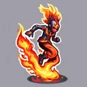

# { .gi .gi-title width="64" height="64" loading="lazy" } Inferno

**Where to play:** Discord
{ .where-to-play }

- **Class:** { .gi .gi-mention width="20" height="20" loading="lazy" }&nbsp;[Wizard](../../../classes/wizard.md)
- **Tree:** { .gi .gi-mention width="20" height="20" loading="lazy" }&nbsp;[Fire Spells](index.md)
- **Kind:** an attack, a spell
- **Learn it from:** level 6 (your rank)
- **Needs first:** no other skill
- **Opens:** { .gi .gi-mention width="20" height="20" loading="lazy" }&nbsp;[Blaze](blaze.md)
- **Weapon:** any
- **Mana:** 2 at rank 1, 21 at rank 20

> In the game: Puts the foe on fire.

## How it works

- It hits the monster you selected.
- Its burn or poison ticks once a round for its rounds.
- Its fire damage never misses: only physical attacks roll to hit.
- It costs its mana once, when used. Without enough mana, or without the weapon or shape it needs, its button says **Attack** and makes the regular attack instead, for free.

## Checked in play

- Rank 1 (burn 13-25, rounds 4) ticks 4 times.

## Rank by rank

What its skill screen shows at each rank. The battle uses exactly these numbers (checked at ranks 1 and 20). A skill takes at most 20 points; 💥&nbsp;[skill points and resets](../../index.md).

| Rank | Burn damage | Rounds | Mana |
|---|---|---|---|
| 1 | 13-25 | 4 | 2 |
| 2 | 26-38 | 5 | 3 |
| 3 | 39-51 | 5 | 4 |
| 4 | 52-64 | 6 | 5 |
| 5 | 65-77 | 6 | 6 |
| 6 | 78-90 | 7 | 7 |
| 7 | 91-103 | 7 | 8 |
| 8 | 104-116 | 8 | 9 |
| 9 | 117-129 | 8 | 10 |
| 10 | 130-142 | 9 | 11 |
| 11 | 143-155 | 9 | 12 |
| 12 | 156-168 | 10 | 13 |
| 13 | 169-181 | 10 | 14 |
| 14 | 182-194 | 11 | 15 |
| 15 | 195-207 | 11 | 16 |
| 16 | 208-220 | 12 | 17 |
| 17 | 221-233 | 12 | 18 |
| 18 | 234-246 | 13 | 19 |
| 19 | 247-259 | 13 | 20 |
| 20 | 260-272 | 14 | 21 |
