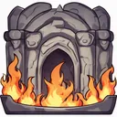

# { .gi .gi-title width="64" height="64" loading="lazy" } Meteor

**Where to play:** Discord
{ .where-to-play }

- **Class:** { .gi .gi-mention width="20" height="20" loading="lazy" }&nbsp;[Wizard](../../../classes/wizard.md)
- **Tree:** { .gi .gi-mention width="20" height="20" loading="lazy" }&nbsp;[Fire Spells](index.md)
- **Kind:** an exploding attack, a spell
- **Learn it from:** level 24 (your rank)
- **Needs first:** { .gi .gi-mention width="20" height="20" loading="lazy" }&nbsp;[Fire Ball](fire-ball.md), { .gi .gi-mention width="20" height="20" loading="lazy" }&nbsp;[Fire Wall](fire-wall.md)
- **Opens:** no other skill
- **Weapon:** any
- **Mana:** 2 at rank 1, 40 at rank 20

> In the game: Calls a meteor from the heavens to smash on your enemies.

## How it works

- It explodes: the monster it hits takes the hit and the explosion, its neighbours the explosion.
- Its burn or poison ticks once a round for its rounds.
- A monster it stuns skips its attack that round.
- Its fire damage never misses: only physical attacks roll to hit.
- It costs its mana once, when used. Without enough mana, or without the weapon or shape it needs, its button says **Attack** and makes the regular attack instead, for free.

## Checked in play

- The monster it hits takes its fire damage twice (the hit and the explosion), the monsters next to it once; all three burn for its rounds from that round (2 at rank 1, 6 at rank 20), and each has its 10% chance to be stunned and skip its attack.

## Rank by rank

What its skill screen shows at each rank. The battle uses exactly these numbers (checked at ranks 1 and 20). A skill takes at most 20 points; 💥&nbsp;[skill points and resets](../../index.md).

| Rank | Fire damage | Stun chance (%) | Burn damage | Rounds | Mana |
|---|---|---|---|---|---|
| 1 | 88-110 | 10 | 25-48 | 2 | 2 |
| 2 | 113-137 | 10 | 40-63 | 2 | 4 |
| 3 | 138-164 | 10 | 55-78 | 2 | 6 |
| 4 | 163-191 | 10 | 70-93 | 3 | 8 |
| 5 | 188-218 | 10 | 85-108 | 3 | 10 |
| 6 | 213-245 | 10 | 100-123 | 3 | 12 |
| 7 | 238-272 | 10 | 115-138 | 3 | 14 |
| 8 | 263-299 | 10 | 130-153 | 3 | 16 |
| 9 | 288-326 | 10 | 145-168 | 4 | 18 |
| 10 | 313-353 | 10 | 160-183 | 4 | 20 |
| 11 | 338-380 | 10 | 175-198 | 4 | 22 |
| 12 | 363-407 | 10 | 190-213 | 4 | 24 |
| 13 | 388-434 | 10 | 205-228 | 4 | 26 |
| 14 | 413-461 | 10 | 220-243 | 5 | 28 |
| 15 | 438-488 | 10 | 235-258 | 5 | 30 |
| 16 | 463-515 | 10 | 250-273 | 5 | 32 |
| 17 | 488-542 | 10 | 265-288 | 5 | 34 |
| 18 | 513-569 | 10 | 280-303 | 5 | 36 |
| 19 | 538-596 | 10 | 295-318 | 6 | 38 |
| 20 | 563-623 | 10 | 310-333 | 6 | 40 |
